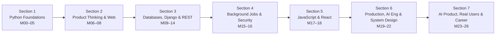

# Softex-Software 🚀

> একজন professional software engineer হওয়ার পথে আমার যাত্রা — Python থেকে Production, তারপর AI আর Real Users পর্যন্ত।

এই repo-তে **Full Stack Product Engineering with Python, Django & AI** সিলেবাসের প্রতিটা মডিউল আমি নিজের ভাষায়, গল্প আর analogy দিয়ে লিখে রাখছি — যাতে মুখস্থ করতে না হয়, বুঝে মনে থাকে। আমি আগে থেকেই MERN stack জানি, তাই প্রতিটা মডিউলে **"MERN / WordPress-এর সাথে তুলনা"** নামে একটা ছোট অংশ আছে।

---

## 📌 এই repo কীভাবে পড়বেন

প্রতিটা মডিউলের জন্য একটা আলাদা folder আছে, আর তার ভেতরে `README.md` — GitHub folder খুললেই সেটা নিজে থেকে দেখাবে। প্রতিটা ফাইলের কাঠামো একই:

| অংশ | কী আছে |
|---|---|
| 🎯 লক্ষ্য | এই মডিউল শেষে কী পারা উচিত |
| 📖 গল্প | বাস্তব জীবনের analogy দিয়ে মূল ধারণা |
| 🗺️ Mermaid diagram | পুরো ছবিটা এক নজরে |
| 🧠 Live Class 1 / 2 | বিস্তারিত ধারণা, code, বাংলা comment |
| 🧩 DSA class | (যে মডিউলে আছে) |
| ⚠️ সাধারণ ভুল | নতুনরা যেখানে আটকায় |
| ⭐ প্রজেক্ট | assignment checklist |
| 🎤 Interview প্রশ্ন | নিজেকে যাচাই করার জন্য |
| 🔁 MERN / WordPress তুলনা | আমার আগের জ্ঞানের সাথে সংযোগ |

---

## 🗺️ পুরো যাত্রার মানচিত্র



---

## 📚 মডিউল সূচি

### Section 1 · Python Foundations
| মডিউল | বিষয় | প্রজেক্ট |
|---|---|---|
| [00](./module-00-pre-course-python-basics/README.md) | Pre-course: Python basics | Python setup ready |
| [01](./module-01-programming-foundations-first-deploy/README.md) | Programming Foundations & First Deploy | Personal Portfolio Page |
| [02](./module-02-logic-loops-data-structures/README.md) | Logic, Loops & Data Structures | Expense Tracker |
| [03](./module-03-file-handling-error-control-testing/README.md) | File Handling, Error Control & Testing | Smart Log Analyzer |
| [04](./module-04-object-oriented-programming/README.md) | Object Oriented Programming | Finance Toolkit |
| [05](./module-05-modules-packages-apis/README.md) | Modules, Packages & APIs | Live Data Fetcher + **GATE 1** |

### Section 2 · Product Thinking & The Web
| মডিউল | বিষয় | প্রজেক্ট |
|---|---|---|
| [06](./module-06-product-thinking-going-live/README.md) | Product Thinking & Going Live | Product Blueprint + Launch Page |
| [07](./module-07-how-the-web-works-html/README.md) | How the Web Works & HTML | Hand-built Product Page |
| [08](./module-08-css-layout-responsive-design/README.md) | CSS, Layout & Responsive Design | Responsive Design System |

### Section 3 · Databases, Django & REST APIs
| মডিউল | বিষয় | প্রজেক্ট |
|---|---|---|
| [09](./module-09-relational-databases-sql/README.md) | Relational Databases & SQL | E-Commerce Database Design |
| [10](./module-10-data-modeling-django-fundamentals/README.md) | Data Modeling & Django Fundamentals | Product Schema (ER diagram) |
| [11](./module-11-django-models-orm-your-product/README.md) | Django Models, ORM & Your Product | Admin Panel + Web App v1 |
| [12](./module-12-authentication-automated-testing/README.md) | Authentication & Automated Testing | Login System + Test Suite |
| [13](./module-13-rest-api-drf/README.md) | REST API Development with DRF | Public REST API |
| [14](./module-14-exam-week-1/README.md) | Exam Week 1 | Assignment + Live Test |

### Section 4 · Background Jobs & Security
| মডিউল | বিষয় | প্রজেক্ট |
|---|---|---|
| [15](./module-15-api-quality-background-jobs/README.md) | API Quality & Background Jobs | API Docs + Postman + Async Tasks |
| [16](./module-16-web-application-security/README.md) | Web Application Security | Security Audit + **GATE 2** |

### Section 5 · JavaScript & React
| মডিউল | বিষয় | প্রজেক্ট |
|---|---|---|
| [17](./module-17-javascript-api-integration/README.md) | JavaScript & API Integration | Live Data Dashboard |
| [18](./module-18-react-full-stack-integration/README.md) | React & Full Stack Integration | Customer Web App (React) |

### Section 6 · Production, AI Engineering & System Design
| মডিউল | বিষয় | প্রজেক্ট |
|---|---|---|
| [19](./module-19-docker-cicd-production-ops/README.md) | Docker, CI/CD & Production Operations | Deployment Pipeline + Incident Report |
| [20](./module-20-ai-assisted-engineering-debugging/README.md) | AI Assisted Engineering & Debugging | AI-Built Feature + Bug Hunt |
| [21](./module-21-system-design-unfamiliar-codebases/README.md) | System Design & Unfamiliar Codebases | Architecture Diagram + Open Source PR |
| [22](./module-22-exam-week-2/README.md) | Exam Week 2 | Assignment + Live Test |

### Section 7 · AI Product, Real Users & Career
| মডিউল | বিষয় | প্রজেক্ট |
|---|---|---|
| [23](./module-23-ai-product-features/README.md) | AI Product Features | Smart Assistant Feature |
| [24](./module-24-ai-evaluation-quality-assurance/README.md) | AI Evaluation & QA | AI Quality Report + **GATE 3** |
| [25](./module-25-real-users-product-analytics/README.md) | Real Users & Product Analytics | First 10 Users Report |
| [26](./module-26-capstone-interview-career-launch/README.md) | Capstone, Interview & Career Launch | Capstone + Final Viva |

---

## 🧭 আমার নিজের নিয়ম

1. **আগে test, তারপর AI-এর কোড।** AI যা লেখে, নিজে না বুঝে accept করি না।
2. **প্রতিটা মডিউলের শেষে প্রজেক্ট** — দেখে দেখে নয়, নিজের product-এর জন্য।
3. **Secret কখনো code-এ নয়।** API key, password সবসময় environment variable-এ।
4. **AI ব্যবহার করলে সৎভাবে বলি** — কতটুকু AI লিখেছে, কতটুকু আমি।

---

## 🛠️ ব্যবহৃত টুল

Python · Django · Django REST Framework · PostgreSQL · pgvector · Celery · Redis · HTML · CSS · Tailwind CSS · JavaScript · React · React Router · Git & GitHub · GitHub Actions · Docker · Postman · pytest · VS Code · Cursor · Claude Code · MCP

---

## 📄 Folder structure

```text
Softex-Software/
├── README.md
├── module-00-pre-course-python-basics/
│   └── README.md
├── module-01-programming-foundations-first-deploy/
│   └── README.md
├── ...
└── module-26-capstone-interview-career-launch/
    └── README.md
```

> ✍️ **লেখক:** Rafsun Jani · WPHelpZone LLC
