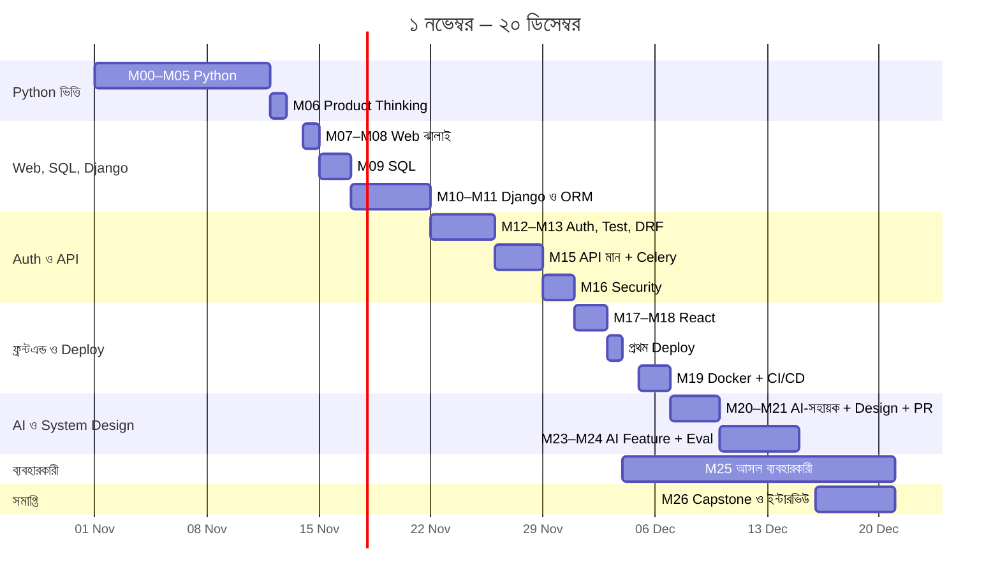
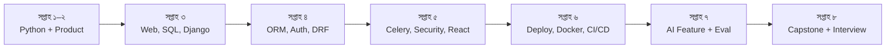
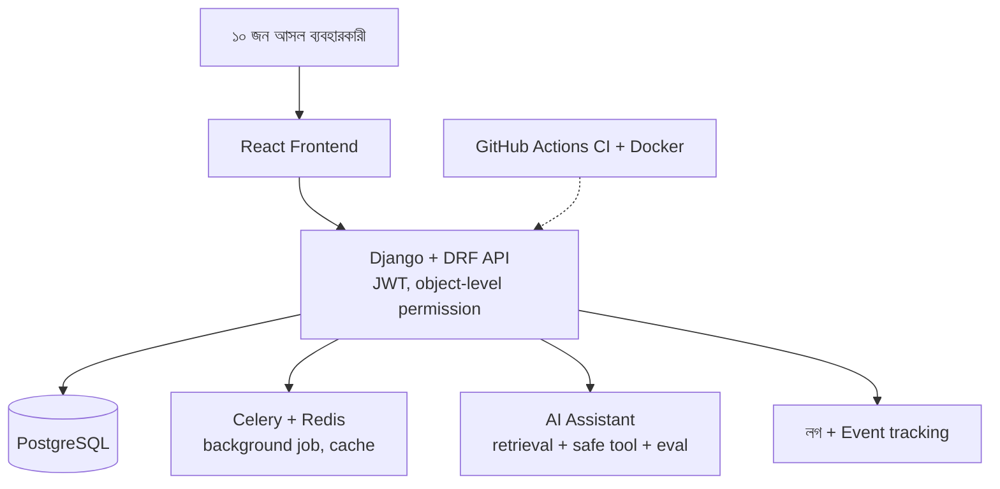
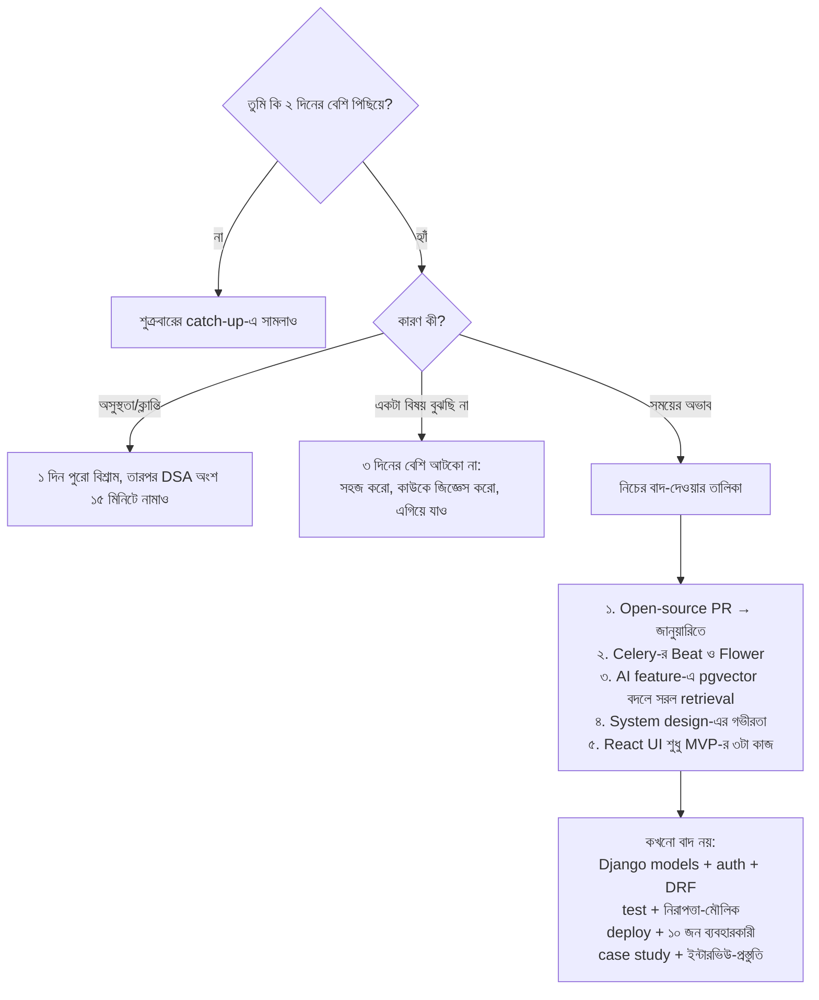

# 🧭 ৫০ দিনের গাইডলাইন: Junior Software Developer হিসেবে নিজেকে প্রস্তুত করা

> **সময়সীমা:** ১ নভেম্বর ২০২৬ (রবিবার) → ২০ ডিসেম্বর ২০২৬ (রবিবার), মোট **৫০ দিন**
> **প্রতিদিন:** ৪ ঘণ্টা (মোট প্রায় ২০০ ঘণ্টা) · **শুরুর অবস্থা:** Python-এ নতুন
> **লক্ষ্য:** deployed Capstone product + ১০ জন আসল ব্যবহারকারী + junior-ইন্টারভিউ-প্রস্তুতি + CV/GitHub/LinkedIn
> **ভিত্তি:** এই repo-র [Module 00–26](.README.md) নোট

---

## ✅ আগের গাইডলাইনের তুলনায় কী বদলাল

সময় বেড়ে প্রায় দ্বিগুণ হয়েছে (১১০ ঘণ্টা → ২০০ ঘণ্টা)। তাই যা আগে বাদ দিতে হয়েছিল, তার বেশিরভাগ ফিরে এসেছে:

| আগে (৪৫ দিন, ২.৫ ঘণ্টা) | এখন (৫০ দিন, ৪ ঘণ্টা) |
|---|---|
| DSA প্রায় বাদ | **প্রতিদিন ৩০ মিনিট DSA**, সিলেবাসের ৮টা ক্লাস সহ |
| Celery ন্যূনতম | Celery + Redis + cache পুরো একদিন |
| Exam Week মক ঐচ্ছিক | দুটো Exam Week-ই মক হিসেবে আছে |
| Docker CI সংকুচিত | Docker + CI/CD + incident অনুশীলন পূর্ণ |
| Open-source PR বাদ | **ঢুকেছে** (Module 21) |
| ব্যবহারকারী ১১ দিন | ব্যবহারকারী ১৭ দিন, ডাটা পড়ার সময় বেশি |
| Mock interview ১ বার | **ইন্টারভিউ-প্রস্তুতি সাপ্তাহিক** |

---

## ⚠️ শুরুর আগে সৎ কথা

- এই কোর্সের পুরো সিলেবাস সাধারণত কয়েক মাসের; তুমি ২০০ ঘণ্টায় করছ। তাই কিছু অংশ **ঝালাই-ধাঁচে** (HTML/CSS, React) রাখা হয়েছে, কারণ তুমি MERN জানো। Python আর Django-র অংশে পুরো সময় দেওয়া হয়েছে।
- ২০ ডিসেম্বরে তুমি পাবে একটা **junior-ready portfolio ও প্রস্তুতি**। চাকরি পাওয়া নির্ভর করবে বাজার, আবেদন ও ইন্টারভিউয়ের উপর। ২০ তারিখ শেষ নয়, **আবেদনের পূর্ণ গতি শুরুর দিন**।
- **দিনে ৪ ঘণ্টা ৫০ দিন টানা** মানে ক্লান্তি আসবে। শুক্রবারের catch-up, ঘুম আর বিরতি তাই পরিকল্পনারই অংশ, বিলাসিতা নয়।

---

## 🎯 "Junior Developer-এর জন্য প্রস্তুত" মানে কী (নিজের মাপকাঠি)

১ নভেম্বরে (Day 1) প্রতিটা বিষয়ে নিজেকে ১ থেকে ৫ রেটিং দাও, আবার ২০ ডিসেম্বরে (Day 50)। লক্ষ্য: **সবকটায় কমপক্ষে ৩, মূলগুলোয় ৪।**

| দক্ষতা | ১ নভেম্বর | ২০ ডিসেম্বর | লক্ষ্য |
|---|---|---|---|
| Python লিখতে পারি (loop, function, class, file, exception) | | | ৪ |
| Git/GitHub দৈনিক কাজে ব্যবহার করি | | | ৪ |
| SQL ও PostgreSQL (join, index, normalization) | | | ৩ |
| Django models + ORM + N+1 চিনি | | | ৪ |
| Authentication ও object-level permission বুঝি ও প্রয়োগ করি | | | ৪ |
| REST API (DRF) নিজে ডিজাইন ও নিরাপদ করতে পারি | | | ৪ |
| Test লিখি (pytest/Django test) | | | ৩ |
| নিরাপত্তা-মৌলিক (XSS, SQLi, CSRF, IDOR, secret) | | | ৩ |
| Docker, CI/CD, deploy | | | ৩ |
| AI টুল ব্যবহার করে কাজ করি, কিন্তু যাচাই করি | | | ৪ |
| অচেনা কোড পড়ে ব্যাখ্যা ও debug করতে পারি | | | ৩ |
| DSA (array, hash map, two pointers, stack, tree) সহজ সমস্যা | | | ৩ |
| নিজের কাজ ব্যাখ্যা করে ইন্টারভিউ দিতে পারি | | | ৩ |

---

## 🗺️ ৫০ দিনের মানচিত্র





---

## 📊 সাপ্তাহিক সারসংক্ষেপ

| সপ্তাহ | তারিখ | বিষয় | সপ্তাহের শেষে হাতে থাকবে |
|---|---|---|---|
| ১ | ১–৬ নভেম্বর | Python ভিত্তি | Portfolio page live, Expense Tracker |
| ২ | ৭–১৩ নভেম্বর | pytest, OOP, API, **Product Brief** | Finance Toolkit, Live Data Fetcher, one-page spec |
| ৩ | ১৪–২০ নভেম্বর | Web ঝালাই, SQL, Django শুরু | ER diagram, Django project, ORM |
| ৪ | ২১–২৭ নভেম্বর | Web App v1, Auth, Test, DRF | Login system, Public REST API |
| ৫ | ২৮ নভেম্বর – ৪ ডিসেম্বর | Celery, Security, React, প্রথম deploy | Security রিপোর্ট, deployed app, প্রথম ৩ ব্যবহারকারী |
| ৬ | ৫–১১ ডিসেম্বর | Docker, CI/CD, AI-সহায়ক কাজ, System Design, PR | Pipeline, architecture diagram, ১০ জন ব্যবহারকারী |
| ৭ | ১২–১৮ ডিসেম্বর | AI Feature, Eval, ডাটা পড়ে পরিবর্তন, README/case study | AI assistant, User Report, case study |
| ৮ | ১৯–২০ ডিসেম্বর | ইন্টারভিউ-প্রস্তুতি, আবেদন | Mock interview, প্রথম আবেদন |

> **শুক্রবার = catch-up দিন:** (১) পিছিয়ে পড়া কাজ, (২) সাপ্তাহিক রিভিউ, (৩) ক্যারিয়ারের ছোট কাজ। নতুন মডিউল নয়।

---

## ⏰ প্রতিদিনের রুটিন (৪ ঘণ্টা)

| সময় | কাজ | নিয়ম |
|---|---|---|
| **০:০০ – ০:১০** | **Recall** | গতকালের ৩টা বিষয় **নোট না দেখে** কাগজে লেখো বা মুখে বলো |
| **০:১০ – ১:১০** | **📖 পড়া** (৬০ মি) | আগে গল্প ও Mermaid, তারপর কোড। কোড **নিজে টাইপ** করে চালাও, কপি-পেস্ট নয় |
| **১:১০ – ১:২০** | বিরতি | উঠে দাঁড়াও, পানি খাও, স্ক্রিন থেকে চোখ সরাও |
| **১:২০ – ৩:১০** | **🛠️ বানানো** (১১০ মি) | প্রজেক্ট/টাস্ক নিজে। আটকালে: ১৫ মিনিট নিজে → নোট → তারপর AI |
| **৩:১০ – ৩:৪০** | **🧩 DSA / অনুশীলন** (৩০ মি) | নিচের DSA ট্র্যাক দেখো |
| **৩:৪০ – ৩:৫০** | **📝 শেষ** | `git commit`, আজকের লগ |
| **৩:৫০ – ৪:০০** | কালকের প্ল্যান | কালকের "পড়া" অংশের শিরোনাম একবার দেখে রাখো |

**পড়ার কৌশল (গল্প মনে রাখার জন্য):**
1. গল্প ও Mermaid ছবি পড়ো → চোখ বন্ধ করে নিজের ভাষায় গল্পটা বলো
2. কোড পড়ো, প্রতিটা variable-এর কমেন্ট বোঝো
3. কোড **না দেখে** আবার লেখার চেষ্টা করো
4. প্রতিটা মডিউলের শেষে "Interview প্রশ্ন"-এর ২টা উত্তর **জোরে বলো**

### 📓 প্রতিদিনের লগ (২ মিনিট, `learning-log.md` ফাইলে)

```markdown
## Day N · তারিখ
- আজ যা শিখলাম:
- যা বানালাম (লিংক/ফাইল):
- আটকে ছিলাম যেখানে → কীভাবে সমাধান:
- DSA: কোন সমস্যা, সমাধান করেছি কি (হ্যাঁ/না/সাহায্য নিয়ে):
- কালকের প্রথম কাজ:
- বোঝার রেটিং ১–৫:
```

### 🤖 AI ব্যবহারের নিয়ম

| সময় | নিয়ম |
|---|---|
| **১–১১ নভেম্বর (Python শেখা)** | AI **বন্ধ**। শুধু error বুঝতে না পারলে ১৫ মিনিট চেষ্টার পর ব্যাখ্যা চাও। কোড লিখিয়ে নিও না |
| **৭ নভেম্বর থেকে** | **আগে test লেখো, তারপর AI** ([Module 03](.module-03-file-handling-error-control-testing/README.md)) |
| **Gate/Exam মক (১১ নভেম্বর, ২৭ নভেম্বর, ৩০ নভেম্বর, ১১ ডিসেম্বর)** | **AI বন্ধ**, সময় ধরে |
| **ডিসেম্বর** | [Module 20](.module-20-ai-assisted-engineering-debugging/README.md)-এর নিয়মে: spec → plan → ছোট diff → নিজে পড়ে accept → review note |
| **DSA অনুশীলন** | সবসময় AI বন্ধ। আটকে গেলে সমাধান দেখো, তারপর ঢেকে নিজে আবার লেখো |

> **মূল নিয়ম:** যে কোড তুমি ব্যাখ্যা করতে পারবে না, সেটা repo-তে যাবে না।

### 🧩 DSA ট্র্যাক (প্রতিদিন ৩০ মিনিট)

**প্রথম ২ দিন** (Python-ই এখনো নতুন): Python drill করো (loop, list, string)। DSA শুরু ৩ নভেম্বর থেকে।

| সপ্তাহ | বিষয় | কী করবে |
|---|---|---|
| ১ | Python drill | ছোট সমস্যা: sum, reverse, palindrome, FizzBuzz |
| ২ | **Big O, Array, Prefix sum** ([Module 03 DSA](.module-03-file-handling-error-control-testing/README.md)), String, Hash map ([Module 05 DSA](.module-05-modules-packages-apis/README.md)) | ৫টা সহজ সমস্যা |
| ৩ | **Two pointers, Sliding window** ([Module 08 DSA](.module-08-css-layout-responsive-design/README.md)) | ৫টা সহজ সমস্যা |
| ৪ | **Recursion** ([Module 11 DSA](.module-11-django-models-orm-your-product/README.md)), Backtracking মৌলিক | ৪টা সহজ + ১টা মাঝারি |
| ৫ | **Sorting ও Binary search** ([Module 15 DSA](.module-15-api-quality-background-jobs/README.md)) | merge sort নিজে লেখো, ৪টা সমস্যা |
| ৬ | **Stack, Queue, Valid parentheses** ([Module 18 DSA](.module-18-react-full-stack-integration/README.md)) | ৫টা সমস্যা |
| ৭ | **Linked list** ([Module 21 DSA](.module-21-system-design-unfamiliar-codebases/README.md)), **Tree, BFS/DFS** ([Module 25 DSA](.module-25-real-users-product-analytics/README.md)) | ৬টা সমস্যা |
| ৮ | মিশ্র পুনরাবৃত্তি | যেগুলো আটকেছে সেগুলো আবার |

**নিয়ম:** প্রতিটা সমস্যায় ১) ৫ মিনিটে সমস্যা বুঝে নিজের ভাষায় লেখো ২) brute force আগে ৩) সময়-জটিলতা বলো ৪) পরে ভালো উপায়। যেকোনো অনুশীলন-প্ল্যাটফর্ম ব্যবহার করতে পারো; সমস্যা নিজে বেছে নাও আর সহজ থেকে শুরু করো।

---

## 🧱 তুমি কী বানাচ্ছ (Capstone পরিধি)

একটাই product, ছোট ও গভীর। **MVP = মাত্র ৩টা কাজ** ([Module 06](.module-06-product-thinking-going-live/README.md))।



**প্রযুক্তি:** Django · DRF · PostgreSQL · Celery/Redis · React · Docker · GitHub Actions · একটা LLM API
**Hosting:** যেকোনো একটা (Render, Railway, নিজের VPS ইত্যাদি)। বর্তমান মূল্য ও সীমা নিজে যাচাই করে নাও।

**দুটো আলাদা repo রাখো:**
- `softex-practice` — Python-এর ছোট অনুশীলন ও DSA সমাধান
- `capstone-<তোমার-product-এর-নাম>` — মূল প্রজেক্ট

---

# 📅 দিনভিত্তিক পরিকল্পনা

> **চিহ্ন:** 📖 পড়া · 🛠️ বানানো · 🧩 DSA বা বিশেষ অনুশীলন · ✅ "আজ শেষ" বলবে যখন

---

## 🗓️ সপ্তাহ ১ · Python ভিত্তি (১–৬ নভেম্বর)

### Day 1 · ১ নভেম্বর (রবি) — Setup ও প্রথম লাইন
- **১ম দিনে করো:** উপরের **দক্ষতার রেটিং টেবিল** পূরণ করে ফাইলে সেভ করো
- 📖 [Module 00](.module-00-pre-course-python-basics/README.md) পুরো + [Module 01](.module-01-programming-foundations-first-deploy/README.md) **Live Class 1**
- 🛠️ Python ও VS Code install; terminal-এ `pwd/ls/cd/mkdir`; `hello.py`; variable, type, `input/print`; `softex-practice` repo খোলো
- 🧩 Python drill: ৫টা ছোট প্রোগ্রাম (নাম-বয়স, বৃত্তের ক্ষেত্রফল, তাপমাত্রা রূপান্তর)
- ✅ `python --version` চলে · commit করেছ

### Day 2 · ২ নভেম্বর (সোম) — Logic, Git ও প্রথম Deploy
- 📖 Module 01 **Live Class 2**
- 🛠️ **Personal Portfolio Page** GitHub Pages-এ live
- 🧩 Python drill: `if/elif` দিয়ে গ্রেড, জোড়-বিজোড়, লিপ ইয়ার
- ✅ Live URL কাজ করছে · ৩টা অর্থবহ commit

### Day 3 · ৩ নভেম্বর (মঙ্গল) — Loop, List, Set
- 📖 [Module 02](.module-02-logic-loops-data-structures/README.md) **Live Class 1**
- 🛠️ ১০টা drill (AI ছাড়া): ১–১০০ যোগ, নামতা, FizzBuzz, list উল্টানো, set দিয়ে ডুপ্লিকেট বাদ, comprehension
- 🧩 DSA শুরু: sum/max/reverse/palindrome
- ✅ FizzBuzz **না দেখে** লিখতে পারো

### Day 4 · ৪ নভেম্বর (বুধ) — Dictionary ও Function
- 📖 Module 02 **Live Class 2**
- 🛠️ **Expense Tracker:** গত মাসের নিজের আসল খরচ, category-wise মোট, সবচেয়ে বেশি category, কমপক্ষে ৩টা function
- 🧩 DSA: দুটো list-এর common element (set ও loop দুই উপায়ে)
- ✅ আসল ডাটায় সঠিক ফল

### Day 5 · ৫ নভেম্বর (বৃহস্পতি) — File ও Exception
- 📖 [Module 03](.module-03-file-handling-error-control-testing/README.md) **Live Class 1**
- 🛠️ ৫,০০০ লাইনের নকল log তৈরি (কয়েকটা ভাঙা লাইন সহ); generator দিয়ে পড়া; `try/except`; JSON সেভ
- 🧩 DSA: string reverse, vowel count, anagram চেক
- ✅ ভাঙা লাইনে প্রোগ্রাম থামে না

### Day 6 · ৬ নভেম্বর (শুক্র) — 🔄 Catch-up + রিভিউ
- যা বাকি, শেষ করো (১.৫ ঘণ্টা)
- Module 01–03-এর interview প্রশ্নগুলোর উত্তর নিজের ভাষায় লিখে ফাইলে রাখো (৪৫ মিনিট)
- **GitHub profile README** বানাও; `softex-practice`-এ ছোট README (৩০ মিনিট)
- **সাপ্তাহিক রিভিউ** (নিচের ছাঁচ)

---

## 🗓️ সপ্তাহ ২ · Python শেষ + Product Brief (৭–১৩ নভেম্বর)

### Day 7 · ৭ নভেম্বর (শনি) — Testing ও AI tool
- 📖 Module 03 **Live Class 2**
- 🛠️ Log Analyzer-এর জন্য `pytest` (কমপক্ষে ৫টা, edge case সহ)। এরপর Cursor/Claude Code setup করে **test-first** একটা refactor, প্রতিটা accept/reject-এর কারণ ছোট নোটে
- 🧩 **DSA Class 1:** Time/Space Complexity, Big O, Array, Prefix sum
- ✅ `pytest` সবুজ · AI-র একটা suggestion reject করেছ ও কারণ লিখেছ

### Day 8 · ৮ নভেম্বর (রবি) — OOP (১)
- 📖 [Module 04](.module-04-object-oriented-programming/README.md) **Live Class 1**
- 🛠️ `Expense` class, `Money` class (`@property` দিয়ে যাচাই)। Expense Tracker class-এ রূপান্তর
- 🧩 DSA: prefix sum দিয়ে range-sum সমস্যা ৩টা
- ✅ `__str__`, `__repr__`, property লিখতে পারো

### Day 9 · ৯ নভেম্বর (সোম) — OOP (২) + Brief খোঁজা
- 📖 Module 04 **Live Class 2**
- 🛠️ **Finance Toolkit:** আগের কোড মিলিয়ে `pip install -e .` করা যায় এমন package; আগের সব test পাস
- ⭐ **আজই (১৫ মিনিট):** একজন আসল মানুষ বাছো (দোকানদার, ছোট ব্যবসায়ী, NGO, ক্যাম্পাস ক্লাব) আর ১১/১২ নভেম্বর কথা বলার সময় চেয়ে নাও
- 🧩 DSA: Abstract class/polymorphism নিয়ে ছোট ডিজাইন প্রশ্ন (shape/payment)
- ✅ Package install হয়, test সবুজ · কথা বলার সময় ঠিক

### Day 10 · ১০ নভেম্বর (মঙ্গল) — Module, Package, Virtual Env
- 📖 [Module 05](.module-05-modules-packages-apis/README.md) **Live Class 1**
- 🛠️ `venv`, `requirements.txt`, `.gitignore`, environment variable থেকে config; Toolkit সুন্দর package কাঠামোয়
- 🧩 DSA: string manipulation, frequency counting (hash map)
- ✅ নতুন venv-এ `pip install -r requirements.txt` দিয়ে সব চলে

### Day 11 · ১১ নভেম্বর (বুধ) — API ও 🚧 GATE 1
- 📖 Module 05 **Live Class 2**
- 🛠️ প্রথম ৯০ মিনিট: **Live Data Fetcher** (`requests`, timeout, retry, API key env-এ, pytest দিয়ে mock)
- 🚧 পরের ৯০ মিনিট — **GATE 1 স্ব-পরীক্ষা (AI বন্ধ, টাইমার):** ১) list/dict function ২) file + exception ৩) ছোট class ৪) `requests` + error handling ৫) একটা hash-map সমস্যা
- ✅ অন্তত চারটা AI ছাড়া পেরেছ; যেটা পারোনি লগে লেখো

### Day 12 · ১২ নভেম্বর (বৃহস্পতি) — Product Thinking
- 📖 [Module 06](.module-06-product-thinking-going-live/README.md) পুরো (গল্পসহ)
- 🛠️ মানুষটার সাথে কথা (আচরণ জিজ্ঞেস করো, সমাধান নয়) → **one-page spec** → MVP ৩টা কাজ + "এবার করছি না" তালিকা → **launch page** live করে তাকে লিংক পাঠাও
- 🧩 DSA: hash map দিয়ে Two Sum (brute force ও hash উভয়)
- ✅ Spec আছে · Launch page live · প্রথম reaction লেখা

### Day 13 · ১৩ নভেম্বর (শুক্র) — 🔄 Catch-up + রিভিউ
- Day 11-এ GATE 1-এ যা পারোনি, আবার অনুশীলন (১ ঘণ্টা)
- Product-এর নাম ঠিক করো; `capstone-<নাম>` repo খোলো, `SPEC.md` যোগ করো (৩০ মিনিট)
- ইন্টারভিউ-অনুশীলন: Module 01–05 থেকে ৫টা প্রশ্নের উত্তর **জোরে বলে রেকর্ড করো**, শোনো (৩০ মিনিট)
- সাপ্তাহিক রিভিউ

---

## 🗓️ সপ্তাহ ৩ · Web ঝালাই, SQL, Django শুরু (১৪–২০ নভেম্বর)

### Day 14 · ১৪ নভেম্বর (শনি) — HTTP, HTML, CSS (সংকুচিত)
- 📖 [Module 07](.module-07-how-the-web-works-html/README.md) (HTTP, status, cookie/session, semantic HTML, accessibility) + [Module 08](.module-08-css-layout-responsive-design/README.md) (design system, responsive) — **শুধু যা জানো না তা**
- 🛠️ নিজের page-এ DevTools **Network tab**; hand-built product page (working form সহ); CSS variable দিয়ে design system; **আসল ফোনে** পরীক্ষা
- 🧩 **DSA Class 3:** Two pointers, Sliding window
- ✅ Network tab-এ একটা request-এর method, status, header ব্যাখ্যা করতে পারো

### Day 15 · ১৫ নভেম্বর (রবি) — SQL (১)
- 📖 [Module 09](.module-09-relational-databases-sql/README.md) **Live Class 1**
- 🛠️ PostgreSQL + pgAdmin; `categories`, `products` table; CRUD; constraint
- 🧩 DSA: sliding window — সর্বোচ্চ k-যোগফল
- ✅ ১০টা row insert, update, delete করেছ

### Day 16 · ১৬ নভেম্বর (সোম) — SQL (২)
- 📖 Module 09 **Live Class 2**
- 🛠️ e-commerce DB সম্পূর্ণ (`customers`, `orders`, `order_items`)। ৪টা query: গত ৩০ দিনের বিক্রি, সেরা ৫ পণ্য, যে গ্রাহক কখনো অর্ডার করেনি (`LEFT JOIN`), category-wise গড়। index দিয়ে `EXPLAIN` আগে-পরে
- 🧩 DSA: two pointers — sorted array-তে pair sum
- ✅ ৪টা query নিজে লিখেছ

### Day 17 · ১৭ নভেম্বর (মঙ্গল) — ER Diagram
- 📖 [Module 10](.module-10-data-modeling-django-fundamentals/README.md) **Live Class 1**
- 🛠️ নিজের product-এর **ER diagram** (spec-এর noun থেকে entity)। কাউকে দিয়ে ছিদ্র খোঁজাও। PostgreSQL-এ schema
- 🧩 DSA: sliding window — সবচেয়ে লম্বা unique substring
- ✅ ER diagram আছে, peer review-র সংশোধন হয়েছে

### Day 18 · ১৮ নভেম্বর (বুধ) — Django Fundamentals
- 📖 Module 10 **Live Class 2**
- ⚠️ **প্রথম `migrate`-এর আগে** custom user model (`AUTH_USER_MODEL`) ঠিক করো ([Module 12](.module-12-authentication-automated-testing/README.md) দেখো); পরে বদলানো প্রায় অসম্ভব
- 🛠️ Django project/app, URL, view, template inheritance, PostgreSQL কানেক্ট (credential env-এ)
- 🧩 DSA: পুনরাবৃত্তি — যা আটকেছে
- ✅ `runserver`-এ পাতা খোলে, request lifecycle আঁকতে পারো

### Day 19 · ১৯ নভেম্বর (বৃহস্পতি) — Models ও ORM
- 📖 [Module 11](.module-11-django-models-orm-your-product/README.md) **Live Class 1**
- 🛠️ ER diagram থেকে model; `makemigrations/migrate`; admin সাজাও; ২০টা আসল record; **ইচ্ছা করে N+1 বানাও, query গুনে ঠিক করো** (`select_related`)
- 🧩 **DSA Class 4:** Recursion (factorial, fibonacci + memo)
- ✅ N+1 কী ও কীভাবে ধরতে হয় নিজের ভাষায় বলতে পারো

### Day 20 · ২০ নভেম্বর (শুক্র) — 🔄 Catch-up + রিভিউ
- যা বাকি শেষ করো
- GitHub-এ ২–৩টা repo **pin** করো, README পরিষ্কার করো
- Module 07–11-এর interview প্রশ্ন জোরে বলো
- সাপ্তাহিক রিভিউ

---

## 🗓️ সপ্তাহ ৪ · Web App, Auth, DRF (২১–২৭ নভেম্বর)

### Day 21 · ২১ নভেম্বর (শনি) — Forms ও Web App v1
- 📖 Module 11 **Live Class 2**
- 🛠️ ModelForm, validation, POST→Redirect→GET, pagination, messages; তালিকা/বিস্তারিত/যোগ/সম্পাদনা পাতা। **Product Web App v1** (আসল ডাটায়)
- 👀 ১–২ জনকে দেখাও, **সাহায্য না করে**, কোথায় আটকায় লিখে রাখো
- 🧩 DSA: backtracking — subsets
- ✅ v1 চলছে, ফিডব্যাক-নোট আছে

### Day 22 · ২২ নভেম্বর (রবি) — Authentication
- 📖 [Module 12](.module-12-authentication-automated-testing/README.md) **Live Class 1**
- 🛠️ Register/login/logout/password reset (dev-এ console email backend); প্রতিটা model-এ `owner`; ব্যবহারকারী **শুধু নিজের** ডাটা দেখে (`get_object_or_404(..., owner=request.user)`)
- 🧩 DSA: recursion — power(x, n), sum of digits
- ✅ অন্য user-এর রেকর্ডের URL লিখলে ৪০৪ আসে

### Day 23 · ২৩ নভেম্বর (সোম) — Test
- 📖 Module 12 **Live Class 2**
- 🛠️ কমপক্ষে ১২টা test; অবশ্যই **"অন্য user ডাটা পায় না"** আর "লগইন ছাড়া redirect"। factory ব্যবহার করে দেখো
- 🧩 DSA: পুনরাবৃত্তি
- ✅ সব সবুজ · README-তে "কীভাবে test চালাবে"

### Day 24 · ২৪ নভেম্বর (মঙ্গল) — DRF (১)
- 📖 [Module 13](.module-13-rest-api-drf/README.md) **Live Class 1**
- 🛠️ Serializer (field + object validation), ViewSet, Router; CRUD API; Postman/Browsable API-তে পরীক্ষা
- 🧩 DSA: bubble/selection/insertion sort নিজে লেখো
- ✅ `GET/POST/PATCH/DELETE` সব কাজ করে

### Day 25 · ২৫ নভেম্বর (বুধ) — DRF (২)
- 📖 Module 13 **Live Class 2**
- 🛠️ JWT (access/refresh), `IsOwner` permission + `get_queryset` ফিল্টার, throttle, pagination, filter/search/ordering, `/api/v1/`, CORS, ধারাবাহিক error ফরম্যাট
- 🧩 DSA: merge sort
- ✅ অন্য user-এর token দিয়ে আমার ডাটা পায় না (test দিয়ে প্রমাণ)

### Day 26 · ২৬ নভেম্বর (বৃহস্পতি) — API মান ও Docs
- 📖 [Module 15](.module-15-api-quality-background-jobs/README.md) **Live Class 1**
- 🛠️ API test (authenticated, permission, error); `drf-spectacular` Swagger docs; Postman collection + environment
- 👥 **একজন বন্ধুকে** collection দিয়ে চালাতে বলো; সে আটকালে docs অসম্পূর্ণ
- 🧩 DSA: quick sort ও binary search
- ✅ বন্ধু collection চালাতে পেরেছে

### Day 27 · ২৭ নভেম্বর (শুক্র) — 🚧 Exam Week 1 মক + CV খসড়া
- 📖 [Module 14](.module-14-exam-week-1/README.md) (মক টেস্ট অংশ)
- 🛠️ **(দেড় ঘণ্টা, AI বন্ধ):** ১) SQL query ২) ORM view (query ≤ ৩) ৩) auth + IDOR test ৪) DRF serializer validation ৫) একটা HTTP/Django lifecycle ব্যাখ্যা। তারপর ৪৫ মিনিট ফাঁক পূরণ
- **CV-র প্রথম খসড়া (৩০ মিনিট):** [Module 26](.module-26-capstone-interview-career-launch/README.md)-এর নিয়মে artifact + ফলাফল
- সাপ্তাহিক রিভিউ
- ✅ যে অংশে আটকেছ, সেটা লগে + আগামী সপ্তাহে ২০ মিনিট

---

## 🗓️ সপ্তাহ ৫ · Celery, Security, React, প্রথম Deploy (২৮ নভেম্বর – ৪ ডিসেম্বর)

### Day 28 · ২৮ নভেম্বর (শনি) — Celery, Redis, Cache
- 📖 Module 15 **Live Class 2**
- 🛠️ Redis (Docker এক কমান্ডে); কাজ সম্পন্ন হলে **background-এ confirmation email**; `retry_backoff`; একটা periodic task (Beat); একটা ধীর পাতা cache + invalidation
- 🧩 **DSA Class 5:** Sorting ও Binary search (পুনরাবৃত্তি)
- ✅ Task-এ object নয় **id** পাঠিয়েছ · কেন idempotent দরকার বলতে পারো

### Day 29 · ২৯ নভেম্বর (রবি) — Security (১)
- 📖 [Module 16](.module-16-web-application-security/README.md) **Live Class 1**
- 🛠️ একটা **ফেলে-দেওয়া ছোট Django app** বানিয়ে ইচ্ছা করে ৩টা ফাঁক (XSS `|safe`, SQL injection `.raw()` + f-string, IDOR) → নিজে আক্রমণ করো → ঠিক করো
- 🧩 DSA: binary search variant
- ✅ প্রতিটা ফাঁক আক্রমণ করে প্রমাণ করেছ

### Day 30 · ৩০ নভেম্বর (সোম) — Security (২) ও 🚧 GATE 2
- 📖 Module 16 **Live Class 2**
- 🛠️ **নিজের product audit:** `check --deploy`, সব ইনপুটের তালিকা, IDOR পরীক্ষা, `grep` দিয়ে `|safe`/`.raw`/`mark_safe`, `gitleaks`/ইতিহাসে secret, `pip-audit`। কমপক্ষে ৩টা fix + test, লিখিত রিপোর্ট
- 🚧 **GATE 2 স্ব-viva:** প্রতিটা finding "কীভাবে খুঁজলাম, কেন বিপজ্জনক, কীভাবে ঠিক করলাম, প্রমাণ কী" — **মুখে রেকর্ড করো**
- 🧩 DSA: পুনরাবৃত্তি
- ✅ রিপোর্ট আছে · ৩টা fix + test

### Day 31 · ১ ডিসেম্বর (মঙ্গল) — JavaScript + React শুরু
- 📖 [Module 17](.module-17-javascript-api-integration/README.md) Live Class 2 + [Module 18](.module-18-react-full-stack-integration/README.md) Live Class 1 (**ঝালাই**, তুমি React জানো)
- 🛠️ Vite React প্রজেক্ট; `api()` wrapper (Bearer token + **expired token refresh**); লগইন; CORS ঠিক; loading/error/empty তিন অবস্থা
- 🧩 **DSA Class 6:** Stack, Queue, Valid parentheses
- ✅ ব্রাউজার থেকে নিজের DRF API-তে লগইন ও ডাটা আনা কাজ করে

### Day 32 · ২ ডিসেম্বর (বুধ) — React পাতা
- 📖 Module 18 **Live Class 2**
- 🛠️ React Router, তালিকা/বিস্তারিত পাতা, controlled form + validation, `AuthContext`, `ProtectedRoute` (মনে রাখো: শুধু UX, আসল সুরক্ষা backend-এ)
- 🧩 DSA: monotonic stack — next greater element
- ✅ MVP-র ৩টা কাজই UI দিয়ে করা যায়

### Day 33 · ৩ ডিসেম্বর (বৃহস্পতি) — প্রথম Production Deploy
- 🛠️ **Backend deploy** (Gunicorn, `DEBUG=False`, `ALLOWED_HOSTS`, secret env-এ, managed PostgreSQL, HTTPS) + **Frontend deploy** (production build, `VITE_API_URL`, SPA rewrite) + CORS-এ production domain
- 🛠️ [Module 25](.module-25-real-users-product-analytics/README.md)-এর **event tracking** (৫টা event: `signup`, `first_product_viewed`, `added_to_cart`, `order_placed`, `returned_next_day`)
- 🧩 DSA: queue দিয়ে ছোট সমস্যা
- ✅ আসল ফোনে লিংক খুলে সম্পূর্ণ flow চলে
- ⏭️ আজ শেষ না হলে কাল শুক্রবারে শেষ করবে

### Day 34 · ৪ ডিসেম্বর (শুক্র) — 🔄 Catch-up + ব্যবহারকারী শুরু
- Deploy শেষ করো / ঠিক করো (২ ঘণ্টা)
- 👥 **প্রথম ৩ জনকে** লিংক পাঠাও (কোনো ব্যাখ্যা ছাড়া, একটা কাজ করতে বলো); দেখো ও নোট নাও
- **LinkedIn profile** খসড়া (headline, About, Featured) (৪৫ মিনিট)
- সাপ্তাহিক রিভিউ

---

## 🗓️ সপ্তাহ ৬ · Docker, CI/CD, AI-সহায়ক কাজ, System Design (৫–১১ ডিসেম্বর)

### Day 35 · ৫ ডিসেম্বর (শনি) — Docker
- 📖 [Module 19](.module-19-docker-cicd-production-ops/README.md) **Live Class 1**
- 🛠️ `Dockerfile` (layer cache, non-root), `.dockerignore`, `docker-compose.yml` (web + db + redis + worker)। `docker compose up`-এ পুরো app চলে
- 🧩 DSA: পুনরাবৃত্তি
- ✅ ফ্রেশ clone থেকে ৩টা কমান্ডে চালানো যায়

### Day 36 · ৬ ডিসেম্বর (রবি) — CI/CD, Logging, Incident অনুশীলন
- 📖 Module 19 **Live Class 2**
- 🛠️ GitHub Actions: lint (`ruff`) + `pytest` + branch protection; structured logging; image-কে commit SHA দিয়ে tag (rollback)। **নিজের তৈরি incident:** deploy-এ ইচ্ছা করে একটা ভুল ঢোকাও, এরপর **শুধু log দেখে** কারণ বের করো, রিপোর্ট লেখো ([Module 19](.module-19-docker-cicd-production-ops/README.md)-এর ছাঁচে)
- 👥 **আরও ৪ জন ব্যবহারকারী** (মোট ৭)
- 🧩 DSA: পুনরাবৃত্তি
- ✅ test ভাঙলে merge আটকায় · incident report আছে

### Day 37 · ৭ ডিসেম্বর (সোম) — AI-সহায়ক ইঞ্জিনিয়ারিং
- 📖 [Module 20](.module-20-ai-assisted-engineering-debugging/README.md) পুরো
- 🛠️ `CLAUDE.md`/context file; একটা ছোট feature **স্পষ্ট spec** লিখে plan-first, test-first পদ্ধতিতে AI দিয়ে বানাও; **review note** লেখো। এরপর Bug Hunt: নিজের repo-তে বন্ধুকে ৫টা bug বসাতে বলো, Round 1 AI ছাড়া, Round 2 AI সহ
- 🧩 DSA: linked list শুরু
- ✅ Review note আছে · Bug Hunt স্কোরবোর্ড আছে

### Day 38 · ৮ ডিসেম্বর (মঙ্গল) — System Design
- 📖 [Module 21](.module-21-system-design-unfamiliar-codebases/README.md) **Live Class 1**
- 🛠️ নিজের product-এর **architecture diagram** + ৬০০ গুণ ব্যবহারকারীর **scaling plan** (১–২ পাতা); প্রতিটা বাক্সের "ভাঙলে কী হবে" টেবিল
- 🧩 **DSA Class 7:** Linked list (reversal, cycle detection)
- ✅ Diagram + plan আছে; trade-off ব্যাখ্যা করতে পারো

### Day 39 · ৯ ডিসেম্বর (বুধ) — অচেনা কোডবেসে Open-source PR
- 📖 Module 21 **Live Class 2**
- 🛠️ একটা ছোট খোলা-উৎস প্রজেক্ট বেছে (`good first issue` লেবেল) README ও CONTRIBUTING পড়ো, locally চালাও, test চালাও, একটা ফিচার trace করো, একটা ছোট issue-তে PR দাও (PR description ছাঁচ অনুযায়ী)। আজ PR না হলেও ড্রাফট থাকবে
- ✅ কমপক্ষে fork + branch + ছোট change তৈরি; PR পাঠানো আদর্শ

### Day 40 · ১০ ডিসেম্বর (বৃহস্পতি) — AI Feature (১)
- 📖 [Module 23](.module-23-ai-product-features/README.md) **Live Class 1**
- 🛠️ LLM API কল (timeout, retry, structured output + validation, token/খরচ লগ); product-ডাটা chunk করে embedding → **pgvector** retrieval; "শুধু প্রসঙ্গ থেকে বলো, না থাকলে জানি না" প্রম্পট
- 🧩 DSA: tree basics — inorder/preorder/postorder
- ✅ নিজের ডাটা থেকে উত্তর আসে; ডাটায় নেই এমন প্রশ্নে "জানি না" বলে

### Day 41 · ১১ ডিসেম্বর (শুক্র) — 🚧 Exam Week 2 মক + ব্যবহারকারী ১০
- 📖 [Module 22](.module-22-exam-week-2/README.md)
- 🛠️ **(দেড় ঘণ্টা, AI বন্ধ):** মডিউল ১৫–২১ থেকে: Celery task লেখা, XSS/SQLi/IDOR ফাঁক খোঁজা, React component, Docker compose, system design প্রশ্ন, linked list/stack সমস্যা। ফাঁক পূরণ ৪৫ মিনিট
- 👥 **ব্যবহারকারী মোট ১০ জনে পৌঁছাও** (বাকি ৩ জনকে লিংক)
- সাপ্তাহিক রিভিউ

---

## 🗓️ সপ্তাহ ৭ · AI Feature, Eval, ডাটা, Case Study (১২–১৮ ডিসেম্বর)

### Day 42 · ১২ ডিসেম্বর (শনি) — AI Feature (২)
- 📖 Module 23 **Live Class 2**
- 🛠️ একটাই **নিরাপদ (read-only) tool**; multi-step agent লুপ (সীমা ৫ ধাপ); **prompt injection নিজে আক্রমণ করে পরীক্ষা**; ঝুঁকিপূর্ণ tool-এ মানুষের অনুমোদন; প্রতিটা tool call লগ
- 🧩 DSA: tree BFS (level order)
- ✅ Injection আক্রমণ ব্যর্থ হয়; tool call লগে দেখা যায়

### Day 43 · ১৩ ডিসেম্বর (রবি) — Eval (১)
- 📖 [Module 24](.module-24-ai-evaluation-quality-assurance/README.md) **Live Class 1**
- 🛠️ **২০টা eval case** (happy path, তথ্য নেই, বাংলা/বাংলিশ/বানান ভুল, adversarial, ফরম্যাট) + স্কোরিং স্ক্রিপ্ট + প্রতি case ৩ বার চালানো; category-wise pass rate
- 🧩 DSA: tree DFS — max depth
- ✅ প্রথম pass rate পেয়েছ

### Day 44 · ১৪ ডিসেম্বর (সোম) — Eval (২) ও 🚧 GATE 3
- 📖 Module 24 **Live Class 2**
- 🛠️ ব্যর্থ case ঠিক করো; guardrail + fallback; AI call log + খরচ-সীমা; CI-তে pass-rate gate। **নিরাপত্তা case-এ ১০০% পাস** না হলে ship নয়। AI feature deploy
- 🚧 **GATE 3 স্ব-ব্যাখ্যা:** "কেন এই ২০টা case, pass rate কত, ship করব কি না, কেন" — মুখে রেকর্ড
- 🧩 DSA: পুনরাবৃত্তি
- ✅ AI feature live · eval রিপোর্ট আছে

### Day 45 · ১৫ ডিসেম্বর (মঙ্গল) — ডাটা পড়ে একটা পরিবর্তন
- 📖 Module 25 **Live Class 2** (ডাটা পড়ার অংশ)
- 🛠️ Funnel বের করো, ব্যবহারকারীদের পর্যবেক্ষণ-নোটের সাথে মেলাও → সবচেয়ে বড় ঝরে-পড়ার জায়গা → **একটাই** পরিবর্তন বাছো → ship করো। **১৫–২০ ডিসেম্বর** মাপার সময়
- 🧩 **DSA Class 8:** Tree interview problem session
- ✅ পরিবর্তন লাইভ; "আগে" সংখ্যা সংরক্ষিত

### Day 46 · ১৬ ডিসেম্বর (বুধ) — Hardening ও User Report
- 📖 [Module 26](.module-26-capstone-interview-career-launch/README.md) **Live Class 1** (final hardening অংশ)
- 🛠️ নিরাপত্তা চেকলিস্ট আবার (`check --deploy`, `pip-audit`, `gitleaks`); error/empty state; মোবাইল; ধীরতম পাতা। **First 10 Users Report** (খসড়া; ১০ জনের সীমা সৎভাবে লেখো)। Commit history পরিষ্কার
- 🧩 DSA: মিশ্র সমস্যা
- ✅ সব test সবুজ · রিপোর্টের খসড়া আছে

### Day 47 · ১৭ ডিসেম্বর (বৃহস্পতি) — README, Case Study, Demo
- 🛠️ **Hiring-manager README** (কী + কোথায় দেখব + কীভাবে চালাব + আর্কিটেকচার Mermaid); **Case study** চূড়ান্ত (সমস্যা → ব্যবহারকারী → সিদ্ধান্ত → trade-off → আবার বদলাতাম → AI কতটুকু); **২ মিনিটের demo ভিডিও**
- 🧩 DSA: পুনরাবৃত্তি
- ✅ একজন অপরিচিত মানুষ README পড়ে ৩টা কমান্ডে app চালাতে পারে

### Day 48 · ১৮ ডিসেম্বর (শুক্র) — 🔄 CV, GitHub, LinkedIn, রিভিউ
- **CV চূড়ান্ত** (artifact-কেন্দ্রিক, ১ পাতা)
- **GitHub:** pinned repo, profile README, প্রতিটা repo-র README
- **LinkedIn:** headline, About (সমস্যা-ভিত্তিক গল্প), Featured (case study + demo)
- পিছিয়ে পড়া কাজ শেষ
- সাপ্তাহিক রিভিউ (এটি সপ্তাহ ৭-এর)

---

## 🗓️ সপ্তাহ ৮ · ইন্টারভিউ-প্রস্তুতি ও আবেদন (১৯–২০ ডিসেম্বর)

### Day 49 · ১৯ ডিসেম্বর (শনি) — ইন্টারভিউ-প্রস্তুতি
- 📖 Module 26 **Live Class 2** (ইন্টারভিউ অংশ)
- 🛠️ **আজ চারটা অনুশীলন:**
  1. **Code comprehension:** অচেনা Django view (নিজে বা বন্ধুকে দিয়ে বানানো) পড়ে ব্যাখ্যা + সমস্যা খোঁজা
  2. **Live debugging:** জোরে ভাবতে ভাবতে একটা bug ঠিক করো
  3. **"এর কতটুকু AI লিখেছে?"** — ৩০ সেকেন্ডের সৎ উত্তর লিখে মুখস্থ নয়, বুঝে বলার চর্চা
  4. **System design:** "URL shortener ডিজাইন করো" ২০ মিনিটে
- 🛠️ **Mock interview রেকর্ড করো** (নিজে বা বন্ধুকে দিয়ে, ৪৫ মিনিট); দেখো কোথায় আটকাও
- ✅ Mock interview রেকর্ড আছে, ৩টা উন্নতির জায়গা লিখেছ

### Day 50 · ২০ ডিসেম্বর (রবি) — Final Viva ও আবেদন শুরু
- 🛠️ **Final viva স্ব-পরীক্ষা (৩০ মিনিট):** product, architecture, security, AI feature, AI-ব্যবহার — প্রতিটায় ২ মিনিট
- 🛠️ **First 10 Users Report চূড়ান্ত** (১৫–২০ ডিসেম্বরের মাপ যোগ করে)
- 🛠️ **প্রথম ৫–১০টা আবেদন/referral অনুরোধ** (বিস্তারিত: [Module 26](.module-26-capstone-interview-career-launch/README.md))
- 🛠️ দক্ষতার **রেটিং টেবিল দ্বিতীয়বার** পূরণ করো, ১ নভেম্বরের সাথে তুলনা
- 🛠️ এই গাইডলাইন ও `learning-log.md` repo-তে যোগ করো
- ✅ ৫০ দিনের শেষ রিভিউ লিখেছ

---

## 🔄 সাপ্তাহিক রিভিউ (প্রতি শুক্রবার, ২০ মিনিট)

```markdown
## সপ্তাহ N রিভিউ
**যা শেষ করেছি:**
**যা বাকি (কেন, কবে করব):**
**সবচেয়ে কঠিন লেগেছে:**
**যা এখনো ঝাপসা:** (আগামী সপ্তাহের শুরুতে ২০ মিনিট)
**এই সপ্তাহে নিজের তৈরি জিনিস (লিংক):**
**DSA: কয়টা সমস্যা, কোন ধরনে আটকাই:**
**পরের সপ্তাহের একটাই সবচেয়ে গুরুত্বপূর্ণ লক্ষ্য:**
**ঘুম ও শরীর কেমন ছিল:**
```

**নিজেকে প্রশ্ন:** "এই সপ্তাহে শেখা কোন বিষয়টা বন্ধুকে ১ মিনিটে বোঝাতে পারব না?" সেটাই পরের সপ্তাহে ২০ মিনিট।

---

## 🚨 পিছিয়ে পড়লে কী করবে



**ব্যবহারকারী জোগাড়ে দেরি করবে না।** ১০ জন পাওয়া সবচেয়ে ধীর অংশ, কারণ মানুষের উত্তরের অপেক্ষা থাকে। ৪ ডিসেম্বরেই প্রথম ৩ জনকে দাও।

**বিশ্রাম নিয়ে:** ৫০ মিনিট কাজ, ১০ মিনিট বিরতি। ৬–৭ ঘণ্টা ঘুম। ৩ দিন পরপর মাথা ভারী লাগলে একটা শুক্রবারকে পুরো ছুটি বানাও। ক্লান্ত অবস্থায় ৪ ঘণ্টা বসে থাকার চেয়ে ২ ঘণ্টা ফোকাসড কাজ ভালো।

---

## 🧯 যা এড়িয়ে চলবে

| ভুল | কেন ক্ষতিকর |
|---|---|
| নোট পড়ে "বুঝেছি" ভেবে এগোনো | প্রথম বাধায় ধরা পড়ে; **টাইপ করো, বানাও** |
| শুরুতেই AI দিয়ে সব লেখানো | Python শেখা হবে না, ইন্টারভিউয়ে ধরা পড়বে |
| Capstone-এ অনেক feature | ৩টা ভালো feature ১০টা অর্ধেকের চেয়ে ভালো |
| ব্যবহারকারীকে সাহায্য করে ফেলা | আটকানোর মুহূর্তটাই আসল ডাটা |
| DSA-কে পরে ভাবা | রোজ ৩০ মিনিট, নইলে জমে পাহাড় হয় |
| শুক্রবারে নতুন মডিউল | catch-up-ই তোমার বাফার |
| Secret/API key GitHub-এ | তাৎক্ষণিক key বদলাও |
| ২০ তারিখের পর থামা | ওটা শুরু, শেষ নয় |

---

## ✅ ২০ ডিসেম্বরের চূড়ান্ত চেকলিস্ট

**প্রযুক্তি**
- [ ] Django + DRF + PostgreSQL + React product deployed (live লিংক)
- [ ] Object-level permission আছে, test দিয়ে প্রমাণিত
- [ ] ১২+ test, CI সবুজ
- [ ] Celery + Redis দিয়ে async email, একটা cache
- [ ] Security audit রিপোর্ট + ৩+ fix
- [ ] Docker compose-এ চলে, CI/CD কাজ করে
- [ ] AI feature: retrieval, safe tool, ২০ case eval, fallback, খরচ লগ
- [ ] README, architecture diagram, scaling plan

**ব্যবহারকারী**
- [ ] ১০ জন আসল ব্যবহারকারী
- [ ] Funnel রিপোর্ট, ১টা পরিবর্তন ship ও আগে-পরে মাপা
- [ ] First 10 Users Report (সীমা সৎভাবে লেখা)

**DSA ও ইন্টারভিউ**
- [ ] ~৪০+ সহজ সমস্যা সমাধান (নিজে)
- [ ] Mock interview একবার রেকর্ড করে দেখা
- [ ] "এর কতটুকু AI লিখেছে?" ৩০ সেকেন্ডের সৎ উত্তর
- [ ] অচেনা কোড ব্যাখ্যা ও live debugging অনুশীলন

**ক্যারিয়ার**
- [ ] Case study, ২ মিনিটের demo ভিডিও
- [ ] CV, GitHub pinned repo, LinkedIn Featured
- [ ] প্রথম ৫–১০টা আবেদন/referral অনুরোধ
- [ ] দক্ষতার রেটিং ১ নভেম্বর বনাম ২০ ডিসেম্বর

**নিজেকে যাচাই (না দেখে ২ মিনিটে):**
1. আমার product কার কোন সমস্যা সমাধান করে?
2. কেন এই architecture? কী ভাঙবে আগে, কীভাবে সামলাব?
3. আমার সবচেয়ে বড় নিরাপত্তা-শিক্ষা কী?
4. AI feature কীভাবে test করলাম? ship করার সিদ্ধান্ত কেন?
5. ১০ জন ব্যবহারকারী আমাকে কী শেখাল?
6. এই কোডের কতটুকু AI লিখেছে, আর আমি কী যাচাই করেছি?

---

## 🚀 ২০ ডিসেম্বরের পরে (পরের ৪ সপ্তাহ)

| কী | কেন |
|---|---|
| **প্রতিদিন ২–৩টা আবেদন/referral** | আবেদনই এখন প্রধান কাজ; ফল আসতে সময় লাগে |
| **প্রতিদিন ৩০–৬০ মিনিট DSA** (মাঝারি সমস্যায় যাও) | অনেক ইন্টারভিউয়ে লাগে |
| সাপ্তাহিক mock interview | অভ্যাসই আত্মবিশ্বাস |
| Open-source PR চালিয়ে যাওয়া | রেফারেল ও অভিজ্ঞতা |
| Capstone-এ ব্যবহারকারীর ফিডব্যাক অনুযায়ী কাজ | চলমান product = শক্তিশালী গল্প |
| Kubernetes/Terraform ([DevOps কোর্স](.README.md) দেখো) | লক্ষ্য-ভূমিকা অনুযায়ী পরে |

> **বাজার নিয়ে:** নির্দিষ্ট কোম্পানি, বেতন বা চাহিদা এখানে লিখিনি, কারণ এগুলো দ্রুত বদলায়। নিজে Bdjobs, LinkedIn Jobs ও কোম্পানির ক্যারিয়ার পাতায় যাচাই করে নাও।

---

## 🧠 শেষ কথা

- **ধারাবাহিকতা > তীব্রতা।** ৫০ দিন রোজ ৪ ঘণ্টা মানে ২০০ ঘণ্টার *বানানো*। এই বানানোই তোমাকে developer করবে।
- যেদিন কিছু বুঝবে না, সেটা স্বাভাবিক। **৩ দিনের বেশি একই জায়গায় আটকে থাকলে** কাউকে জিজ্ঞেস করো বা অংশটা সরল করো।
- প্রতিটা সপ্তাহের শেষে নিজের তৈরি জিনিসের **লিংক** থাকবে, শুধু "পড়েছি" নয়।

শুরু করো আজ — **Day 1: দক্ষতার রেটিং, Python install, `hello.py`, প্রথম commit।** 🚀
