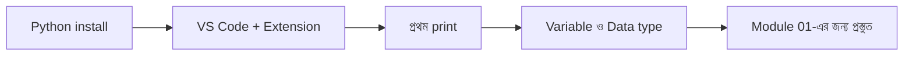

# Module 00 · Pre-course: Python Basics

> **Section 1 · Python Foundations** · প্রি-কোর্স ভিডিও (ক্লাস শুরুর আগেই দেখে ফেলতে হয়)

## 🎯 লক্ষ্য

ক্লাস শুরুর আগে Python-এর একদম বেসিক হাতে নিয়ে বসা — যাতে Module 01-এর প্রথম ক্লাসে "setup" নিয়ে আটকে না থাকি।

## 📖 গল্প: রান্নাঘরে ঢোকার আগে

ধরো তুমি একটা রেস্টুরেন্টে শেফ হিসেবে যোগ দিচ্ছ। প্রথম দিনই যদি জানো না চুলা কীভাবে জ্বালাতে হয়, তাহলে মেনু শেখা অর্থহীন। Module 00 হলো সেই **"চুলা জ্বালাতে শেখা"** — Python install করা, একটা লাইন চালানো, একটা ভুল দেখা।



## 🧠 কী কী শিখব

### ১. Python install ও যাচাই

```bash
python --version      # অথবা python3 --version
# Output: Python 3.12.x  (যেকোনো 3.10+ হলেই চলবে)
```

### ২. প্রথম প্রোগ্রাম

```python
# এটা একটা comment — Python এটা চালায় না, শুধু মানুষ পড়ে
print("Hello, Softex!")   # print() = স্ক্রিনে কিছু দেখাও
```

### ৩. Variable — নাম দেওয়া বাক্স

```python
name = "Suaib"      # str  (লেখা)
age = 25             # int  (পূর্ণসংখ্যা)
height = 5.8         # float (দশমিক)
is_student = False   # bool (সত্য/মিথ্যা)

print(type(name))    # <class 'str'>
```

> **মনে রাখার উপায়:** variable হলো একটা বাক্স, যার গায়ে নাম লেখা আছে। ভেতরের জিনিস বদলাতে পারো, কিন্তু বাক্সের ধরন (type) Python নিজে বুঝে নেয়।

### ৪. Input নেওয়া

```python
city = input("তোমার শহর কোথায়? ")   # input সবসময় str ফেরত দেয়!
print("তুমি থাকো", city)
```

## ⚠️ সাধারণ ভুল

| ভুল | কেন হয় | সমাধান |
|---|---|---|
| `python` command পাওয়া যায় না | PATH-এ যোগ হয়নি | install-এর সময় "Add to PATH" চেক করো |
| `input("সংখ্যা: ") + 5` এ error | input সবসময় `str` | `int(input(...))` ব্যবহার করো |
| Indentation error | space/tab মিশে গেছে | VS Code-এ ৪ space ঠিক করো |

## ⭐ প্রজেক্ট / চেকলিস্ট

- [done ] Python ও VS Code install হয়েছে
- [ done] `python --version` কাজ করছে
- [done ] একটা `hello.py` চালিয়েছি
- [done ] নিজের নাম, বয়স input নিয়ে একটা বাক্য print করেছি

## 🎤 নিজেকে যাচাই

1. `int`, `float`, `str`, `bool`-এর পার্থক্য কী?
2. `input()` কেন সবসময় `str` ফেরত দেয়?
3. Comment কেন লিখি?

## 🔁 MERN / WordPress-এর সাথে তুলনা

| Python | JavaScript | PHP |
|---|---|---|
| `print("hi")` | `console.log("hi")` | `echo "hi";` |
| `name = "A"` | `let name = "A"` | `$name = "A";` |
| indentation দিয়ে block | `{ }` দিয়ে block | `{ }` দিয়ে block |
| `True / False` | `true / false` | `true / false` |
