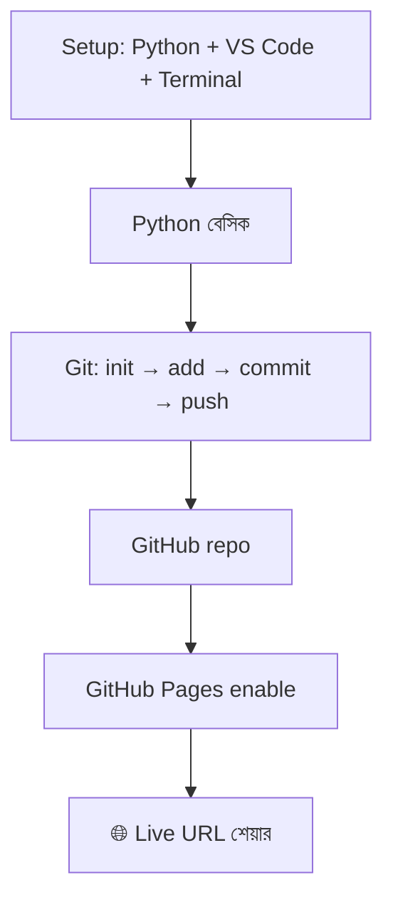
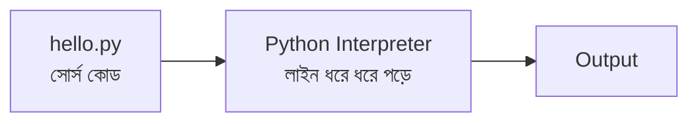
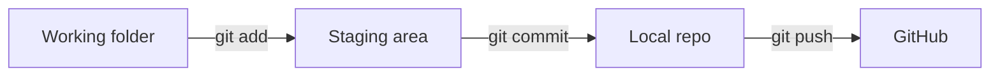

# Module 01 · Programming Foundations & Your First Deploy

> **Section 1 · Python Foundations** · ২টি Live Class
> ⭐ **প্রজেক্ট:** Personal Portfolio Page — internet-এ live

## 🎯 লক্ষ্য

নিজের মেশিন সেটআপ করা, Python-এর মৌলিক জিনিস (variable, string, operator, condition) শেখা, Git দিয়ে code track করা, আর **প্রথমবার নিজের একটা page internet-এ live করা**।

## 📖 গল্প: নতুন দোকান খোলা

তুমি একটা দোকান খুলছ। আগে জায়গা ঠিক করতে হয় (**setup**), তারপর জিনিসপত্র সাজাতে হয় (**Python basics**), প্রতিদিনের হিসাবের খাতা রাখতে হয় (**Git** — কে কখন কী বদলাল), আর শেষে দোকানের সাইনবোর্ড ঝোলাতে হয় যাতে মানুষ দেখতে পায় (**deploy**)।



---

## 🧠 Live Class 1 · Setup and First Program

### Developer-এর মেশিন কেমন হয়

Python, VS Code, Terminal, Git, একটা browser — এতেই শুরু। কারো মেশিন broken থাকলেও ক্লাস শেষে ঠিক হয়ে যাবে — এটাই ক্লাসের লক্ষ্য।

### Terminal-এর বেসিক

```bash
pwd              # এখন কোথায় আছি?
ls               # এই folder-এ কী কী আছে?  (Windows: dir)
cd projects      # projects folder-এ যাও
mkdir softex     # নতুন folder বানাও
python hello.py  # ফাইল চালাও
```

### Python কীভাবে code চালায়



Python একটা **interpreted** ভাষা — মানে উপর থেকে নিচে, এক লাইন এক লাইন করে চালায়।

### Variable, Data Type, Type Conversion

```python
price = "100"              # এটা কিন্তু str, সংখ্যা নয়!
quantity = 3

# total = price * quantity  → "100100100" (str repeat!)
total = int(price) * quantity   # type conversion: str → int
print(total)                    # 300

print(type(price), type(total))
```

**Mutable vs Immutable** (পরে খুব কাজে লাগবে):
- Immutable (বদলানো যায় না): `int`, `str`, `tuple`
- Mutable (বদলানো যায়): `list`, `dict`, `set`

### print ও input

```python
name = input("নাম: ")
print(f"স্বাগতম, {name}!")    # f-string: {} এর ভেতর variable বসে
```

---

## 🧠 Live Class 2 · Logic, Git and Going Live

### String ও Number

```python
text = "  Softex Software  "
print(text.strip())          # দুই পাশের space বাদ
print(text.upper())          # বড় হাতের অক্ষর
print(text.replace("Soft", "Hard"))

print(10 / 3)    # 3.3333  (সাধারণ ভাগ)
print(10 // 3)   # 3       (ভাগফল, পূর্ণসংখ্যা)
print(10 % 3)    # 1       (ভাগশেষ)
print(2 ** 5)    # 32      (power)
```

**Operator precedence:** `()` → `**` → `* / // %` → `+ -`। সন্দেহ হলে bracket দাও।

### if / elif / else

```python
marks = 72

if marks >= 80:
    grade = "A+"
elif marks >= 70:
    grade = "A"
elif marks >= 60:
    grade = "B"
else:
    grade = "Fail"

print(grade)   # A
```

Logical operator: `and`, `or`, `not`। Comparison: `==`, `!=`, `<`, `>`, `<=`, `>=`।

> ⚠️ `=` মানে **বসাও**, `==` মানে **মেলাও**। এই দুটো গুলিয়ে ফেলা সবচেয়ে সাধারণ ভুল।

### Git from zero — কেন দরকার?

Git হলো ফাইলের **time machine**। কাল কী বদলেছিলে, কেন বদলেছিলে — সব ধরা থাকে। ভুল হলে আগের অবস্থায় ফেরা যায়।

```bash
git init                         # এই folder-কে Git-এর আওতায় আনো
git add .                        # সব বদল staging area-তে রাখো
git commit -m "Add portfolio page"   # একটা সেভ-পয়েন্ট বানাও
git branch -M main
git remote add origin https://github.com/<username>/portfolio.git
git push -u origin main          # GitHub-এ পাঠাও
```



### GitHub Pages দিয়ে Deploy

1. Profile page-এর একটা template নাও
2. নিজের নাম, ছবি, লিংক বসাও
3. `git push` করো
4. Repo → **Settings → Pages → Branch: main** → Save
5. কয়েক মিনিট পর `https://<username>.github.io/portfolio/` — live! 🎉

## ⚠️ সাধারণ ভুল

| ভুল | সমাধান |
|---|---|
| `git push` এ authentication error | Personal Access Token বা `gh auth login` ব্যবহার করো |
| Pages-এ 404 | ফাইলের নাম `index.html` কিনা দেখো |
| `.env` বা password commit হয়ে গেছে | সাথে সাথে key বদলাও, আর `.gitignore` ব্যবহার করো |

## ⭐ প্রজেক্ট: Personal Portfolio Page

- [ ] নিজের নাম, পরিচয়, ছবি আছে
- [ ] অন্তত ২টা লিংক (GitHub / LinkedIn)
- [ ] GitHub-এ push করা
- [ ] GitHub Pages-এ live URL কাজ করছে
- [ ] কমপক্ষে ৩টা অর্থবহ commit message

## 🎤 Interview প্রশ্ন

1. `git add` আর `git commit`-এর পার্থক্য কী?
2. `/` আর `//` operator-এর পার্থক্য?
3. Mutable ও immutable type কী? উদাহরণ দাও।
4. Interpreted ভাষা বলতে কী বোঝায়?

## 🔁 MERN / WordPress-এর সাথে তুলনা

- Git workflow তোমার আগে থেকেই জানা — এখানে নতুন কিছু নেই, শুধু Python-এর সাথে অভ্যাস করা।
- GitHub Pages ≈ static hosting। WordPress-এর মতো server-side PHP চলে না, শুধু HTML/CSS/JS।
- `f"{name}"` ≈ JavaScript-এর `` `${name}` `` template literal।
