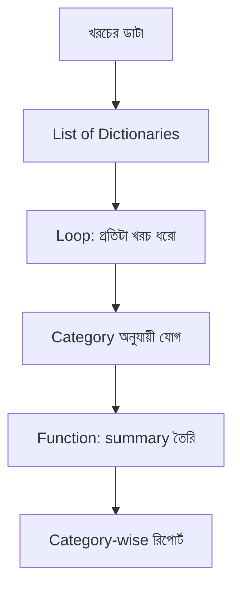

# Module 02 · Logic, Loops and Data Structures

> **Section 1 · Python Foundations** · ২টি Live Class
> ⭐ **প্রজেক্ট:** Expense Tracker — নিজের আসল মাসিক খরচ দিয়ে

## 🎯 লক্ষ্য

Loop দিয়ে বারবার কাজ করানো, list/tuple/set/dictionary দিয়ে data সাজানো, function লেখা, আর এগুলো মিলিয়ে একটা সত্যিকারের **Expense Tracker** বানানো যা তোমার নিজের খরচের category-wise হিসাব দেখায়।

## 📖 গল্প: মুদি দোকানের খাতা

দোকানদার প্রতিদিন একই কাজ করে — প্রতিটা জিনিস তুলে দাম যোগ করে (**loop**)। জিনিসগুলো সে রাখে তাকে সাজিয়ে (**list**)। কোন জিনিসের কী দাম, সেটা মনে রাখে একটা দামের তালিকায় (**dictionary**)। আর "মাস শেষের হিসাব" নামে একটা নিয়ম বানিয়ে রাখে যেটা বারবার ডাকা যায় (**function**)।



---

## 🧠 Live Class 1 · Loops and Sequences

### while loop

```python
count = 1
while count <= 3:
    print("বার", count)
    count += 1        # এটা না দিলে infinite loop!
```

### for loop ও range

```python
for i in range(5):          # 0,1,2,3,4
    print(i)

for i in range(1, 10, 2):   # 1,3,5,7,9  (শুরু, শেষ, ধাপ)
    print(i)
```

`break` = loop থামাও। `continue` = এই ধাপ বাদ দিয়ে পরেরটায় যাও।

```python
for n in range(1, 10):
    if n == 5:
        break        # 5 এ এসে পুরো loop শেষ
    if n % 2 == 0:
        continue     # জোড় সংখ্যা বাদ
    print(n)         # 1, 3
```

### List — সাজানো ও বদলানো যায়

```python
fruits = ["আম", "জাম", "কলা"]
fruits.append("লিচু")       # শেষে যোগ
fruits.insert(1, "পেয়ারা")  # index ১-এ যোগ
fruits.remove("জাম")        # মান ধরে মুছো
last = fruits.pop()         # শেষটা তুলে নাও
fruits.sort()               # সাজাও

print(fruits[0])            # প্রথমটা
print(fruits[-1])           # শেষটা
print(fruits[1:3])          # slicing: index 1 থেকে 2
```

**List comprehension** — এক লাইনে নতুন list:

```python
squares = [x * x for x in range(1, 6)]        # [1, 4, 9, 16, 25]
evens   = [x for x in range(10) if x % 2 == 0]  # [0, 2, 4, 6, 8]
```

### Tuple ও Set — কখন কোনটা?

| ধরন | বদলানো যায়? | ডুপ্লিকেট? | কখন |
|---|---|---|---|
| `list` | ✅ | ✅ | ক্রম দরকার, বদলাবে |
| `tuple` | ❌ | ✅ | বদলাবে না (যেমন `(lat, lng)`) |
| `set` | ✅ | ❌ | ইউনিক জিনিস, দ্রুত `in` check |

```python
location = (23.81, 90.41)         # tuple
tags = {"python", "django", "python"}   # set → {'python', 'django'}
```

---

## 🧠 Live Class 2 · Dictionaries and Functions

### Dictionary — key দিয়ে value খোঁজা

```python
expense = {"title": "ভাত", "amount": 120, "category": "খাবার"}

print(expense["amount"])           # 120
print(expense.get("note", "নেই"))   # key না থাকলে error না দিয়ে default দেয়
expense["amount"] = 150            # update
expense["date"] = "2026-11-01"     # নতুন key

for key, value in expense.items():
    print(key, "→", value)
```

**Nested dictionary:**

```python
data = {
    "rafsun": {"city": "Dhaka", "skills": ["python", "php"]},
}
print(data["rafsun"]["skills"][0])   # python
```

### Function — একবার লেখো, বারবার ডাকো

```python
def total_expense(expenses, category=None):
    """category দিলে শুধু সেই category-র মোট, না দিলে সব।"""
    total = 0
    for e in expenses:
        if category is None or e["category"] == category:
            total += e["amount"]
    return total

expenses = [
    {"title": "ভাত", "amount": 120, "category": "খাবার"},
    {"title": "রিকশা", "amount": 40, "category": "যাতায়াত"},
    {"title": "চা", "amount": 20, "category": "খাবার"},
]

print(total_expense(expenses))              # 180
print(total_expense(expenses, "খাবার"))     # 140
```

**জরুরি ধারণা:**
- **Parameter vs Argument:** parameter = সংজ্ঞায় নাম, argument = ডাকার সময় মান
- **Default parameter:** `category=None`
- **Keyword argument:** `total_expense(expenses, category="খাবার")`
- **Multiple return:** `return total, count` → tuple হিসেবে আসে
- **Scope:** function-এর ভেতরের variable বাইরে দেখা যায় না (local); বাইরের গুলো global

### 🛠️ Build: Expense Tracker

```python
def category_summary(expenses):
    summary = {}
    for e in expenses:
        cat = e["category"]
        summary[cat] = summary.get(cat, 0) + e["amount"]
    return summary

for cat, total in category_summary(expenses).items():
    print(f"{cat}: {total} টাকা")
```

## ⚠️ সাধারণ ভুল

| ভুল | কেন | সমাধান |
|---|---|---|
| Loop থামে না | counter বাড়ানো ভুলে গেছি | `count += 1` ভুলো না |
| `list` ঘুরতে ঘুরতে মুছে ফেলা | index এলোমেলো হয় | নতুন list বানাও |
| `d["key"]` এ KeyError | key নেই | `d.get("key")` ব্যবহার করো |
| Default argument হিসেবে `[]` | সব call-এ একই list শেয়ার হয় | `None` দাও, ভেতরে `[]` বানাও |

## ⭐ প্রজেক্ট: Expense Tracker (নিজের real spending দিয়ে)

- [ ] অন্তত ১ মাসের নিজের খরচ আছে
- [ ] category অনুযায়ী মোট দেখায়
- [ ] সবচেয়ে বেশি খরচের category বের করে
- [ ] কমপক্ষে ৩টা function আছে
- [ ] GitHub-এ push করা

## 🎤 Interview প্রশ্ন

1. list আর tuple-এর পার্থক্য কী? কখন tuple ব্যবহার করব?
2. `dict.get()` আর `dict[]`-এর পার্থক্য?
3. Mutable default argument সমস্যা কী?
4. List comprehension কেন ভালো?

## 🔁 MERN / WordPress-এর সাথে তুলনা

| Python | JavaScript | PHP |
|---|---|---|
| `list` | `Array` | `array` |
| `dict` | `Object` / `Map` | associative `array` |
| `for x in list` | `for...of` | `foreach` |
| `[x*2 for x in a]` | `a.map(x => x*2)` | `array_map` |
| `def f():` | `function f() {}` | `function f() {}` |
