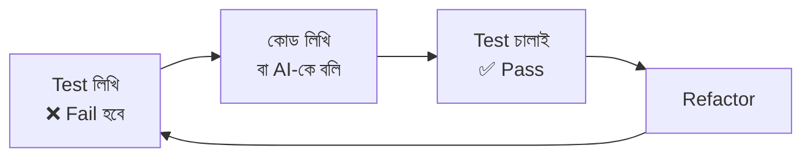
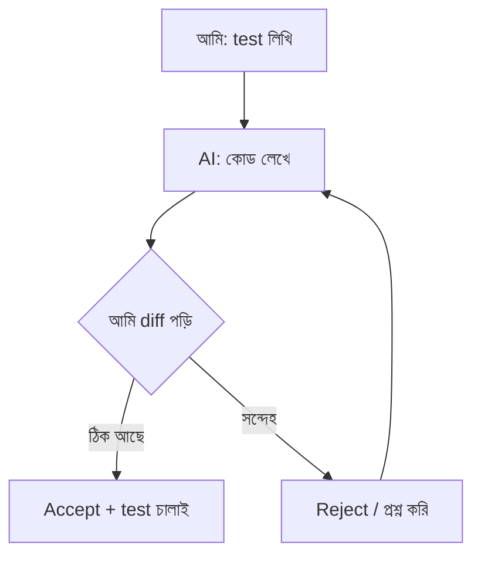

# Module 03 · File Handling, Error Control and Testing

> **Section 1 · Python Foundations** · ২টি Live Class + ১টি DSA Class
> ⭐ **প্রজেক্ট:** Smart Log Analyzer (test suite সহ)

## 🎯 লক্ষ্য

ফাইল পড়া-লেখা, error সামলানো, **pytest দিয়ে আগে test লেখা**, আর AI tool (Cursor, Claude Code) ঠিকভাবে ব্যবহার করা — এই কোর্সের সবচেয়ে গুরুত্বপূর্ণ নিয়মটা এখানেই শুরু: **আগে test, তারপর AI-এর কোড।**

## 📖 গল্প: ডাকঘরের কর্মী ও পরীক্ষক

ফাইল হলো ডাকঘরের চিঠির বাক্স — খুলতে হয়, পড়তে হয়, আবার বন্ধ করতে হয় (না করলে বাক্স আটকে থাকে)। চিঠি হারিয়ে গেলে বা ঠিকানা ভুল হলে কর্মী ভেঙে পড়ে না, বরং জানে কী করতে হবে (**exception handling**)। আর পরীক্ষক (**pytest**) প্রতিদিন সকালে এসে দেখে সব ঠিকঠাক চলছে কিনা — কেউ কিছু বদলালে সে সাথে সাথে ধরে ফেলে।



---

## 🧠 Live Class 1 · Files and Exceptions

### ফাইল পড়া ও লেখা — `with` ব্যবহার করো

```python
# with ব্যবহার করলে ফাইল নিজে নিজে বন্ধ হয় (error হলেও)
with open("app.log", "r", encoding="utf-8") as f:
    content = f.read()           # পুরোটা একসাথে
    # for line in f: ...         # লাইন ধরে ধরে (বড় ফাইলের জন্য ভালো)

with open("report.txt", "w", encoding="utf-8") as f:   # "w" = নতুন করে লেখো
    f.write("মোট error: 5\n")

with open("report.txt", "a", encoding="utf-8") as f:   # "a" = শেষে যোগ করো
    f.write("মোট warning: 12\n")
```

### File path

```python
from pathlib import Path

base = Path(__file__).parent          # এই ফাইল যে folder-এ আছে
log_file = base / "logs" / "app.log"  # / দিয়ে path জোড়া লাগে
print(log_file.exists())
```

### JSON

```python
import json

data = {"errors": 5, "warnings": 12}
with open("summary.json", "w", encoding="utf-8") as f:
    json.dump(data, f, ensure_ascii=False, indent=2)

with open("summary.json", encoding="utf-8") as f:
    loaded = json.load(f)
```

### try / except / else / finally

```python
def read_number(text):
    try:
        return int(text)
    except ValueError:                 # নির্দিষ্ট error ধরো
        print("এটা সংখ্যা নয়")
        return None
    else:
        pass                           # error না হলে চলে
    finally:
        print("এটা সবসময় চলে")        # ফাইল বন্ধ/clean-up এখানে
```

> ⚠️ **কখনো খালি `except:` লিখো না।** এতে `Ctrl+C` সহ সব error চাপা পড়ে। সবসময় নির্দিষ্ট error ধরো।

### নিজের Exception ও `raise`

```python
class InvalidLogLine(Exception):
    """লগ লাইনের ফরম্যাট ভুল হলে এই error দেব।"""

def parse_line(line):
    parts = line.split(" ", 2)
    if len(parts) < 3:
        raise InvalidLogLine(f"ভুল লাইন: {line!r}")
    return parts
```

### Iterator ও Generator — বড় ফাইলের জন্য জরুরি

৫ লাখ লাইনের ফাইল একসাথে মেমোরিতে নিলে কম্পিউটার আটকে যাবে। Generator **একটা একটা করে** দেয়।

```python
def read_lines(path):
    with open(path, encoding="utf-8") as f:
        for line in f:
            yield line.strip()      # yield = একটা দিয়ে থামো, চাইলে আবার চলো

for line in read_lines("app.log"):
    ...                             # মেমোরিতে একবারে একটাই লাইন
```

---

## 🧠 Live Class 2 · Testing, and Your AI Tools

### Test কেন দরকার?

"আমার মেশিনে তো চলছে" — এটা test নয়। Test হলো **কোডের জন্য লিখিত প্রতিশ্রুতি।** পরে কেউ (বা AI) কোড বদলালে test বলে দেবে কিছু ভেঙেছে কিনা।

### প্রথম pytest

```bash
pip install pytest
pytest                 # সব test চালায়
pytest -v              # বিস্তারিত
```

```python
# log_analyzer.py
def count_level(lines, level):
    return sum(1 for line in lines if f" {level} " in line)
```

```python
# test_log_analyzer.py  ← ফাইলের নাম test_ দিয়ে শুরু
from log_analyzer import count_level

def test_counts_errors():
    lines = [
        "2026-11-01 ERROR db timeout",
        "2026-11-01 INFO started",
        "2026-11-01 ERROR api failed",
    ]
    assert count_level(lines, "ERROR") == 2

def test_empty_input():
    assert count_level([], "ERROR") == 0     # edge case: খালি input

def test_unknown_level():
    assert count_level(["x INFO y"], "DEBUG") == 0
```

**Edge case ভাবার অভ্যাস:** খালি input, একটাই item, খুব বড় সংখ্যা, ভুল ধরনের ডাটা, `None`।

### 🤖 AI tool setup (Cursor + Claude Code)

নিয়ম:
1. **আগে test লিখি** — কোড কী করবে সেটা আমি ঠিক করি
2. AI-কে বলি test pass করাতে
3. **Suggestion accept / reject / undo** — প্রতিটা পরিবর্তন আমি পড়ে তবে accept করি
4. Test চালিয়ে যাচাই করি



### 🛠️ Build: ৫,০০০ লাইনের log file-এর উপর Log Analyzer

```python
from collections import Counter

def analyze(path):
    levels = Counter()
    for line in read_lines(path):          # generator — মেমোরি বাঁচে
        parts = line.split(" ", 3)
        if len(parts) >= 3:
            levels[parts[2]] += 1          # ERROR / INFO / WARNING
    return levels

print(analyze("app.log").most_common())
```

---

## 🧩 DSA Class 1 · Time & Space Complexity, Big O

**Big O** মানে — ডাটা বাড়লে কাজ কত ধীর হবে।

| Big O | নাম | উদাহরণ |
|---|---|---|
| `O(1)` | Constant | `list[0]`, `dict[key]` |
| `O(log n)` | Logarithmic | Binary search |
| `O(n)` | Linear | একটা `for` loop |
| `O(n log n)` | — | ভালো sorting |
| `O(n²)` | Quadratic | loop-এর ভেতর loop |

```python
# O(n) — Prefix sum তৈরি
def prefix_sum(arr):
    result = [0]
    for x in arr:
        result.append(result[-1] + x)
    return result

nums = [3, 1, 4, 2]
ps = prefix_sum(nums)         # [0, 3, 4, 8, 10]
print(ps[3] - ps[1])          # index 1..2 এর যোগফল = 5 → O(1) এ!
```

**Array operation:** Traversal `O(n)` · Insert/Delete মাঝখানে `O(n)` · শেষে append `O(1)` (প্রায়)।

## ⚠️ সাধারণ ভুল

| ভুল | সমাধান |
|---|---|
| `open()` কিন্তু `close()` ভুলে গেছি | সবসময় `with open(...)` |
| Bangla ফাইলে `UnicodeDecodeError` | `encoding="utf-8"` দাও |
| Test কেবল "happy path" | edge case-ও লেখো |
| AI-এর কোড না পড়েই accept | diff পড়ো, test চালাও |

## ⭐ প্রজেক্ট: Smart Log Analyzer

- [ ] ৫,০০০ লাইনের log file পড়ে
- [ ] ERROR / WARNING / INFO গুনে দেখায়
- [ ] ভুল লাইনে ভেঙে পড়ে না (exception handling)
- [ ] Generator দিয়ে মেমোরি-বান্ধব
- [ ] কমপক্ষে ৫টা pytest (edge case সহ)
- [ ] আগে test, পরে কোড — commit history-তে দেখা যায়

## 🎤 Interview প্রশ্ন

1. `with open(...)` কেন ভালো?
2. Generator আর list-এর মেমোরি ব্যবহারের পার্থক্য?
3. `try/except/else/finally` — প্রতিটা কখন চলে?
4. `O(n)` আর `O(n²)` উদাহরণসহ বোঝাও।
5. Test-first কেন AI ব্যবহারের সময় আরও জরুরি?

## 🔁 MERN / WordPress-এর সাথে তুলনা

| Python | Node.js / JS | PHP |
|---|---|---|
| `with open()` | `fs.readFileSync` / streams | `fopen` / `file_get_contents` |
| `try / except` | `try / catch` | `try / catch` |
| `pytest` | Jest / Vitest | PHPUnit |
| Generator `yield` | Stream / async iterator | `yield` (PHP-তেও আছে) |
