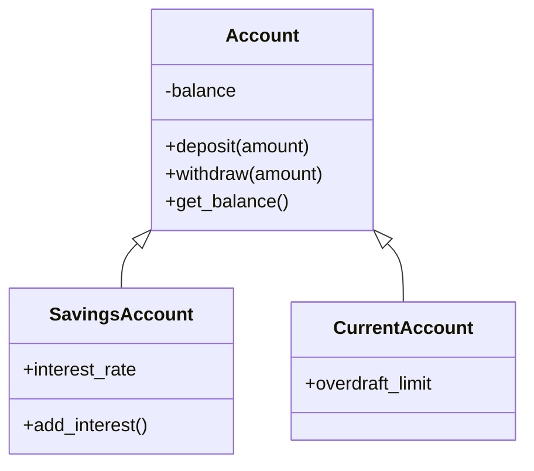
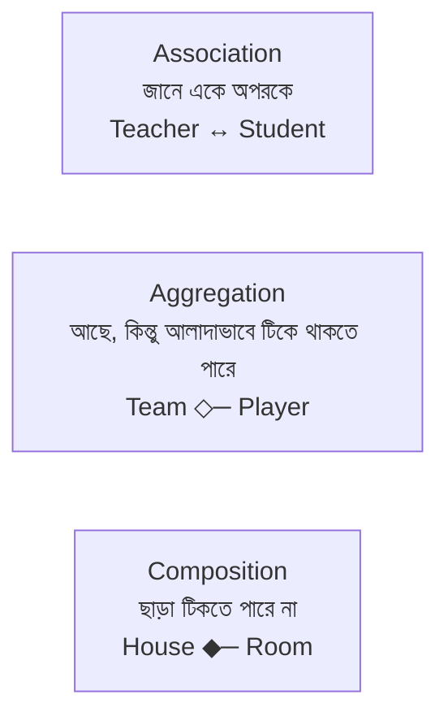

# Module 04 · Object Oriented Programming

> **Section 1 · Python Foundations** · ২টি Live Class
> ⭐ **প্রজেক্ট:** Finance Toolkit — Module 2 ও 3 থেকে বানানো installable package

## 🎯 লক্ষ্য

OOP বোঝা — কেন দরকার, কীভাবে class বানাতে হয়, চারটি স্তম্ভ (Inheritance, Polymorphism, Encapsulation, Abstraction) — আর আগের দুটো প্রজেক্ট (Expense Tracker + Log Analyzer) জুড়ে একটা পরিষ্কার package বানানো।

## 📖 গল্প: গাড়ির কারখানা

কারখানায় আগে একটা **নকশা (blueprint)** থাকে — সেটাই **class**। সেই নকশা থেকে একের পর এক গাড়ি তৈরি হয় — প্রতিটা গাড়ি একেকটা **object**। সব গাড়ির `চলা()` আছে, কিন্তু ইলেকট্রিক গাড়ি আর পেট্রলের গাড়ি আলাদাভাবে চলে (**polymorphism**)। ইলেকট্রিক গাড়ি সাধারণ গাড়ির সব গুণ পায় (**inheritance**)। ইঞ্জিনের ভেতরে হাত দিতে হয় না, শুধু স্টিয়ারিং ধরলেই হয় (**encapsulation**)।



---

## 🧠 Live Class 1 · Classes and Objects

### OOP কেন দরকার?

যখন একই ধরনের ডাটা আর সেই ডাটার উপর কাজ — দুটোই একসাথে জড়িত, তখন সবকিছু আলাদা variable আর function-এ ছড়িয়ে রাখলে সামলানো কঠিন হয়। Class এগুলোকে **একটা জায়গায় প্যাক** করে।

### class, `__init__`, `self`

```python
class Expense:
    # Class variable — সব object-এ শেয়ার হয়
    currency = "BDT"

    def __init__(self, title, amount, category):
        # Instance variable — প্রতিটা object-এর নিজস্ব
        self.title = title
        self.amount = amount
        self.category = category

    def is_big(self, limit=1000):
        return self.amount >= limit

    def __str__(self):                 # print(obj) করলে মানুষ-পাঠযোগ্য
        return f"{self.title}: {self.amount} {self.currency}"

    def __repr__(self):                # debug-এর জন্য
        return f"Expense({self.title!r}, {self.amount}, {self.category!r})"

e = Expense("ভাত", 120, "খাবার")
print(e)              # ভাত: 120 BDT
print(e.is_big())     # False
```

> **`self` কী?** যে object-এর উপর method ডাকা হচ্ছে, `self` হলো সেই object নিজে। `e.is_big()` লিখলে Python আড়ালে `Expense.is_big(e)` চালায়।

### Static method, Class method, Property

```python
class Money:
    def __init__(self, amount):
        self._amount = amount          # _ মানে "ভেতরের জিনিস, বাইরে থেকে ছুঁয়ো না"

    @property                          # getter — এটা field এর মতো পড়া যায়
    def amount(self):
        return self._amount

    @amount.setter                     # setter — মান বসানোর আগে যাচাই
    def amount(self, value):
        if value < 0:
            raise ValueError("টাকা ঋণাত্মক হতে পারে না")
        self._amount = value

    @staticmethod                      # self লাগে না, শুধু সংগঠনের জন্য class-এর ভেতরে
    def is_valid(value):
        return value >= 0

    @classmethod                       # cls = class নিজে — বিকল্প constructor বানাতে ভালো
    def from_string(cls, text):        # "500 BDT" থেকে object বানাও
        return cls(float(text.split()[0]))
```

---

## 🧠 Live Class 2 · The Four Pillars and Refactoring

### ১. Inheritance (উত্তরাধিকার)

```python
class Account:
    def __init__(self, owner, balance=0):
        self.owner = owner
        self._balance = balance

    def deposit(self, amount):
        self._balance += amount

    def get_balance(self):
        return self._balance

class SavingsAccount(Account):               # Account-এর সব কিছু পাবে
    def __init__(self, owner, balance=0, rate=0.05):
        super().__init__(owner, balance)     # parent-এর __init__ ডাকো
        self.rate = rate

    def add_interest(self):
        self.deposit(self._balance * self.rate)
```

### ২. Polymorphism — একই নাম, ভিন্ন আচরণ

```python
class Shape:
    def area(self): raise NotImplementedError

class Circle(Shape):
    def __init__(self, r): self.r = r
    def area(self): return 3.1416 * self.r ** 2     # method overriding

class Rect(Shape):
    def __init__(self, w, h): self.w, self.h = w, h
    def area(self): return self.w * self.h

for s in [Circle(2), Rect(3, 4)]:
    print(s.area())        # কোন ধরনের shape সেটা জানার দরকার নেই
```

> Python-এ method overloading (একই নামে বিভিন্ন parameter) সরাসরি নেই। Default argument বা `*args` দিয়ে সেটা সামলানো হয়।

### ৩. Encapsulation — ভেতরটা লুকিয়ে রাখো

| নাম | অর্থ |
|---|---|
| `name` | public — সবাই ব্যবহার করতে পারে |
| `_name` | protected — convention: ভেতরের জিনিস |
| `__name` | private-ish — name mangling হয় (`_Class__name`) |

### ৪. Abstraction — Abstract class

```python
from abc import ABC, abstractmethod

class PaymentMethod(ABC):
    @abstractmethod
    def pay(self, amount): ...       # সবাইকে এটা লিখতে বাধ্য করে

class BkashPayment(PaymentMethod):
    def pay(self, amount):
        return f"bKash দিয়ে {amount} পরিশোধ"

# PaymentMethod() → TypeError, সরাসরি object বানানো যায় না
```

### Association, Aggregation, Composition



**সহজ নিয়ম:** "X **is-a** Y" হলে inheritance (`SavingsAccount` is-an `Account`)। "X **has-a** Y" হলে composition (`Car` has-an `Engine`)। সন্দেহ থাকলে composition বেছে নাও — সাধারণত নমনীয়।

### 🛠️ Build: Finance Toolkit (installable package)

```text
finance_toolkit/
├── pyproject.toml
├── src/
│   └── finance_toolkit/
│       ├── __init__.py
│       ├── base.py          # শেয়ার্ড base class
│       ├── expenses.py      # Module 2 থেকে
│       └── logs.py          # Module 3 থেকে
└── tests/
    └── test_expenses.py
```

```bash
pip install -e .        # editable mode — কোড বদলালে সাথে সাথে কাজ করে
pytest                  # সব test pass থাকতে হবে
```

## ⚠️ সাধারণ ভুল

| ভুল | সমাধান |
|---|---|
| `self` ভুলে যাওয়া | method-এর প্রথম parameter সবসময় `self` |
| `super().__init__()` না ডাকা | parent-এর setup হয় না |
| সবকিছুতে inheritance | আগে composition ভাবো |
| `__str__` না লেখা | print করলে `<object at 0x...>` আসে |

## ⭐ প্রজেক্ট: Finance Toolkit

- [ ] Module 2 ও 3-এর কোড class-এ রূপান্তর
- [ ] অন্তত একটা shared base class
- [ ] `pip install -e .` দিয়ে install করা যায়
- [ ] সব আগের test এখনো pass করে
- [ ] README-তে ব্যবহারের উদাহরণ

## 🎤 Interview প্রশ্ন

1. OOP-এর চার স্তম্ভ কী কী? প্রতিটার উদাহরণ দাও।
2. `@classmethod` আর `@staticmethod`-এর পার্থক্য?
3. Inheritance বনাম Composition — কখন কোনটা?
4. `__str__` আর `__repr__`-এর পার্থক্য?
5. Abstract class কেন লাগে?

## 🔁 MERN / WordPress-এর সাথে তুলনা

| Python | JavaScript | PHP |
|---|---|---|
| `class A(B):` | `class A extends B` | `class A extends B` |
| `__init__` | `constructor` | `__construct` |
| `super().__init__()` | `super()` | `parent::__construct()` |
| `@property` | `get x()` | magic `__get` |
| `ABC` | (নেই; TypeScript `abstract`) | `abstract class` |

WordPress-এ `WP_Widget` extend করে widget বানানো আসলে inheritance-এর বাস্তব উদাহরণ।
