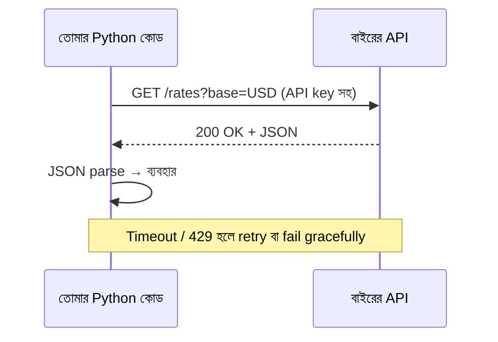

# Module 05 · Modules, Packages and Working with APIs

> **Section 1 · Python Foundations** · ২টি Live Class + ১টি DSA Class
> ⭐ **প্রজেক্ট:** Live Data Fetcher + 🚧 **GATE 1** (AI ছাড়া live coding)

## 🎯 লক্ষ্য

Python code-কে module ও package-এ ভাগ করা, virtual environment ব্যবহার, standard library চেনা, আর **বাইরের API থেকে live data আনা**। মডিউলের শেষে GATE 1 — AI ছাড়া, instructor-এর সামনে live coding।

## 📖 গল্প: শহরের রেস্টুরেন্ট ও ফোন-অর্ডার

নিজের রান্নাঘরে সব বানাতে গেলে সময় যায়। বুদ্ধিমান শেফ জানে কোন কাজ **নিজে করতে হবে**, কোনটা **পাশের দোকান থেকে আনা যায়**। `import` হলো পাশের দোকান। আর API হলো **ফোনে অর্ডার** — তুমি নির্দিষ্ট ফরম্যাটে চাইলে (request), ওরা নির্দিষ্ট ফরম্যাটে পাঠাবে (response)। কিন্তু ফোনের লাইন কখনো ব্যস্ত থাকে (timeout), কখনো বলে "আজ আর অর্ডার নিতে পারব না" (rate limit)।



---

## 🧠 Live Class 1 · Packaging and the Standard Library

### Module ও Package

```text
myapp/
├── main.py
└── utils/
    ├── __init__.py       # এটা থাকলে folder একটা package
    └── money.py
```

```python
# utils/money.py
def format_bdt(amount):
    return f"৳{amount:,.2f}"

# main.py
from utils.money import format_bdt
import utils.money as m          # alias দিয়ে

print(format_bdt(125000))        # ৳125,000.00
```

### Virtual environment — প্রতি প্রজেক্টের আলাদা ঘর

কেন? Project A-তে `requests 2.28`, Project B-তে `2.31` লাগতে পারে। এক জায়গায় রাখলে সংঘাত।

```bash
python -m venv .venv                 # বানাও
source .venv/bin/activate            # চালু (Windows: .venv\Scripts\activate)
pip install requests                 # শুধু এই env-এ ইনস্টল
pip freeze > requirements.txt        # তালিকা সেভ
pip install -r requirements.txt      # অন্য মেশিনে একই env
```

> `.venv/` কখনো Git-এ push করো না — `.gitignore`-এ দাও।

### Standard Library ঘুরে দেখা

```python
from datetime import datetime, timedelta
import json, os

now = datetime.now()
due = now + timedelta(days=7)
print(due.strftime("%d %B %Y"))           # তারিখ ফরম্যাট

api_key = os.environ.get("EXCHANGE_API_KEY")   # config / secret environment থেকে
```

---

## 🧠 Live Class 2 · Consuming APIs, and Gate 1

### API কী?

দুটো সফটওয়্যারের কথা বলার নিয়ম। HTTP-র মাধ্যমে **URL-এ request** পাঠালে **JSON response** আসে।

### requests দিয়ে GET ও POST

```python
import requests

# Query parameter — ? এর পরের অংশ
resp = requests.get(
    "https://api.example.com/rates",
    params={"base": "USD", "symbols": "BDT"},
    headers={"Authorization": f"Bearer {api_key}"},
    timeout=10,                    # ⚠️ timeout ছাড়া request ঝুলে থাকতে পারে
)

resp.raise_for_status()            # 4xx/5xx হলে exception দেয়
data = resp.json()                 # JSON → Python dict
print(data["rates"]["BDT"])

# POST — ডাটা পাঠাও
requests.post("https://api.example.com/items", json={"name": "Pen"}, timeout=10)
```

### ব্যর্থতা সামলানো

```python
import time

def fetch_with_retry(url, retries=3):
    for attempt in range(1, retries + 1):
        try:
            r = requests.get(url, timeout=10)
            if r.status_code == 429:                # rate limit
                time.sleep(2 ** attempt)            # 2, 4, 8 সেকেন্ড অপেক্ষা (exponential backoff)
                continue
            r.raise_for_status()
            return r.json()
        except requests.exceptions.Timeout:
            print(f"Timeout — চেষ্টা {attempt}/{retries}")
        except requests.exceptions.RequestException as e:
            print("Request ব্যর্থ:", e)
            break
    return None
```

### 🔐 API key সুরক্ষা

```python
# ❌ কখনো না
API_KEY = "sk-live-abc123"

# ✅ environment variable বা .env (+ .gitignore)
import os
API_KEY = os.environ["API_KEY"]
```

### 🛠️ Build: Live Data Fetcher

নির্দিষ্ট সময় পরপর live currency rate বা আবহাওয়া টেনে এনে ফাইলে রাখে, ব্যর্থ হলে লগ করে।

```python
def run():
    data = fetch_with_retry(URL)
    if data is None:
        print("এবার ডাটা পাওয়া যায়নি")
        return
    with open("rates.json", "w", encoding="utf-8") as f:
        json.dump(data, f, ensure_ascii=False, indent=2)
```

### 🚧 GATE 1 — AI ছাড়া live coding

Instructor-এর সামনে, **AI tool বন্ধ রেখে**, একটা ছোট সমস্যা সমাধান করতে হবে। প্রস্তুতি:

- [ ] Loop, list, dict, function — চোখ বন্ধ করে লিখতে পারি
- [ ] File পড়া, JSON parse, try/except — মুখস্থ নয়, বুঝে
- [ ] `requests.get` + error handling
- [ ] একটা ছোট class বানাতে পারি
- [ ] নিজের কোড ব্যাখ্যা করতে পারি (কেন এভাবে লিখলাম)

---

## 🧩 DSA Class 2 · Strings

String manipulation · Hashing · Hash map ও Set · Frequency counting

```python
# Frequency counting — hash map-এর সবচেয়ে বেশি ব্যবহৃত প্যাটার্ন
def is_anagram(a, b):
    if len(a) != len(b):
        return False
    count = {}
    for ch in a:
        count[ch] = count.get(ch, 0) + 1
    for ch in b:
        if count.get(ch, 0) == 0:
            return False
        count[ch] -= 1
    return True                      # O(n) সময়

print(is_anagram("listen", "silent"))   # True
```

```python
# প্রথম অ-পুনরাবৃত্ত অক্ষর
def first_unique(s):
    from collections import Counter
    c = Counter(s)
    for i, ch in enumerate(s):
        if c[ch] == 1:
            return i
    return -1
```

**Hash map কেন দ্রুত?** key-কে hash function দিয়ে একটা সংখ্যায় রূপান্তর করে সরাসরি জায়গায় পৌঁছে যায় — গড়ে `O(1)`।

## ⚠️ সাধারণ ভুল

| ভুল | সমাধান |
|---|---|
| `timeout` না দেওয়া | সবসময় `timeout=10` |
| API key GitHub-এ push | key বদলাও, `.env` + `.gitignore` |
| `.venv` ভুলে activate না করা | prompt-এ `(.venv)` দেখো |
| `resp.json()` সরাসরি, status না দেখে | আগে `raise_for_status()` |

## ⭐ প্রজেক্ট: Live Data Fetcher

- [ ] কমপক্ষে একটা real API থেকে live data আনে
- [ ] API key environment variable-এ
- [ ] Timeout, retry, rate limit সামলায়
- [ ] ফলাফল ফাইলে সেভ হয়
- [ ] `requirements.txt` আছে, pytest দিয়ে mock করা test আছে
- [ ] 🚧 GATE 1 পাস

## 🎤 Interview প্রশ্ন

1. Virtual environment কেন ব্যবহার করি?
2. `requests.get` এর `timeout` না দিলে কী হয়?
3. HTTP status 200, 404, 429, 500 কী বোঝায়?
4. Exponential backoff কী?
5. Hash map-এর গড় lookup কত? Worst case?

## 🔁 MERN / WordPress-এর সাথে তুলনা

| Python | Node.js | PHP / WordPress |
|---|---|---|
| `venv` + `pip` | `node_modules` + `npm` | Composer |
| `requirements.txt` | `package.json` | `composer.json` |
| `requests.get()` | `fetch()` / `axios` | `wp_remote_get()` |
| `os.environ` | `process.env` | `getenv()` / `wp-config.php` constant |
