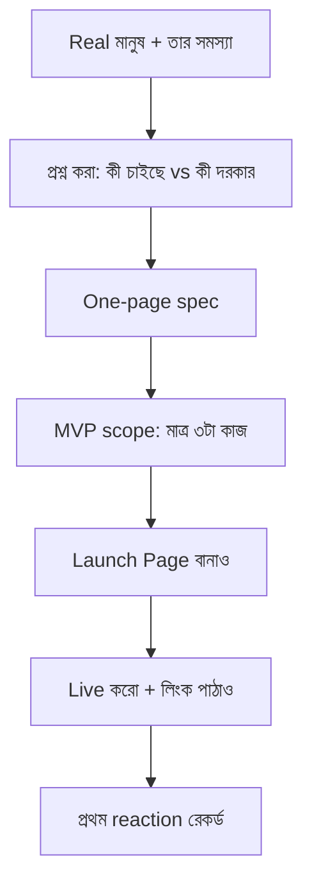
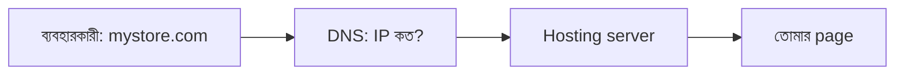

# Module 06 · Product Thinking and Going Live

> **Section 2 · Product Thinking & The Web** · ২টি Live Class
> ⭐ **প্রজেক্ট:** Product Blueprint (one page spec) + Product Launch Page (live)

## 🎯 লক্ষ্য

কোড লেখার আগে **সমস্যাটা ঠিকমতো বোঝা**। একজন সত্যিকারের মানুষের (local SME, NGO, ক্যাম্পাসের সমস্যা বা দোকানদার) real brief নিয়ে এক পাতার spec লেখা, MVP ঠিক করা, আর একটা launch page live করা। এই product-ই কোর্সের বাকি অংশে বড় হবে।

## 📖 গল্প: দর্জির কাছে যাওয়া

ভালো দর্জি কাপড় কাটার আগে মাপ নেয়। কেউ যদি বলে "একটা জামা বানিয়ে দাও", দর্জি জিজ্ঞেস করে — কার জন্য? কখন পরবে? কী মাপ? তারপর কাটে। প্রোডাক্ট ইঞ্জিনিয়ারের **মাপ নেওয়া** হলো সমস্যা বোঝা। যে মাপ না নিয়ে শুরু করে, সে সুন্দর কিন্তু কারো গায়ে না-লাগা জামা বানায়।



---

## 🧠 Live Class 1 · Finding the Problem

### Ostad-এর shortlist থেকে একটা real brief

একজন মানুষ বেছে নাও — যার সমস্যা তার সাথে বসে শুনতে হবে। যেমন: পাড়ার দোকানদার, NGO কর্মী, ক্যাম্পাসের ক্লাব।

### Product engineer vs শুধু developer

| Developer | Product Engineer |
|---|---|
| "কী বানাব?" জিজ্ঞেস করে | "কেন বানাব?" জিজ্ঞেস করে |
| যা বলা হয় তাই বানায় | সমস্যার মূল খোঁজে |
| feature গোনে | ফলাফল গোনে |

### মানুষের সাথে কথা বলার কৌশল

মানুষ যা **চায়** (want) আর যা **দরকার** (need) প্রায়ই আলাদা।

- ❌ "আপনার কি একটা অ্যাপ লাগবে?" (সবাই "হ্যাঁ" বলবে)
- ✅ "গত সপ্তাহে শেষবার এই সমস্যাটা কখন হয়েছিল? তখন কী করেছিলেন?"
- ✅ "এখন কীভাবে সামলাচ্ছেন? কোথায় সবচেয়ে সময় যায়?"

**নিয়ম:** সমাধান নিয়ে নয়, **আচরণ ও অতীতের ঘটনা** নিয়ে জিজ্ঞেস করো।

### One-page spec লেখার ছক

```markdown
# [Product-এর নাম]

**কে:** কার সমস্যা (নাম, কাজ, প্রসঙ্গ)
**সমস্যা:** এক-দুই বাক্যে
**এখন কীভাবে সামলায়:** বর্তমান উপায় ও তার ঝামেলা
**সফল হলে কী বদলাবে:** মাপা যায় এমন ফলাফল
**MVP — মাত্র ৩টা কাজ:**
1. ...
2. ...
3. ...
**যা এবার করছি না:** (এটাও লেখো!)
**ঝুঁকি / অনুমান:** যেগুলো ভুল হতে পারে
```

### MVP scoping — "না" বলতে শেখা

MVP = **Minimum Viable Product** — সবচেয়ে ছোট জিনিস যা আসল সমস্যাটা সমাধান করে। ১০টা feature-এর ভিড়ে তিনটা ভালো feature হারিয়ে যায়।

> **পরীক্ষা:** একটা feature বাদ দিলে কি মূল সমস্যা সমাধান হওয়া থামবে? না থামলে, ওটা MVP-তে নেই।

**ব্রিফ sign-off:** Instructor-এর কাছ থেকে ব্রিফ অনুমোদন নিতে হবে, তারপর এগোবে।

---

## 🧠 Live Class 2 · Getting It Online

### Hosting আসলে কী?

তোমার ফাইলগুলো এমন একটা কম্পিউটারে রাখা, যেটা ২৪ ঘণ্টা ইন্টারনেটে চালু থাকে এবং অন্যরা তাতে ঢুকতে পারে।

### Static hosting-এর বিকল্প

| সেবা | কখন ভালো |
|---|---|
| GitHub Pages | সবচেয়ে সহজ, ফ্রি, Git-এর সাথে মেলে |
| Netlify / Vercel / Cloudflare Pages | auto deploy, preview link |

### Domain ও DNS — সহজ ভাষায়

- **Domain** = বাড়ির নাম (`mystore.com`)
- **DNS** = ফোনবুক — নাম দিয়ে খুঁজলে ঠিকানা (IP) দেয়
- **A record** → IP-তে নিয়ে যায়; **CNAME** → অন্য নামে নিয়ে যায়



### Template নিয়ে নিজের product-এর জন্য adapt করা

কপি লেখার নিয়ম:
- **Technology নয়, সমস্যা বোঝাও।** ❌ "Django দিয়ে বানানো" → ✅ "দোকানের বাকির হিসাব রাখুন, ভুল ছাড়া।"
- একটাই স্পষ্ট call-to-action (যেমন: "আজই চেষ্টা করুন")
- ছোট, সহজ বাক্য

### Deploy ও যাচাই

- [ ] **ফোনে** খুলে দেখো (বেশিরভাগ ব্যবহারকারী ফোনেই দেখবে)
- [ ] লিংক শেয়ার করে যার সমস্যা তাকে পাঠাও
- [ ] **প্রথম reaction রেকর্ড করো** — হাসি, প্রশ্ন, বিভ্রান্তি — যা-ই হোক লিখে রাখো
- [ ] ৬৮ সপ্তাহ ধরে এই brief-ই বহন করবে — বেছে নাও সাবধানে

## ⚠️ সাধারণ ভুল

| ভুল | সমাধান |
|---|---|
| শুরুতেই সমাধান ধরে নেওয়া | আগে সমস্যার ইতিহাস শোনো |
| সব feature MVP-তে ঢোকানো | "এবার করছি না" তালিকা লেখো |
| কপিতে প্রযুক্তি-ভাষা | ব্যবহারকারীর ভাষায় লেখো |
| শুধু ডেস্কটপে পরীক্ষা | ফোনে দেখো |

## ⭐ প্রজেক্ট: Product Blueprint + Launch Page

- [ ] Real মানুষের real brief, instructor sign-off সহ
- [ ] এক পাতার spec (উপরের ছক অনুযায়ী)
- [ ] MVP — মাত্র ৩টা কাজ, সাথে "না করার" তালিকা
- [ ] Launch page live (URL আছে)
- [ ] ফোনে পরীক্ষা করা
- [ ] প্রথম মানুষের reaction লিখে রাখা

## 🎤 Interview প্রশ্ন

1. MVP বলতে কী বোঝো? কীভাবে scope ঠিক করো?
2. ব্যবহারকারী যা চায় আর যা দরকার — পার্থক্য কেন গুরুত্বপূর্ণ?
3. DNS কীভাবে কাজ করে সহজ ভাষায় বোঝাও।
4. কোনো সমস্যা নিয়ে ব্যবহারকারীর সাথে প্রথম কথায় কী জিজ্ঞেস করবে?

## 🔁 MERN / WordPress-এর সাথে তুলনা

WordPress ক্লায়েন্ট কাজে এই ধাপটা আগেই করা হয় (client brief)। কিন্তু প্রায়ই "ক্লায়েন্ট যা বলে তাই বানাও" — এখানে শেখানো হচ্ছে **brief-কে প্রশ্ন করা**: কেন, কার জন্য, সবচেয়ে ছোট সংস্করণ কী। ফ্রিল্যান্স প্রপোজালে scope লেখার সময় সরাসরি কাজে লাগবে।
