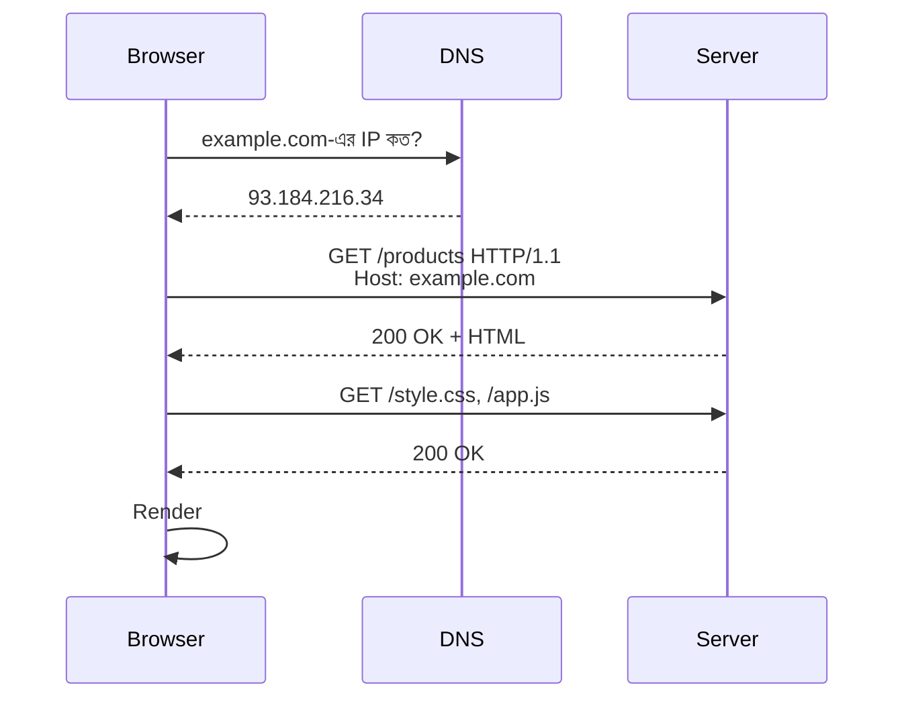

# Module 07 · How the Web Works and HTML

> **Section 2 · Product Thinking & The Web** · ২টি Live Class
> ⭐ **প্রজেক্ট:** Hand-built Product Page with a working form

## 🎯 লক্ষ্য

Browser-এ URL লিখে Enter চাপার পর পর্দার আড়ালে কী ঘটে সেটা বোঝা, HTTP-র মূল ধারণা (method, status, header, cookie, session) আয়ত্ত করা, আর HTML **হাতে লিখে** Module 06-এর page rebuild করা — form সহ।

## 📖 গল্প: রেস্টুরেন্টের ওয়েটার

তুমি (**client / browser**) টেবিলে বসে ওয়েটারকে বললে "একটা বিরিয়ানি" (**request**)। ওয়েটার রান্নাঘরে (**server**) গিয়ে অর্ডার দিল। রান্নাঘর খাবার পাঠাল, সাথে একটা স্লিপ — "সফল", "আজ নেই", "রান্নাঘরে আগুন" (**status code**)। ওয়েটার **তোমাকে মনে রাখে না** — প্রতিবার তোমার অর্ডার নতুন করে বুঝতে হয় (**stateless**)। তাই সে তোমার হাতে একটা টোকেন দেয় (**cookie**), যাতে পরের বার চিনতে পারে।



---

## 🧠 Live Class 1 · The Request and Response Cycle

### URL ভেঙে দেখা

```text
https://shop.example.com:443/products/42?color=red&size=M#reviews
└─┬─┘   └──────┬──────┘└┬┘└─────┬─────┘└──────┬───────┘└──┬──┘
scheme      host      port    path       query string   fragment
```

### HTTP method

| Method | কাজ | উদাহরণ |
|---|---|---|
| `GET` | ডাটা চাও (নিরাপদ, বদলায় না) | পণ্যের তালিকা দেখা |
| `POST` | নতুন কিছু তৈরি করো | অর্ডার দেওয়া |
| `PUT` | পুরোটা প্রতিস্থাপন | প্রোফাইল সম্পূর্ণ বদলানো |
| `PATCH` | আংশিক বদলাও | শুধু ফোন নম্বর বদলানো |
| `DELETE` | মুছো | কার্ট থেকে সরানো |

### Status code পরিবার

| কোড | অর্থ | উদাহরণ |
|---|---|---|
| `2xx` | সফল | `200 OK`, `201 Created` |
| `3xx` | অন্যত্র যাও | `301`, `302` redirect |
| `4xx` | **তোমার** ভুল | `400`, `401` (লগইন নেই), `403` (অনুমতি নেই), `404` |
| `5xx` | **সার্ভারের** ভুল | `500`, `502`, `503` |

### Header, Query string বনাম Body

```http
POST /orders HTTP/1.1
Host: shop.example.com
Content-Type: application/json
Authorization: Bearer eyJhbGciOi...
Cookie: sessionid=abc123

{"product_id": 42, "qty": 2}
```

- **Query string:** `GET`-এ ফিল্টার/সার্চ (`?q=shirt`) — URL-এ দেখা যায়, secret রাখা যাবে না
- **Body:** `POST`-এ ডাটা — URL-এ দেখা যায় না

### Stateless, Cookie, Session

HTTP কাউকে মনে রাখে না। তাই:
- **Cookie:** browser-এ থাকা ছোট তথ্য, প্রতি request-এ সাথে যায়
- **Session:** server-এ থাকা তথ্য; cookie-তে শুধু session ID থাকে

> 💡 **Tip:** নিজের deploy করা page-এ Browser DevTools → **Network tab** খুলে real traffic দেখো। প্রতিটা request-এর method, status, header — সব দেখা যায়।

---

## 🧠 Live Class 2 · HTML Complete

### Document কাঠামো

```html
<!DOCTYPE html>
<html lang="bn">
<head>
  <meta charset="UTF-8">
  <meta name="viewport" content="width=device-width, initial-scale=1.0">
  <title>দোকানের হিসাব | আমার Product</title>
</head>
<body>
  <header>...</header>
  <nav>...</nav>
  <main>
    <section>...</section>
    <article>...</article>
  </main>
  <footer>...</footer>
</body>
</html>
```

### Semantic element কেন?

`<div>` দিয়ে সব বানানো যায়, কিন্তু `<nav>`, `<main>`, `<article>` বললে **screen reader** আর **search engine** বুঝতে পারে কোনটা কী।

| ভুল (div স্যুপ) | ভালো (semantic) |
|---|---|
| `<div class="header">` | `<header>` |
| `<div class="menu">` | `<nav>` |
| `<div class="content">` | `<main>` |

### সাধারণ tag

```html
<h1>প্রধান শিরোনাম</h1>              <!-- পেজে একটাই h1 -->
<p>এটা অনুচ্ছেদ <strong>গুরুত্বপূর্ণ</strong> শব্দসহ।</p>
<a href="/pricing">মূল্য দেখুন</a>
   <!-- alt বাধ্যতামূলক -->

<ul><li>একটা</li><li>দুটো</li></ul>
<table>
  <thead><tr><th>পণ্য</th><th>দাম</th></tr></thead>
  <tbody><tr><td>কলম</td><td>১০</td></tr></tbody>
</table>
```

### Form — ব্যবহারকারীর কাছ থেকে ডাটা নেওয়া

```html
<form action="/subscribe" method="POST">
  <label for="name">আপনার নাম</label>
  <input type="text" id="name" name="name" required minlength="2">

  <label for="email">ইমেইল</label>
  <input type="email" id="email" name="email" required>

  <label for="plan">প্ল্যান</label>
  <select id="plan" name="plan">
    <option value="free">ফ্রি</option>
    <option value="pro">প্রো</option>
  </select>

  <label for="note">মন্তব্য</label>
  <textarea id="note" name="note" rows="3"></textarea>

  <label><input type="checkbox" name="agree" required> শর্তে রাজি</label>

  <button type="submit">জমা দিন</button>
</form>
```

**মনে রাখো:**
- `<label for="x">` আর `<input id="x">` মিলিয়ে দাও — ক্লিক সহজ হয়, screen reader বোঝে
- `name` attribute ছাড়া input-এর ডাটা server-এ যায় না
- HTML validation (`required`, `type="email"`) শুধু সুবিধার জন্য — **server-এও যাচাই করতে হবে** (Module 11-এ আসবে)

### Accessibility বেসিক

- ছবিতে অর্থবহ `alt`
- Heading ক্রম ঠিক রাখো (`h1` → `h2` → `h3`)
- Keyboard দিয়ে সব কাজ করে কিনা দেখো (Tab)
- রঙ ছাড়াও তথ্য বোঝানো (শুধু লাল রঙে error নয়, লেখাও)

### 🛠️ Build: Module 06-এর page হাতে লিখে rebuild

Template ছেড়ে নিজে লেখো — semantic tag, accessible form, একটা কাজ করা signup/contact form।

## ⚠️ সাধারণ ভুল

| ভুল | সমাধান |
|---|---|
| `alt` ছাড়া ছবি | সবসময় অর্থবহ `alt` |
| `<br>` দিয়ে স্পেস বানানো | CSS দিয়ে করো (Module 08) |
| `input`-এ `name` না দেওয়া | ডাটা হারিয়ে যায় |
| একাধিক `<h1>` | পেজে একটা |
| শুধু client validation-এ ভরসা | server-এও যাচাই |

## ⭐ প্রজেক্ট: Hand-built Product Page

- [ ] Module 06-এর page নিজের হাতে লেখা
- [ ] Semantic element ব্যবহার
- [ ] একটা কাজ করা form (label, validation)
- [ ] Accessibility checklist পাস
- [ ] DevTools Network tab-এ নিজের page-এর request দেখে ছবি/নোট রাখা

## 🎤 Interview প্রশ্ন

1. Browser-এ URL দিলে Enter চাপার পর কী কী ঘটে?
2. `GET` আর `POST`-এর পার্থক্য? `PUT` আর `PATCH`?
3. `401` আর `403`-এর পার্থক্য?
4. HTTP stateless বলতে কী? Cookie ও session কীভাবে সমাধান করে?
5. Semantic HTML কেন গুরুত্বপূর্ণ?

## 🔁 MERN / WordPress-এর সাথে তুলনা

- Express-এ `req.query`, `req.body`, `res.status(404)` — এখানে যা শিখলে, সেটাই ওগুলোর ভিত্তি।
- WordPress-এ `$_GET`, `$_POST`, `wp_redirect()`, nonce — একই HTTP ধারণা।
- Cookie-session বনাম JWT পার্থক্য Module 12–13-এ আরও পরিষ্কার হবে।
