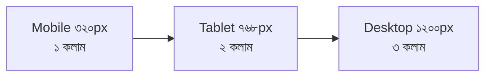
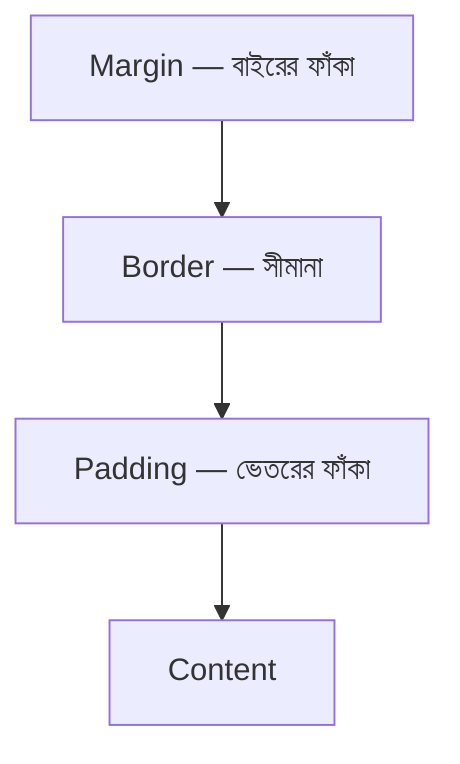

# Module 08 · CSS, Layout and Responsive Design

> **Section 2 · Product Thinking & The Web** · ২টি Live Class + ১টি DSA Class
> ⭐ **প্রজেক্ট:** Responsive Design System for your product

## 🎯 লক্ষ্য

CSS কীভাবে কাজ করে তা বোঝা (cascade, specificity, box model), Flexbox ও Grid দিয়ে layout বানানো, mobile-first ভাবনা, আর নিজের product-এর জন্য ছোট একটা **design system** (রঙ, টাইপ স্কেল, spacing) তৈরি করা।

## 📖 গল্প: বাড়ির ইন্টেরিয়র

HTML হলো বাড়ির কাঠামো — দেয়াল, দরজা, ছাদ। CSS হলো **ইন্টেরিয়র ডিজাইনার** — কোন দেয়ালে কোন রঙ, কোথায় সোফা, ফাঁকা জায়গা কতটুকু। একই বাড়ি ছোট ফ্ল্যাটে (মোবাইল) আর বড় হলঘরে (ডেস্কটপ) ঢোকাতে হলে আসবাব সরিয়ে সাজাতে হয় — এটাই **responsive design**।



---

## 🧠 Live Class 1 · CSS Fundamentals

### CSS কীভাবে apply হয়

```css
/* selector { property: value; } */
h1 { color: #1a1a1a; }                 /* tag selector */
.card { padding: 16px; }               /* class selector */
#hero { margin: 0; }                   /* id selector */
.card > p { font-size: 14px; }         /* সরাসরি সন্তান */
a:hover { text-decoration: underline; }
```

### Specificity ও Cascade — কোন নিয়ম জেতে?

একই element-এ দুটো নিয়ম সংঘাত করলে:

1. `!important` (এড়িয়ে চলো)
2. inline style
3. `#id`
4. `.class`, `:hover`
5. `tag`
6. সমান হলে **পরে লেখাটা** জেতে

### Box model



```css
* { box-sizing: border-box; }   /* width-এ padding ও border ধরা হয় — জীবন সহজ হয় */
.card { width: 300px; padding: 20px; border: 1px solid #ddd; margin: 16px auto; }
```

### Flexbox — এক দিকে সাজানো (সারি বা কলাম)

```css
.nav {
  display: flex;
  justify-content: space-between;   /* মূল অক্ষ বরাবর */
  align-items: center;              /* আড়াআড়ি অক্ষ বরাবর */
  gap: 16px;
}
```

### CSS Grid — দুই দিকে (সারি + কলাম)

```css
.products {
  display: grid;
  grid-template-columns: repeat(auto-fill, minmax(220px, 1fr));  /* নিজে নিজে কলাম ঠিক করে */
  gap: 20px;
}
```

> **কখন কোনটা?** একটা সারির জিনিস সাজাতে → Flexbox। পুরো পাতার গ্রিড → Grid।

### Unit ও রঙ

| Unit | অর্থ |
|---|---|
| `px` | নির্দিষ্ট পিক্সেল |
| `rem` | root font size-এর গুণিতক (ভালো — ব্যবহারকারীর সেটিং মানে) |
| `%` | parent-এর শতাংশ |
| `vw / vh` | viewport-এর প্রস্থ/উচ্চতার শতাংশ |

### Tailwind — দ্রুত পথ হিসেবে

```html
<button class="bg-green-600 text-white px-4 py-2 rounded-lg hover:bg-green-700">
  অর্ডার করুন
</button>
```

Tailwind শেখানো হয় **দ্রুত রাস্তা** হিসেবে — মূল CSS বোঝা সবচেয়ে আগে। না বুঝে Tailwind ব্যবহার করলে debug করতে পারবে না।

---

## 🧠 Live Class 2 · Responsive and Professional

### Mobile-first

আগে ছোট স্ক্রিনের জন্য লেখো, তারপর বড় স্ক্রিনের জন্য উপরে যোগ করো।

```css
/* ডিফল্ট: মোবাইল */
.products { grid-template-columns: 1fr; }

/* ৭৬৮px বা তার বেশি */
@media (min-width: 768px) {
  .products { grid-template-columns: repeat(2, 1fr); }
}
@media (min-width: 1100px) {
  .products { grid-template-columns: repeat(3, 1fr); }
}
```

### Responsive image

```css
img { max-width: 100%; height: auto; }   /* কখনো container ছাপিয়ে যাবে না */
```

### ছোট Design System — CSS variable দিয়ে

```css
:root {
  /* রঙ */
  --color-primary: #16a34a;
  --color-text: #111827;
  --color-muted: #6b7280;
  --color-bg: #ffffff;

  /* টাইপ স্কেল */
  --text-sm: 0.875rem;
  --text-base: 1rem;
  --text-lg: 1.25rem;
  --text-xl: 1.75rem;

  /* spacing — ৮-এর ধাপে */
  --space-1: 0.5rem;
  --space-2: 1rem;
  --space-3: 1.5rem;
  --space-4: 2rem;
}

.btn {
  background: var(--color-primary);
  color: #fff;
  padding: var(--space-1) var(--space-3);
  border-radius: 8px;
}
```

**ফল:** রঙ বদলাতে চাইলে এক জায়গায় বদলালেই পুরো সাইটে বদলে যায়।

### সাধারণ layout প্যাটার্ন

Hero → Feature grid → Pricing → Footer। নিজের product page ভালোভাবে rebuild করে, Module 06-এর template-এর পাশাপাশি তুলনা করো।

### ফোনে টেস্ট

DevTools → Device toolbar (Ctrl+Shift+M) + **আসল ফোনে** দেখো। Emulator ধরতে পারে না এমন সমস্যা আছে।

---

## 🧩 DSA Class 3 · Two Pointers

**Sliding window** ও **fixed/variable window** সমস্যা।

```python
# Two pointers: sorted array-তে দুটো সংখ্যার যোগফল target কিনা
def two_sum_sorted(arr, target):
    left, right = 0, len(arr) - 1
    while left < right:
        s = arr[left] + arr[right]
        if s == target:
            return (left, right)
        if s < target:
            left += 1          # যোগফল ছোট → বাম দিক বাড়াও
        else:
            right -= 1         # যোগফল বড় → ডান দিক কমাও
    return None                # O(n) সময়, O(1) জায়গা
```

```python
# Fixed window: k সংখ্যার সর্বোচ্চ যোগফল
def max_window_sum(arr, k):
    window = sum(arr[:k])
    best = window
    for i in range(k, len(arr)):
        window += arr[i] - arr[i - k]     # নতুন ঢোকাও, পুরোনো বাদ দাও
        best = max(best, window)
    return best                            # O(n)
```

## ⚠️ সাধারণ ভুল

| ভুল | সমাধান |
|---|---|
| `box-sizing` না দেওয়া | `* { box-sizing: border-box; }` |
| Fixed `px` width সব জায়গায় | `%`, `rem`, `minmax()` |
| `!important` ছড়ানো | specificity ঠিক করো |
| Desktop-first লিখে পরে মোবাইল ঠিক করা | mobile-first |
| ফোনে না দেখে ডেপ্লয় | আসল ফোনে টেস্ট |

## ⭐ প্রজেক্ট: Responsive Design System

- [ ] CSS variable-এ রঙ, টাইপ স্কেল, spacing
- [ ] Mobile-first, ৩টা breakpoint পর্যন্ত
- [ ] Product page rebuild + redeploy
- [ ] Module 06-এর template-এর সাথে পাশাপাশি তুলনা (screenshot)
- [ ] আসল ফোনে টেস্ট

## 🎤 Interview প্রশ্ন

1. Box model ব্যাখ্যা করো। `box-sizing: border-box` কেন দরকার?
2. Flexbox আর Grid কখন কোনটা?
3. Specificity কীভাবে হিসাব হয়?
4. Mobile-first বলতে কী বোঝো?
5. `rem` বনাম `px`?

## 🔁 MERN / WordPress-এর সাথে তুলনা

- Theme development-এ তুমি আগেই CSS লেখো — এখানে নতুন হলো **design system-এর চিন্তা** (variable, scale)।
- WordPress theme.json-এর colors/spacing scale আসলে একই ধারণা।
- React-এ (Module 18) CSS variable আর Tailwind একই ভাবে চলবে।
