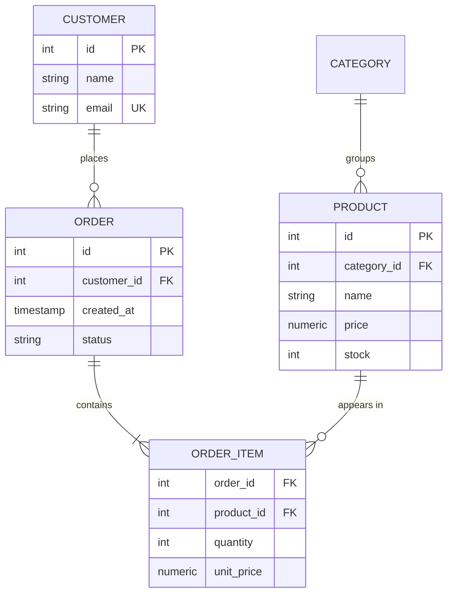
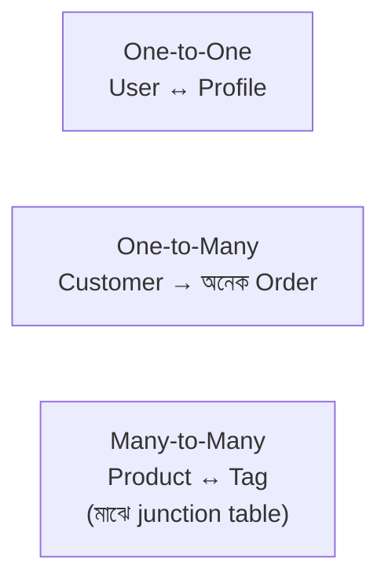

# Module 09 · Relational Databases and SQL

> **Section 3 · Databases, Django & REST APIs** · ২টি Live Class
> ⭐ **প্রজেক্ট:** E-Commerce Database Design (single vendor)

## 🎯 লক্ষ্য

ডাটাবেস কেন লাগে বোঝা, PostgreSQL install করে SQL দিয়ে ডাটা তৈরি-পড়া-বদলানো-মোছা, JOIN ও aggregation, index ও query plan, আর normalization শেখা। শেষে একটা single-vendor e-commerce database নিজে ডিজাইন করে query চালানো।

## 📖 গল্প: লাইব্রেরির কার্ড-ক্যাটালগ

ফাইলে ডাটা রাখা মানে স্তূপ করে বই রাখা — একটা বই খুঁজতে পুরো স্তূপ ঘাঁটতে হয়। **ডাটাবেস** হলো সাজানো লাইব্রেরি: তাক (**table**), প্রতিটা বইয়ের একটা ক্রমিক নম্বর (**primary key**), আর কার্ড-ক্যাটালগ যা দিয়ে সেকেন্ডে বই খোঁজা যায় (**index**)। দুই বইয়ের মধ্যে সংযোগ ("এই লেখকের এই বই") রাখা হয় **foreign key** দিয়ে।



---

## 🧠 Live Class 1 · PostgreSQL Fundamentals

### ডাটাবেস কেন, ফাইল দিয়ে নয় কেন?

| ফাইল | ডাটাবেস |
|---|---|
| একসাথে দুজন লিখলে নষ্ট হতে পারে | concurrency সামলায় |
| খুঁজতে পুরোটা পড়তে হয় | index দিয়ে দ্রুত |
| সম্পর্ক রাখা কঠিন | foreign key দিয়ে নিশ্চিত |
| কোনো নিয়ম নেই | constraint দিয়ে ভুল ঠেকায় |

### মূল শব্দ

- **Database** → অনেক **table**
- **Table** → **row** (একটা রেকর্ড) আর **column** (একটা বৈশিষ্ট্য)

### Table তৈরি ও Data type

```sql
CREATE DATABASE shop;
\c shop

CREATE TABLE categories (
    id   SERIAL PRIMARY KEY,            -- নিজে নিজে বাড়ে: 1, 2, 3...
    name VARCHAR(100) NOT NULL UNIQUE
);

CREATE TABLE products (
    id          SERIAL PRIMARY KEY,
    category_id INTEGER NOT NULL REFERENCES categories(id),   -- foreign key
    name        VARCHAR(200) NOT NULL,
    price       NUMERIC(10, 2) NOT NULL CHECK (price >= 0),   -- টাকার জন্য FLOAT নয়!
    stock       INTEGER NOT NULL DEFAULT 0 CHECK (stock >= 0),
    created_at  TIMESTAMPTZ NOT NULL DEFAULT now()
);
```

> ⚠️ **টাকার হিসাবে `FLOAT` কখনো নয়** — `0.1 + 0.2 = 0.30000000000000004`। `NUMERIC` / `DECIMAL` ব্যবহার করো।

### CRUD

```sql
-- Create
INSERT INTO categories (name) VALUES ('জামা'), ('জুতা');
INSERT INTO products (category_id, name, price, stock)
VALUES (1, 'পাঞ্জাবি', 1200.00, 15);

-- Read
SELECT name, price FROM products WHERE price > 500 ORDER BY price DESC LIMIT 10;

-- Update (WHERE ভুলে গেলে সব row বদলে যায়!)
UPDATE products SET stock = stock - 1 WHERE id = 1;

-- Delete
DELETE FROM products WHERE id = 1;
```

### Operator ও Constraint

`=`, `<>`, `<`, `>`, `AND`, `OR`, `IN (...)`, `BETWEEN`, `LIKE '%শার্ট%'`, `IS NULL`।

| Constraint | কাজ |
|---|---|
| `PRIMARY KEY` | প্রতিটা row ইউনিক পরিচয় |
| `FOREIGN KEY` | অন্য table-এর row-এর সাথে বাঁধা |
| `UNIQUE` | ডুপ্লিকেট নয় |
| `NOT NULL` | খালি রাখা যাবে না |
| `CHECK` | শর্ত মানতে হবে |

### সম্পর্কের ধরন



---

## 🧠 Live Class 2 · Querying Like an Engineer

### JOIN — table জুড়ে ডাটা আনা

```sql
-- INNER JOIN: দুই পাশেই মিল থাকলে তবেই
SELECT o.id, c.name AS customer, o.created_at
FROM orders o
INNER JOIN customers c ON c.id = o.customer_id;

-- LEFT JOIN: বাম table-এর সব, ডানে মিল না থাকলে NULL
-- (কারা কখনো অর্ডার করেনি, তা বের করতে দারুণ)
SELECT c.name
FROM customers c
LEFT JOIN orders o ON o.customer_id = c.id
WHERE o.id IS NULL;
```

`RIGHT JOIN` ও `FULL JOIN`-ও আছে, তবে বাস্তবে `INNER` আর `LEFT`-ই ৯০% সময়।

### Aggregation

```sql
SELECT
    cat.name AS category,
    COUNT(*)        AS products,
    AVG(p.price)    AS avg_price,
    SUM(p.stock)    AS total_stock
FROM products p
JOIN categories cat ON cat.id = p.category_id
GROUP BY cat.name
HAVING COUNT(*) >= 3          -- WHERE হলো row-এর আগে, HAVING হলো group-এর পরে
ORDER BY total_stock DESC;
```

### Subquery

```sql
-- গড়ের চেয়ে দামি পণ্য
SELECT name, price FROM products
WHERE price > (SELECT AVG(price) FROM products);
```

### Index ও EXPLAIN

```sql
CREATE INDEX idx_orders_customer ON orders(customer_id);

EXPLAIN ANALYZE
SELECT * FROM orders WHERE customer_id = 42;
-- "Index Scan" দেখলে ভালো, "Seq Scan" (পুরো table পড়ছে) বড় table-এ খারাপ
```

> **Index-এর দাম আছে:** পড়া দ্রুত হয়, কিন্তু লেখা একটু ধীর হয় আর জায়গা খায়। যেসব column-এ প্রায়ই `WHERE`/`JOIN` হয়, শুধু সেগুলোতে দাও।

### Normalization

| ধাপ | নিয়ম | খারাপ উদাহরণ |
|---|---|---|
| **1NF** | প্রতিটা ঘরে একটাই মান | `phones = "017..., 018..."` |
| **2NF** | সবকিছু পুরো key-এর উপর নির্ভর করবে | order item-এ পণ্যের নাম (শুধু `product_id`-এর উপর নির্ভর) |
| **3NF** | non-key column একে অপরের উপর নির্ভর করবে না | `zip_code` আর `city` একই table-এ |

**কখন ইচ্ছাকৃত denormalize?** রিপোর্টিং বা পড়া-ভারী অংশে দ্রুততার জন্য — তবে ইচ্ছাকৃতভাবে, জেনে।

### Transaction — সব হবে নয়তো কিছুই না

```sql
BEGIN;
UPDATE accounts SET balance = balance - 500 WHERE id = 1;
UPDATE accounts SET balance = balance + 500 WHERE id = 2;
COMMIT;      -- মাঝখানে সমস্যা হলে ROLLBACK;
```

ACID: **A**tomicity (সব বা কিছু না), **C**onsistency, **I**solation, **D**urability।

> 🔑 **অর্ডার করার সময় `order_items.unit_price` আলাদা করে রাখো** — কারণ পণ্যের দাম পরে বদলাতে পারে, কিন্তু আগের অর্ডারের দাম বদলানো চলবে না।

### 🛠️ Build: Single vendor e-commerce

Table: `categories`, `products`, `customers`, `orders`, `order_items`। তারপর query লেখো:

1. গত ৩০ দিনের মোট বিক্রি
2. সবচেয়ে বেশি বিক্রিত ৫টা পণ্য
3. যে গ্রাহক কখনো অর্ডার করেনি
4. Category-wise গড় অর্ডার মূল্য

## ⚠️ সাধারণ ভুল

| ভুল | সমাধান |
|---|---|
| `UPDATE`/`DELETE`-এ `WHERE` ভুলে যাওয়া | আগে `SELECT` চালিয়ে দেখো, transaction-এ রাখো |
| টাকায় `FLOAT` | `NUMERIC(10,2)` |
| `SELECT *` সবখানে | দরকারি column বলো |
| Index ছাড়া বড় table-এ JOIN | `EXPLAIN` দেখো |
| শুধু `WHERE` দিয়ে group filter | `HAVING` |

## ⭐ প্রজেক্ট: E-Commerce Database Design

- [ ] ৫+ table, সঠিক PK/FK/constraint
- [ ] ER diagram (Mermaid বা dbdiagram)
- [ ] ৩NF পর্যন্ত যুক্তিসহ
- [ ] উপরের ৪টা query কাজ করে
- [ ] অন্তত একটা index + `EXPLAIN` আগে-পরে তুলনা
- [ ] সব SQL ফাইল GitHub-এ

## 🎤 Interview প্রশ্ন

1. `INNER JOIN` vs `LEFT JOIN`?
2. `WHERE` আর `HAVING`-এর পার্থক্য?
3. Index কীভাবে কাজ করে? কখন ক্ষতি করে?
4. Normalization কী? ৩NF বোঝাও।
5. ACID বলতে কী বোঝো?
6. টাকার জন্য `FLOAT` কেন নয়?

## 🔁 MERN / WordPress-এর সাথে তুলনা

| ধারণা | MongoDB (MERN) | MySQL (WordPress) | PostgreSQL |
|---|---|---|---|
| ডাটার একক | document | row | row |
| সংযোগ | embed / `populate` | `JOIN` + `wp_postmeta` | `JOIN` + foreign key |
| Schema | নমনীয় | নির্দিষ্ট | কঠোর, constraint সহ |
| Transaction | সীমিত/জটিল | আছে | শক্তিশালী |

WordPress-এর `wp_postmeta` আসলে EAV প্যাটার্ন — flexible কিন্তু বড় হলে ধীর। এখানে শেখা normalization সেই সমস্যা কেন হয় তা ব্যাখ্যা করে। তোমার আগের NestJS + PostgreSQL কাজের সাথে এই মডিউল বেশ মিলবে।
