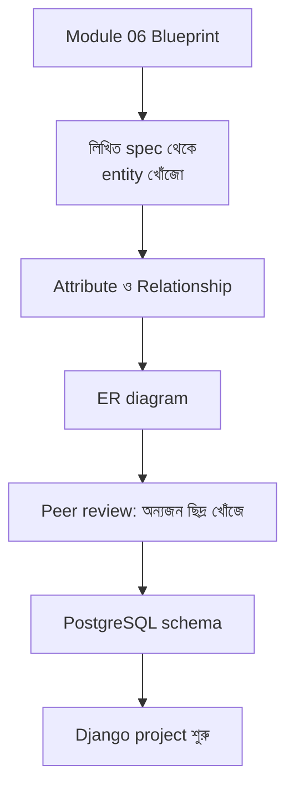
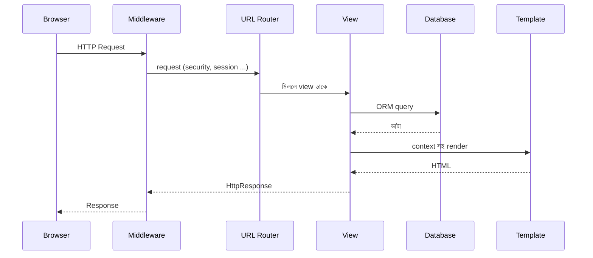

# Module 10 · Data Modeling and Django Fundamentals

> **Section 3 · Databases, Django & REST APIs** · ২টি Live Class
> ⭐ **প্রজেক্ট:** Your Product's Schema (ER diagram + running schema)

## 🎯 লক্ষ্য

নিজের product-এর Blueprint (Module 06) থেকে **entity ও সম্পর্ক বের করে ER diagram আঁকা**, peer review নেওয়া, PostgreSQL-এ schema বানানো। তারপর Django-র গঠন, URL, view, template ও request lifecycle বোঝা।

## 📖 গল্প: স্থপতির নকশা, তারপর বাড়ি

বাড়ি বানানোর আগে স্থপতি নকশা আঁকে — কোথায় কোন ঘর, ঘরগুলোর মধ্যে কীভাবে যাওয়া যায়। ER diagram হলো তোমার ডাটার নকশা। ভুল নকশা ছয় মাস পরে দেয়াল ভাঙতে বাধ্য করে। আর **Django** হলো একটা সম্পূর্ণ নির্মাণ-সরঞ্জামের বাক্স — "batteries included": ডাটাবেস, URL রাউটিং, admin panel, authentication, সব তৈরি।



---

## 🧠 Live Class 1 · Modeling Your Own Product

### ER diagram-এর notation

- **Entity** = বাস্তব জিনিস (User, Order, Product)
- **Attribute** = বৈশিষ্ট্য (name, price)
- **Relationship** = সংযোগ (User **places** Order)
- **Cardinality** = কয়টা (এক-থেকে-অনেক ইত্যাদি)

### Spec থেকে Entity বের করার কৌশল

লিখিত spec-এ **বিশেষ্য** (noun) খোঁজো — সেগুলো entity হতে পারে। **ক্রিয়া** (verb) খোঁজো — সেগুলো সম্পর্ক।

> "একজন **দোকানদার** তার **গ্রাহকদের** **বাকি** লিখে রাখে, গ্রাহক **কিস্তিতে** **পরিশোধ** করে।"
> → Entity: Shopkeeper, Customer, Debt, Payment। সম্পর্ক: Customer → অনেক Debt, Debt → অনেক Payment।

### সাধারণ modeling ভুল ও ছয় মাস পরের পরিণতি

| ভুল | কেন সমস্যা | সমাধান |
|---|---|---|
| ইতিহাস না রেখে শুধু বর্তমান মান | "আগে দাম কত ছিল?" উত্তর নেই | snapshot column / history table |
| সবকিছু একটাই বড় table-এ | ডুপ্লিকেট, ভুল বাড়ে | normalize করো |
| Many-to-many সরাসরি রাখার চেষ্টা | কীভাবে? | junction table |
| status-এর জন্য ফ্রি-টেক্সট | "paid", "Paid", "PAID" | choices / enum |
| মুছে ফেলা (hard delete) | ডাটা চিরতরে যায় | `is_deleted` / `deleted_at` (soft delete) |
| সময়ক্ষেত্র ভুলে যাওয়া | কখন হয়েছিল? | `created_at`, `updated_at` সবখানে |

### Peer review

প্রত্যেকে অন্যজনের diagram **ভাঙার চেষ্টা** করবে:
- "এই ক্ষেত্রে কী হবে যদি দুজন গ্রাহকের একই ফোন নম্বর হয়?"
- "ডিসকাউন্ট দিলে কোথায় রাখব?"
- "এক গ্রাহক মুছে দিলে তার অর্ডারের কী হবে?"

### PostgreSQL-এ schema

ER diagram থেকে `CREATE TABLE` লেখো। (Module 11-এ Django ORM এটা স্বয়ংক্রিয়ভাবে করবে, কিন্তু এখন হাতে করলে বোঝা গভীর হয়।)

---

## 🧠 Live Class 2 · The Django Way

### Web framework কী দেয়?

কাঁচা Python-এ HTTP বুঝতে হলে সকেট, parsing, routing — সব নিজে করতে হতো। Framework দেয়: URL routing, request/response অবজেক্ট, template, ORM, security default।

### প্রথম Django project

```bash
python -m venv .venv && source .venv/bin/activate
pip install django
django-admin startproject config .          # প্রজেক্ট (configuration)
python manage.py startapp shop              # app (একটা কাজের একক)
python manage.py runserver                  # http://127.0.0.1:8000
```

```text
├── manage.py
├── config/                 # project settings
│   ├── settings.py
│   ├── urls.py             # মূল URL মানচিত্র
│   └── wsgi.py / asgi.py
└── shop/                   # app
    ├── models.py           # ডাটার গঠন
    ├── views.py            # লজিক
    ├── urls.py             # app-এর URL
    ├── templates/shop/     # HTML
    └── admin.py
```

> **Project বনাম App:** project = পুরো সাইট। app = একটা নির্দিষ্ট দায়িত্ব (shop, users, billing)। একটা project-এ অনেক app থাকে।

### settings.py-তে জরুরি জিনিস

- `INSTALLED_APPS` — তোমার app এখানে যোগ করতে হয়
- `DATABASES` — PostgreSQL এখানে (Module 11-এ)
- `DEBUG`, `ALLOWED_HOSTS`, `SECRET_KEY` — production-এ সাবধান (Module 16)

### URL ও View

```python
# shop/views.py
from django.http import HttpResponse
from django.shortcuts import render

# Function-based view
def home(request):
    return HttpResponse("স্বাগতম!")

def product_detail(request, product_id):          # URL থেকে parameter
    context = {"product_id": product_id}
    return render(request, "shop/detail.html", context)
```

```python
# shop/urls.py
from django.urls import path
from . import views

urlpatterns = [
    path("", views.home, name="home"),
    path("products/<int:product_id>/", views.product_detail, name="product_detail"),
]
```

```python
# config/urls.py
from django.urls import path, include
urlpatterns = [
    path("", include("shop.urls")),
]
```

Class-based view (পরে ভালো লাগবে):

```python
from django.views import View

class HomeView(View):
    def get(self, request):
        return HttpResponse("GET")
    def post(self, request):
        return HttpResponse("POST")
```

### Template ও Inheritance

```html
<!-- templates/base.html -->
<!DOCTYPE html>
<html>
<head><title>Softex Shop</title></head>
<body>
  <nav>...</nav>
  
</body>
</html>
```

```html
<!-- templates/shop/detail.html -->

পণ্য #{{ product_id }}

  <h1>পণ্য নম্বর: {{ product_id }}</h1>
  <p>নতুন!</p>
  <span>{{ tag|upper }}</span>

```

- `{{ var }}` = মান দেখাও; `` = লজিক; `{{ x|filter }}` = রূপান্তর
- Django template **নিজে নিজেই HTML escape করে** — XSS থেকে সুরক্ষা

### Django request lifecycle — শুরু থেকে শেষ



### Static files

CSS/JS/ছবি `static/` folder-এ রাখো, template-এ `` + ``।

## ⚠️ সাধারণ ভুল

| ভুল | সমাধান |
|---|---|
| app তৈরি করে `INSTALLED_APPS`-এ না দেওয়া | `settings.py`-তে যোগ করো |
| template খুঁজে পায় না | `templates/shop/` ফোল্ডার-কাঠামো ঠিক রাখো |
| URL-এ শেষে `/` ভুলে যাওয়া | Django ডিফল্টে `/` আশা করে |
| ER diagram ছাড়াই model লেখা | আগে নকশা, পরে কোড |

## ⭐ প্রজেক্ট: Your Product's Schema

- [ ] নিজের product-এর ER diagram (entity, relationship, cardinality)
- [ ] অন্তত একজন peer-এর review ও সংশোধন
- [ ] PostgreSQL-এ চলমান schema
- [ ] Django project + app চালু, একটা view + template কাজ করছে
- [ ] `created_at/updated_at`, soft delete, status choices ভেবে রাখা

## 🎤 Interview প্রশ্ন

1. Django-র request lifecycle ব্যাখ্যা করো।
2. Project আর app-এর পার্থক্য কী?
3. Function-based vs class-based view?
4. Template inheritance কেন ব্যবহার করি?
5. Many-to-many সম্পর্ক ডাটাবেসে কীভাবে রাখা হয়?

## 🔁 MERN / WordPress-এর সাথে তুলনা

| ধারণা | Django | Express (MERN) | WordPress |
|---|---|---|---|
| URL রাউটিং | `urls.py` | `app.get('/x')` | rewrite rules / `add_rewrite_rule` |
| Controller | view | route handler | template tag / hook callback |
| Template | Django template | EJS / React | PHP template + loop |
| Middleware | `MIDDLEWARE` list | `app.use()` | filters/hooks |
| Admin panel | ডিফল্টে আছে | নিজে বানাতে হয় | wp-admin |

Django-র "batteries included" দর্শন WordPress-এর মতোই — অনেক কিছু তৈরি পাওয়া যায়। পার্থক্য: এখানে সবকিছু **কোডে** সংজ্ঞায়িত, plugin-এর মাধ্যমে ক্লিক করে নয়।
