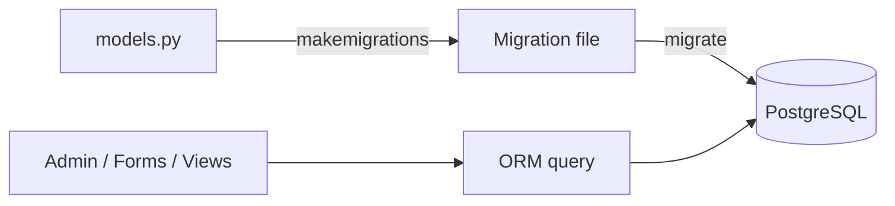

# Module 11 · Django Models, ORM and Your Product

> **Section 3 · Databases, Django & REST APIs** · ২টি Live Class + ১টি DSA Class
> ⭐ **প্রজেক্ট:** Product Admin Panel + Product Web App v1

## 🎯 লক্ষ্য

ER diagram-কে Django model-এ রূপান্তর, migration বোঝা, ORM দিয়ে query করা (বিশেষ করে **N+1 সমস্যা** চেনা ও সমাধান), admin panel সাজানো, form ও ModelForm দিয়ে নিরাপদে POST সামলানো, pagination যোগ করে product-এর প্রথম সংস্করণ বানানো — **আসল ডাটা সহ**।

## 📖 গল্প: অনুবাদক

তুমি Python বলো, ডাটাবেস বলে SQL। **ORM** হলো মাঝের অনুবাদক — তুমি Python-এ বলো "সব সক্রিয় পণ্য আনো", সে SQL বানিয়ে ডাটাবেসকে জিজ্ঞেস করে। কিন্তু অনুবাদক **বোকাও** হতে পারে: তুমি যদি ১০০টা পণ্যের জন্য আলাদা আলাদা করে ১০০ বার বলো "এর ক্যাটাগরি কী?", সে ১০০ বার ডাটাবেসে ছুটবে। এটাই **N+1 সমস্যা**।



---

## 🧠 Live Class 1 · Models, Migrations and Queries

### PostgreSQL কানেক্ট

```bash
pip install psycopg2-binary
```

```python
# settings.py
import os
DATABASES = {
    "default": {
        "ENGINE": "django.db.backends.postgresql",
        "NAME": os.environ["DB_NAME"],
        "USER": os.environ["DB_USER"],
        "PASSWORD": os.environ["DB_PASSWORD"],      # কোডে নয়, environment-এ
        "HOST": os.environ.get("DB_HOST", "localhost"),
        "PORT": "5432",
    }
}
```

### Model সংজ্ঞা

```python
# shop/models.py
from django.db import models
from django.conf import settings

class Category(models.Model):
    name = models.CharField(max_length=100, unique=True)

    def __str__(self):
        return self.name


class Product(models.Model):
    class Status(models.TextChoices):
        DRAFT = "draft", "খসড়া"
        ACTIVE = "active", "সক্রিয়"

    category = models.ForeignKey(
        Category, on_delete=models.PROTECT, related_name="products"
    )
    name = models.CharField(max_length=200)
    price = models.DecimalField(max_digits=10, decimal_places=2)
    stock = models.PositiveIntegerField(default=0)
    status = models.CharField(max_length=10, choices=Status.choices, default=Status.DRAFT)
    tags = models.ManyToManyField("Tag", blank=True)
    created_at = models.DateTimeField(auto_now_add=True)
    updated_at = models.DateTimeField(auto_now=True)

    class Meta:
        ordering = ["-created_at"]

    def __str__(self):
        return self.name
```

**সম্পর্কের ধরন:**

| ক্ষেত্র | কখন |
|---|---|
| `ForeignKey` | এক-থেকে-অনেক (Product → Category) |
| `OneToOneField` | এক-এক (User → Profile) |
| `ManyToManyField` | অনেক-অনেক (Product ↔ Tag) |

`on_delete`: `CASCADE` (সাথে মুছে যায়), `PROTECT` (বাধা দেয়), `SET_NULL`। `related_name` দিলে উল্টো দিক থেকে খোঁজা সহজ: `category.products.all()`।

### Migration

```bash
python manage.py makemigrations     # model-এর বদল থেকে migration ফাইল বানায়
python manage.py migrate            # ডাটাবেসে প্রয়োগ করে
python manage.py showmigrations     # কোনটা প্রয়োগ হয়েছে
```

> Migration ফাইল **Git-এ commit করো**। এটা ডাটাবেসের ইতিহাস। প্রয়োগ হয়ে যাওয়া migration হাতে বদলিও না — নতুন migration বানাও।

### Admin panel

```python
# shop/admin.py
from django.contrib import admin
from .models import Product, Category

@admin.register(Product)
class ProductAdmin(admin.ModelAdmin):
    list_display = ("name", "category", "price", "stock", "status")
    list_filter = ("status", "category")
    search_fields = ("name",)
    list_editable = ("stock",)
```

```bash
python manage.py createsuperuser
```

### QuerySet — ORM-এর মূল

```python
# সব
Product.objects.all()

# filter / exclude / get
Product.objects.filter(status="active", price__lte=500)
Product.objects.exclude(stock=0)
Product.objects.get(pk=1)              # না পেলে DoesNotExist, একাধিক হলে MultipleObjectsReturned

# order_by, chaining
Product.objects.filter(status="active").order_by("-price")[:10]

# সম্পর্ক পেরিয়ে lookup (double underscore)
Product.objects.filter(category__name="জামা")
Product.objects.filter(name__icontains="শার্ট")

# Aggregation
from django.db.models import Count, Avg
Category.objects.annotate(n=Count("products")).filter(n__gt=3)
Product.objects.aggregate(avg=Avg("price"))
```

> QuerySet **lazy** — `.filter()` লিখলেই ডাটাবেসে যায় না। যখন তুমি loop করো, `list()` করো বা `[0]` নাও, তখন যায়।

### ⚠️ N+1 সমস্যা — সবচেয়ে গুরুত্বপূর্ণ জিনিস

```python
# ❌ খারাপ: ১টা query + প্রতিটা পণ্যের জন্য ১টা করে category query = N+1
for p in Product.objects.all():
    print(p.name, p.category.name)        # প্রতিবার ডাটাবেসে ছোটে!

# ✅ ভালো: select_related → JOIN করে ১টা query-তে
for p in Product.objects.select_related("category"):
    print(p.name, p.category.name)

# ✅ many-to-many / reverse → prefetch_related (আলাদা ১টা query, Python-এ জোড়া)
for p in Product.objects.prefetch_related("tags"):
    print(p.name, [t.name for t in p.tags.all()])
```

**ডিবাগ:** `django-debug-toolbar` ব্যবহার করো বা `connection.queries` গোনো। ১০০ পণ্যে ১০১টা query = সমস্যা।

---

## 🧠 Live Class 2 · From Diagram to Working App

### ER diagram থেকে সম্পূর্ণ app

Module 10-এর **নিজের product-এর schema** থেকে model লেখো, migrate করো, admin-এ সাজাও, তারপর ব্যবহারকারীর জন্য পাতা বানাও।

### Form ও ModelForm

```python
# shop/forms.py
from django import forms
from .models import Product

class ProductForm(forms.ModelForm):
    class Meta:
        model = Product
        fields = ["category", "name", "price", "stock"]

    def clean_price(self):                      # field-level validation
        price = self.cleaned_data["price"]
        if price <= 0:
            raise forms.ValidationError("দাম শূন্যের বেশি হতে হবে")
        return price

    def clean(self):                            # form-level validation (একাধিক field মিলিয়ে)
        data = super().clean()
        return data
```

### POST নিরাপদে সামলানো + Post/Redirect/Get

```python
from django.shortcuts import render, redirect
from django.contrib import messages

def product_create(request):
    if request.method == "POST":
        form = ProductForm(request.POST)
        if form.is_valid():
            form.save()
            messages.success(request, "পণ্য যোগ হয়েছে ✅")
            return redirect("product_list")    # ⚠️ POST-এর পর redirect — না করলে refresh-এ ডুপ্লিকেট!
    else:
        form = ProductForm()
    return render(request, "shop/form.html", {"form": form})
```

```html
<form method="post">
            <!-- CSRF সুরক্ষা — বাদ দিলে POST ব্যর্থ হবে -->
  {{ form.as_p }}
  <button type="submit">সংরক্ষণ</button>
</form>
```

### Pagination

```python
from django.core.paginator import Paginator

def product_list(request):
    qs = Product.objects.select_related("category").filter(status="active")
    page = Paginator(qs, 20).get_page(request.GET.get("page"))
    return render(request, "shop/list.html", {"page": page})
```

### 🛠️ Build: Product এখন real record store ও display করে

আসল ডাটা (Module 06-এর brief-এর মানুষের আসল তথ্য) এনে ঢোকাও — তারপর বানাও পণ্যের তালিকা, বিস্তারিত পাতা, আর যোগ/সম্পাদনার ফর্ম।

---

## 🧩 DSA Class 4 · Recursion

**Base case** (কখন থামবে) + **Recursive case** (নিজেকে ছোট সমস্যায় ডাকা)।

```python
def factorial(n):
    if n <= 1:                 # base case — না থাকলে infinite recursion
        return 1
    return n * factorial(n - 1)

def fib(n, memo={}):
    if n <= 1:
        return n
    if n not in memo:
        memo[n] = fib(n - 1) + fib(n - 2)    # memoization → O(n)
    return memo[n]
```

**Call stack:** প্রতিটা call একটা stack frame নেয়। খুব গভীর recursion-এ `RecursionError`।

**Backtracking basics:**

```python
def subsets(nums):
    result, path = [], []
    def go(i):
        if i == len(nums):
            result.append(path[:])
            return
        path.append(nums[i]); go(i + 1)     # নিলাম
        path.pop();           go(i + 1)     # নিলাম না
    go(0)
    return result
```

## ⚠️ সাধারণ ভুল

| ভুল | সমাধান |
|---|---|
| Loop-এর ভেতর `.category` → N+1 | `select_related` / `prefetch_related` |
| Migration হাতে বদলানো | নতুন migration বানাও |
| `` ভুলে যাওয়া | form-এ সবসময় |
| POST-এর পর redirect না | Post/Redirect/Get |
| `.get()` সর্বত্র | `.filter().first()` বা `get_object_or_404` |
| `DEBUG=True` + কাঁচা secret | environment variable |

## ⭐ প্রজেক্ট: Admin Panel + Product Web App v1

- [ ] সব model, admin-এ সাজানো (filter, search, list_display)
- [ ] ModelForm দিয়ে তৈরি/সম্পাদনা, validation সহ
- [ ] তালিকা পাতায় pagination
- [ ] N+1 নেই — query সংখ্যা যাচাই করা
- [ ] আসল ডাটা দিয়ে চলছে
- [ ] Migration ফাইল commit করা

## 🎤 Interview প্রশ্ন

1. N+1 সমস্যা কী? কীভাবে সমাধান করো?
2. `select_related` vs `prefetch_related`?
3. `makemigrations` আর `migrate`-এর পার্থক্য?
4. QuerySet lazy বলতে কী বোঝো?
5. `on_delete=CASCADE` আর `PROTECT`?
6. কেন POST-এর পর redirect করি?

## 🔁 MERN / WordPress-এর সাথে তুলনা

| ধারণা | Django ORM | Mongoose | WordPress |
|---|---|---|---|
| Model সংজ্ঞা | `models.py` | Schema | CPT + meta box / `$wpdb` |
| Query | `.filter()` | `.find()` | `WP_Query` |
| Join | `select_related` | `.populate()` | `meta_query` / JOIN |
| Migration | বিল্ট-ইন | নেই (schema-less) | ম্যানুয়াল / `dbDelta` |

N+1 সমস্যা Mongoose-এর `populate` লুপ আর WordPress-এর `get_post_meta` লুপেও একই — পরিচিত সমস্যা, নতুন নাম।
