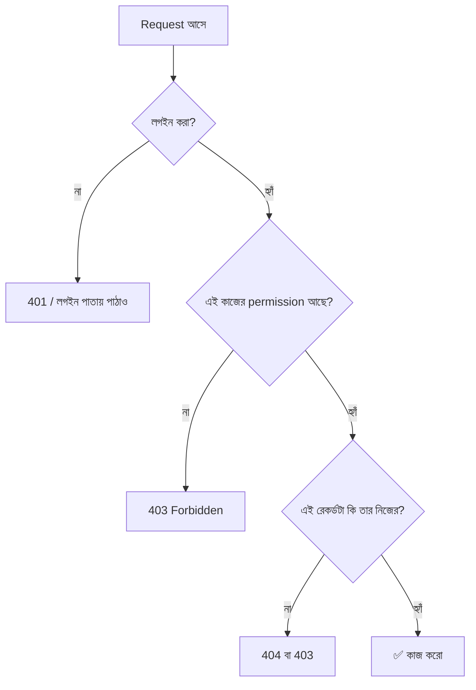
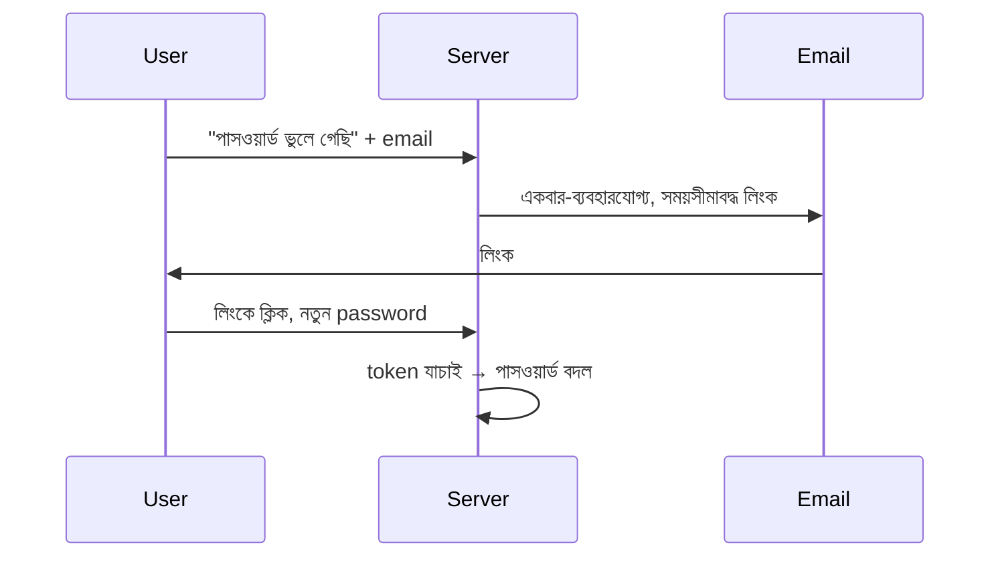

# Module 12 · Authentication and Automated Testing

> **Section 3 · Databases, Django & REST APIs** · ২টি Live Class
> ⭐ **প্রজেক্ট:** Login & User Accounts System + Automated Test Suite

## 🎯 লক্ষ্য

Django-র authentication system দিয়ে registration, login, logout, password reset বানানো; permission ও **object-level access control** (user A যেন user B-র রেকর্ড না দেখে); আর পুরো app-এর জন্য automated test suite লেখা — যাতে প্রতিবার push-এর আগে ভরসা নিয়ে বলা যায় "কিছু ভাঙেনি"।

## 📖 গল্প: অফিসের গেট ও কর্মচারী কার্ড

অফিসের গেটে নিরাপত্তারক্ষী জিজ্ঞেস করে "আপনি কে?" — এটা **authentication** (পরিচয় যাচাই)। ভেতরে ঢুকে দেখা গেল সব ঘরে সবার প্রবেশ নেই — অ্যাকাউন্টসের ঘরে শুধু অ্যাকাউন্টস টিম ঢুকতে পারে — এটা **authorization** (অনুমতি)। আর সবচেয়ে সূক্ষ্ম ব্যাপার: অ্যাকাউন্টস টিমের সদস্য হলেও তুমি **অন্য কর্মচারীর বেতনের ফাইল** খুলতে পারবে না — এটা **object-level permission**।



---

## 🧠 Live Class 1 · Users and Permissions

### Django-র Authentication

Django-তে User model, password hashing, session, permission — সব তৈরি পাওয়া যায়।

### Custom User Model — শুরুতেই করো

> ⚠️ **প্রজেক্টের একদম শুরুতে** custom user model বানাও, যদিও আপাতত কিছু যোগ না করো। পরে বদলানো প্রায় অসম্ভব রকম কঠিন।

```python
# accounts/models.py
from django.contrib.auth.models import AbstractUser

class User(AbstractUser):
    phone = models.CharField(max_length=20, blank=True)
    # ভবিষ্যতে যা লাগবে এখানে যোগ হবে

# settings.py
AUTH_USER_MODEL = "accounts.User"
```

আর অন্য model-এ User ডাকতে:

```python
from django.conf import settings
owner = models.ForeignKey(settings.AUTH_USER_MODEL, on_delete=models.CASCADE)
```

### Registration, Login, Logout

```python
# accounts/views.py
from django.contrib.auth import login, logout, authenticate
from django.contrib.auth.forms import UserCreationForm

def register(request):
    form = UserCreationForm(request.POST or None)    # বা নিজের form
    if request.method == "POST" and form.is_valid():
        user = form.save()
        login(request, user)
        return redirect("home")
    return render(request, "accounts/register.html", {"form": form})
```

Django-র বিল্ট-ইন `LoginView`, `LogoutView`, `PasswordResetView` ব্যবহার করা নিরাপদ — নিজে লিখতে গেলে ভুল হয়।

```python
# accounts/urls.py
from django.contrib.auth import views as auth_views
urlpatterns = [
    path("login/", auth_views.LoginView.as_view(), name="login"),
    path("logout/", auth_views.LogoutView.as_view(), name="logout"),
    path("password-reset/", auth_views.PasswordResetView.as_view(), name="password_reset"),
]
```

### Password hashing — কেন কখনো password সেভ করি না

Password **hash** করে রাখা হয়: একমুখী গাণিতিক ফাংশন, উল্টানো যায় না। লগইনের সময় ইনপুট hash করে মেলানো হয়। ডাটাবেস চুরি হলেও আসল password বেরোয় না। Django ডিফল্টে PBKDF2 ব্যবহার করে, salt সহ।

### Password reset flow



### Access control

```python
from django.contrib.auth.decorators import login_required, permission_required

@login_required                     # লগইন না থাকলে login পাতায় পাঠায়
def dashboard(request): ...

@permission_required("shop.change_product", raise_exception=True)
def edit_product(request, pk): ...
```

### ⚠️ Object-level permission — সবচেয়ে বেশি ভুল হয় এখানে

```python
# ❌ ভয়ংকর: যেকোনো লগইন করা user যেকোনো order ID লিখে দেখতে পারবে (IDOR)
def order_detail(request, pk):
    order = Order.objects.get(pk=pk)

# ✅ শুধু নিজের order
from django.shortcuts import get_object_or_404
@login_required
def order_detail(request, pk):
    order = get_object_or_404(Order, pk=pk, owner=request.user)   # অন্যের হলে 404
    return render(request, "orders/detail.html", {"order": order})
```

> **নিয়ম:** query-তেই `owner=request.user` ফিল্টার বসাও। আগে পাও, পরে চেক — এই পদ্ধতি ভুলে যায়।

### Session management

ব্যবহারকারী লগইন করলে server-এ session তৈরি হয়, browser-এ `sessionid` cookie যায়। লগআউটে session মুছে যায়। `SESSION_COOKIE_AGE` দিয়ে মেয়াদ ঠিক করো।

**Build:** product-এ account আছে — ব্যবহারকারী শুধু **নিজের** ডাটা দেখে।

---

## 🧠 Live Class 2 · Testing a Real Application

### Django test client

```python
# shop/tests.py
from django.test import TestCase
from django.urls import reverse
from django.contrib.auth import get_user_model

User = get_user_model()

class OrderAccessTests(TestCase):
    def setUp(self):                                   # প্রতিটা test-এর আগে চলে
        self.alice = User.objects.create_user("alice", password="pass12345")
        self.bob   = User.objects.create_user("bob",   password="pass12345")
        self.order = Order.objects.create(owner=self.alice, total=500)

    def test_owner_can_view_order(self):
        self.client.login(username="alice", password="pass12345")
        res = self.client.get(reverse("order_detail", args=[self.order.pk]))
        self.assertEqual(res.status_code, 200)

    def test_other_user_cannot_view_order(self):       # ← সবচেয়ে জরুরি test
        self.client.login(username="bob", password="pass12345")
        res = self.client.get(reverse("order_detail", args=[self.order.pk]))
        self.assertEqual(res.status_code, 404)

    def test_anonymous_redirected_to_login(self):
        res = self.client.get(reverse("order_detail", args=[self.order.pk]))
        self.assertEqual(res.status_code, 302)
        self.assertIn("/login/", res.url)
```

```bash
python manage.py test            # Django-র নিজস্ব runner
# অথবা pytest + pytest-django
pytest
```

### কী কী test করব

| ক্ষেত্র | উদাহরণ |
|---|---|
| View ও status code | 200, 302, 404 |
| Form ও validation | ভুল ইনপুটে error দেখায়? |
| Authentication | লগইন আছে/নেই |
| Permission | **user A user B-র ডাটা পায় না** |
| Model লজিক | stock কমে? total ঠিক? |

### Test fixture ও factory

কাঁচা `create()` প্রতিবার লিখলে ক্লান্তিকর। **factory** (যেমন `factory_boy`) দিয়ে ডামি ডাটা সহজে বানাও:

```python
class ProductFactory(factory.django.DjangoModelFactory):
    class Meta: model = Product
    name = factory.Sequence(lambda n: f"পণ্য {n}")
    price = 100
```

### Test database

Django test চালানোর সময় **আলাদা অস্থায়ী ডাটাবেস** বানায়, শেষে মুছে ফেলে — আসল ডাটা ছোঁয় না।

### কী test করব না

- Django নিজের কোড (ওটা Django টিম test করেছে)
- ছোটখাটো getter, প্রতিটা লাইন — ১০০% coverage-এর পেছনে ছুটো না
- ঝুঁকিপূর্ণ ও জটিল জায়গায় বেশি মনোযোগ দাও

### প্রতিবার push-এর আগে suite চালানো

```bash
pytest -x               # প্রথম failure-এ থামো
git push                # শুধু সব সবুজ হলে
```

### Failing test পড়ে কারণ বের করা

```text
FAILED shop/tests.py::OrderAccessTests::test_other_user_cannot_view_order
AssertionError: 200 != 404
```

পড়ার ধাপ: ① কোন test? ② কী আশা করেছিল, কী পেল? ③ কোন লাইনে? ④ হাইপোথিসিস → ঠিক করো → আবার চালাও। (AI-কে পুরো traceback দিলে ভালো সাহায্য পায়, কিন্তু **নিজে আগে পড়ো**।)

## ⚠️ সাধারণ ভুল

| ভুল | ফল | সমাধান |
|---|---|---|
| Custom user model পরে বানানো | migration দুঃস্বপ্ন | প্রথম দিনেই |
| `Order.objects.get(pk=pk)` লগইন চেক ছাড়া | IDOR — অন্যের ডাটা দেখা যায় | `owner=request.user` |
| শুধু happy path test | production-এ বিস্ফোরণ | "অন্যের ডাটা চাইলে কী হয়?" test |
| Password plain text-এ সেভ | বিপর্যয় | Django-র hashing |
| নিজের auth লেখা | নিরাপত্তা ফাঁক | বিল্ট-ইন view ব্যবহার |

## ⭐ প্রজেক্ট: Login System + Test Suite

- [ ] Custom user model দিয়ে শুরু
- [ ] Register / Login / Logout / Password reset
- [ ] ব্যবহারকারী শুধু নিজের ডাটা দেখে (object-level)
- [ ] অন্তত ১০টা test — **"অন্যের ডাটা পাওয়া যায় না" test সহ**
- [ ] `pytest`/`manage.py test` সব সবুজ
- [ ] README-তে কীভাবে test চালাতে হয় লেখা

## 🎤 Interview প্রশ্ন

1. Authentication আর authorization-এর পার্থক্য?
2. IDOR কী? কীভাবে ঠেকাও?
3. Password কেন hash করি, encrypt নয় কেন?
4. Session আর JWT-এর মূল পার্থক্য?
5. কী test করব, কী করব না?
6. Custom user model শুরুতেই কেন?

## 🔁 MERN / WordPress-এর সাথে তুলনা

| ধারণা | Django | Express (MERN) | WordPress |
|---|---|---|---|
| Auth | বিল্ট-ইন | Passport / JWT নিজে | বিল্ট-ইন (`wp_signon`) |
| Permission | `permission_required` | middleware নিজে | `current_user_can()` |
| Object-level | query-তে filter | `req.user.id` মিলানো | `post_author` চেক |
| Test | `TestCase` + client | Jest + supertest | PHPUnit / WP_UnitTestCase |

WordPress-এ `current_user_can('edit_post', $id)` আসলে object-level check-ই। আর nonce ≈ Django-র CSRF token।
