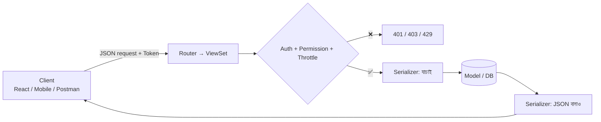
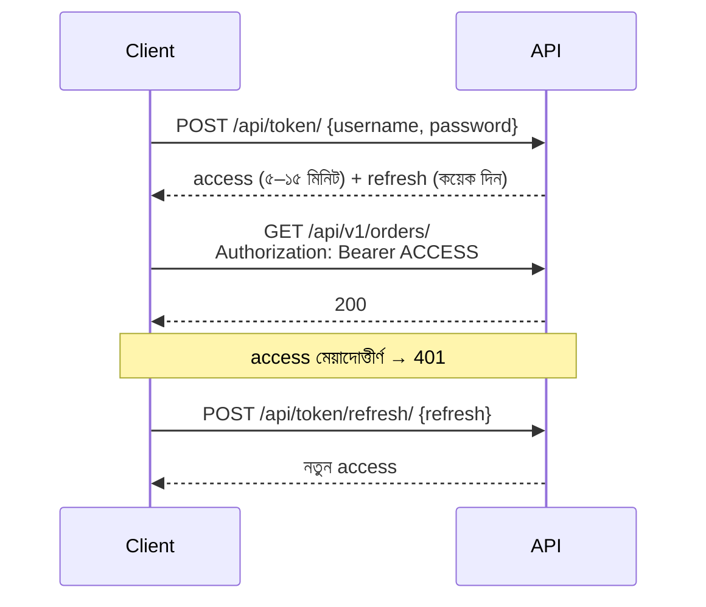

# Module 13 · REST API Development with DRF

> **Section 3 · Databases, Django & REST APIs** · ২টি Live Class
> ⭐ **প্রজেক্ট:** Public REST API

## 🎯 লক্ষ্য

নিজের product-কে একটা পরিষ্কার, নিরাপদ **REST API**-তে রূপ দেওয়া — Django REST Framework (DRF) দিয়ে serializer, viewset, router, JWT authentication, permission, throttling, pagination, filtering, versioning, CORS ও ধারাবাহিক error response সহ।

## 📖 গল্প: রেস্টুরেন্টের মেনু-কার্ড ও ওয়েটার

এতদিন তোমার দোকান শুধু নিজের ঘরে (ওয়েব পাতা) বিক্রি করত। এখন তুমি **জানালা খুললে** — বাইরের যে কেউ (মোবাইল অ্যাপ, React frontend, অন্য সার্ভিস) নির্দিষ্ট ফরম্যাটে চাইতে পারে। **API** হলো সেই জানালা, **serializer** হলো অনুবাদক (Python object ↔ JSON), আর **permission/throttle** হলো জানালার পাহারাদার — কে চাইতে পারবে, কত ঘন ঘন।



---

## 🧠 Live Class 1 · Serializers and ViewSets

### Web page বনাম API

| Web পাতা | API |
|---|---|
| HTML ফেরত | JSON ফেরত |
| মানুষের জন্য | প্রোগ্রামের জন্য |
| redirect, form | status code, JSON error |

### REST নীতি ও Resource ডিজাইন

**Resource = noun**, **method = verb**:

| কাজ | Method + URL |
|---|---|
| তালিকা | `GET /api/v1/products/` |
| একটা | `GET /api/v1/products/42/` |
| তৈরি | `POST /api/v1/products/` |
| সম্পাদনা | `PATCH /api/v1/products/42/` |
| মুছো | `DELETE /api/v1/products/42/` |
| নেস্টেড | `GET /api/v1/orders/7/items/` |

❌ `/api/getProducts`, `/api/deleteProduct?id=3` — ক্রিয়া URL-এ নয়।

### DRF ইনস্টল

```bash
pip install djangorestframework djangorestframework-simplejwt django-filter django-cors-headers
```

```python
INSTALLED_APPS += ["rest_framework", "corsheaders", "django_filters"]
```

### Serializer

```python
# shop/serializers.py
from rest_framework import serializers
from .models import Product, Category

class CategorySerializer(serializers.ModelSerializer):
    class Meta:
        model = Category
        fields = ["id", "name"]

class ProductSerializer(serializers.ModelSerializer):
    category = CategorySerializer(read_only=True)                   # nested — পড়ার জন্য
    category_id = serializers.PrimaryKeyRelatedField(               # লেখার জন্য শুধু id
        queryset=Category.objects.all(), source="category", write_only=True
    )

    class Meta:
        model = Product
        fields = ["id", "name", "price", "stock", "status", "category", "category_id"]
        read_only_fields = ["id"]

    def validate_price(self, value):                                # field validation
        if value <= 0:
            raise serializers.ValidationError("দাম শূন্যের বেশি হতে হবে")
        return value

    def validate(self, attrs):                                      # object validation
        if attrs.get("status") == "active" and attrs.get("stock", 0) == 0:
            raise serializers.ValidationError("স্টক ছাড়া পণ্য সক্রিয় করা যাবে না")
        return attrs
```

> **কখন nested serializer এড়াবে:** লেখার সময় (জটিল), আর বড় তালিকায় (N+1!)। `select_related` ভুলো না।

### ViewSet ও Router

```python
# shop/views.py
from rest_framework import viewsets, permissions

class ProductViewSet(viewsets.ModelViewSet):
    serializer_class = ProductSerializer
    permission_classes = [permissions.IsAuthenticatedOrReadOnly]

    def get_queryset(self):
        return Product.objects.select_related("category").filter(status="active")

# shop/urls.py
from rest_framework.routers import DefaultRouter
router = DefaultRouter()
router.register("products", ProductViewSet, basename="product")
urlpatterns = router.urls
```

একটা `ModelViewSet` পাঁচটা endpoint দেয় (list, create, retrieve, update, destroy)। চাইলে `APIView`, generic view (`ListAPIView` ইত্যাদি) ব্যবহার করে নিয়ন্ত্রণ বাড়াতে পারো।

### Browser ও Postman-এ endpoint পরীক্ষা

DRF-এর **Browsable API** (browser-এ URL খুলে) আর **Postman** — দুটোতেই চেষ্টা করো।

---

## 🧠 Live Class 2 · Securing and Shaping the API

### JWT Authentication



```python
# settings.py
REST_FRAMEWORK = {
    "DEFAULT_AUTHENTICATION_CLASSES": [
        "rest_framework_simplejwt.authentication.JWTAuthentication",
    ],
    "DEFAULT_PERMISSION_CLASSES": ["rest_framework.permissions.IsAuthenticated"],
    "DEFAULT_PAGINATION_CLASS": "rest_framework.pagination.PageNumberPagination",
    "PAGE_SIZE": 20,
    "DEFAULT_THROTTLE_CLASSES": [
        "rest_framework.throttling.AnonRateThrottle",
        "rest_framework.throttling.UserRateThrottle",
    ],
    "DEFAULT_THROTTLE_RATES": {"anon": "30/min", "user": "120/min"},
    "DEFAULT_FILTER_BACKENDS": [
        "django_filters.rest_framework.DjangoFilterBackend",
        "rest_framework.filters.SearchFilter",
        "rest_framework.filters.OrderingFilter",
    ],
}
```

**Access ছোট মেয়াদ, refresh বড় মেয়াদ কেন?** access token চুরি হলেও ক্ষতির সময়সীমা ছোট।

### Custom permission (object-level)

```python
from rest_framework import permissions

class IsOwner(permissions.BasePermission):
    def has_object_permission(self, request, view, obj):
        return obj.owner == request.user
```

আর `get_queryset()`-এ `.filter(owner=self.request.user)` — **দুটোই** করো (permission + queryset ফিল্টার)।

### Throttling ও Pagination

- **Throttle:** অপব্যবহার ঠেকায় (`429 Too Many Requests`)
- **Pagination strategy:** page-number (সহজ), cursor (বড়/বদলাতে থাকা ডাটায় ভালো)

### Filtering, Search, Ordering

```text
GET /api/v1/products/?category=3&search=পাঞ্জাবি&ordering=-price&page=2
```

```python
class ProductViewSet(viewsets.ModelViewSet):
    filterset_fields = ["category", "status"]
    search_fields = ["name"]
    ordering_fields = ["price", "created_at"]
```

### API versioning

`/api/v1/...` — ভবিষ্যতে breaking change হলে `/v2/` বানাও, পুরোনো client না ভেঙে।

### CORS

Browser নিরাপত্তা-নীতি: এক origin-এর JS অন্য origin-এ request করতে গেলে সার্ভারকে অনুমতি দিতে হয়।

```python
CORS_ALLOWED_ORIGINS = ["https://myfrontend.com", "http://localhost:3000"]
# ❌ CORS_ALLOW_ALL_ORIGINS = True  — production-এ নয়
```

### ধারাবাহিক error response

সব error একই ছাঁচে:

```json
{
  "error": {
    "code": "validation_error",
    "message": "দাম শূন্যের বেশি হতে হবে",
    "fields": {"price": ["দাম শূন্যের বেশি হতে হবে"]}
  }
}
```

DRF-এর `EXCEPTION_HANDLER` কাস্টমাইজ করে একই ফরম্যাট বজায় রাখো।

### Status code ঠিকঠাক

`201` তৈরির পর, `204` মোছার পর, `400` ভুল ইনপুট, `401` লগইন নেই, `403` অনুমতি নেই, `404` নেই, `429` throttle।

## ⚠️ সাধারণ ভুল

| ভুল | সমাধান |
|---|---|
| Nested serializer-এ N+1 | `select_related`/`prefetch_related` |
| শুধু permission class, queryset ফিল্টার নেই | দুটোই |
| Access token-এর মেয়াদ দিন-মাস | ছোট রাখো + refresh |
| `CORS_ALLOW_ALL_ORIGINS=True` | নির্দিষ্ট origin |
| URL-এ ক্রিয়া (`/getUser`) | noun + HTTP method |
| সব error 200 দিয়ে ফেরানো | সঠিক status code |

## ⭐ প্রজেক্ট: Public REST API

- [ ] CRUD endpoint, `/api/v1/` প্রিফিক্স সহ
- [ ] JWT login + refresh
- [ ] Object-level permission (নিজের ডাটা শুধু)
- [ ] Throttle, pagination, filter/search/ordering
- [ ] ধারাবাহিক error ফরম্যাট
- [ ] Postman/Browsable API-তে সব পরীক্ষা করা
- [ ] CORS সঠিকভাবে কনফিগার

## 🎤 Interview প্রশ্ন

1. REST-এর মূল নীতিগুলো কী?
2. `PUT` আর `PATCH`-এর পার্থক্য?
3. JWT কীভাবে কাজ করে? access ও refresh কেন আলাদা?
4. Serializer কী কাজ করে?
5. CORS কেন আছে? কীভাবে ঠিক করো?
6. Pagination-এ page-number বনাম cursor?

## 🔁 MERN / WordPress-এর সাথে তুলনা

| ধারণা | DRF | Express | WordPress REST API |
|---|---|---|---|
| Endpoint | ViewSet + Router | `router.get(...)` | `register_rest_route()` |
| Validation | Serializer | Joi / Zod | `args` + `validate_callback` |
| Auth | JWT / Token | JWT middleware | Application Passwords / JWT plugin |
| Permission | `permission_classes` | middleware | `permission_callback` |

WordPress-এর `register_rest_route` + `permission_callback` — একই ধারণা। তোমার NestJS অভিজ্ঞতার `@Controller` + `Guards` + `DTO validation` = DRF-এর `ViewSet` + `permissions` + `Serializer`।
