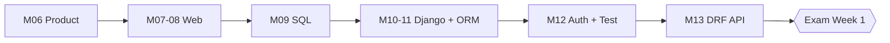

# Module 14 · Exam Week 1

> **Section 3 · Databases, Django & REST APIs** · অ্যাসাইনমেন্ট ও লাইভ টেস্ট
> **কভার করে:** Module 06 – Module 13

## 🎯 লক্ষ্য

এই সপ্তাহে নতুন কিছু শেখা নয় — **এতদিনে যা শিখেছি, নিজেকে ঝালিয়ে নেওয়া**। একটা বড় অ্যাসাইনমেন্ট আর একটা লাইভ টেস্ট। ক্লাসে যা বুঝিনি, এখনই ধরার সময়।

## 📖 গল্প: ম্যারাথনের মাঝপথে বিরতি

ম্যারাথনে মাঝে মাঝে পানির স্টেশন থাকে। দৌড় থামে না, কিন্তু একবার শ্বাস নিয়ে দেখে নেওয়া যায় — শরীর ঠিক আছে তো? জুতা ঠিক আছে তো? এই সপ্তাহও তাই। নতুন কিলোমিটার নয়, **এ পর্যন্ত পার হওয়া পথের পরীক্ষা**।

---

## 🧭 কী কী আসতে পারে — মডিউল ধরে ঝালাই

### Module 06 · Product Thinking
- [ ] MVP কী? এক পাতার spec-এর ছক মনে আছে?
- [ ] ব্যবহারকারীর want বনাম need

### Module 07 · HTTP ও HTML
- [ ] Request-response চক্র আঁকতে পারি
- [ ] Method (`GET/POST/PUT/PATCH/DELETE`), status code পরিবার
- [ ] Cookie vs Session, stateless
- [ ] Semantic HTML, accessible form

### Module 08 · CSS
- [ ] Box model, specificity
- [ ] Flexbox vs Grid কখন কোনটা
- [ ] Mobile-first media query

### Module 09 · SQL
- [ ] `INNER` vs `LEFT JOIN`
- [ ] `GROUP BY` + `HAVING`
- [ ] Index ও `EXPLAIN`
- [ ] Normalization (1NF–3NF), transaction

### Module 10 · Data Modeling + Django বেসিক
- [ ] ER diagram আঁকা, cardinality
- [ ] Django request lifecycle
- [ ] Project বনাম app, URL, view, template inheritance

### Module 11 · Models + ORM
- [ ] Model, migration, relationship
- [ ] **N+1 সমস্যা** — `select_related`/`prefetch_related`
- [ ] ModelForm, validation, Post/Redirect/Get
- [ ] Pagination, admin customization

### Module 12 · Auth + Testing
- [ ] Authentication বনাম authorization
- [ ] Object-level permission (IDOR)
- [ ] Django test client, কী test করব/করব না

### Module 13 · DRF
- [ ] Serializer, ViewSet, Router
- [ ] JWT: access/refresh
- [ ] Throttle, pagination, filtering, versioning, CORS

---

## 🧪 নিজে নিজে করার মক টেস্ট

নিচের কাজগুলো **AI ছাড়া**, টাইমার চালু রেখে (প্রতিটা ~৩০–৪৫ মিনিট) করে দেখো:

1. **SQL:** একটা e-commerce schema-তে "গত ৩০ দিনে সবচেয়ে বেশি বিক্রিত ৫ পণ্য" query লেখো।
2. **ORM:** এমন একটা view লেখো যেখানে ১০০টা পণ্যের category দেখানো হয় — query সংখ্যা ৩-এর বেশি হবে না।
3. **Auth:** একটা model-এর জন্য এমন view লেখো যেখানে user শুধু নিজের রেকর্ড দেখে। সাথে test লেখো যা প্রমাণ করে অন্য user দেখতে পায় না।
4. **DRF:** একটা resource-এর জন্য serializer + viewset + router লেখো, `price <= 0` হলে validation error দাও।
5. **Debug:** নিজের পুরোনো কোডে ইচ্ছাকৃত একটা N+1 ঢুকিয়ে অন্যজনকে খুঁজতে বলো।

## 🛠️ লাইভ টেস্টের কৌশল

1. **প্রথমে পুরো প্রশ্ন পড়ো**, তারপর কোডে হাত দাও
2. **ছোট করে ভাগ করো** — আগে সবচেয়ে সহজ অংশ কাজ করাও
3. **ধাপে ধাপে চালাও** — ২০ লাইন লিখে একবার চালাও, ২০০ লাইন লিখে নয়
4. আটকে গেলে **জোরে বলো** তুমি কী ভাবছ — instructor-এর কাছে যুক্তিটাও নম্বর পায়
5. Error message **পড়ো** — অর্ধেক সমাধান ওখানেই লেখা

## ⚠️ সাধারণ ভুল (পরীক্ষায়)

| ভুল | সমাধান |
|---|---|
| প্রশ্ন ভালো করে না পড়েই শুরু | আগে ২ মিনিট পড়ো |
| ছোট জিনিসে আটকে বড়টা বাদ | আটকে গেলে এগিয়ে যাও, পরে ফিরো |
| শেষে চালিয়ে দেখা | বারবার ছোট ছোট চালাও |
| Test লেখা ভুলে যাওয়া | অন্তত একটা গুরুত্বপূর্ণ test দাও |

## ⭐ অ্যাসাইনমেন্ট চেকলিস্ট

- [ ] নিজের product-এর API কাজ করছে (`Module 13` পর্যন্ত)
- [ ] সব test সবুজ
- [ ] README আপডেট করা (কীভাবে চালাতে হয়)
- [ ] কোড পরিষ্কার, secret নেই (`.env` ignored)
- [ ] ব্যাখ্যা করতে পারি: "কেন এভাবে করলাম?"

## 🎤 নিজেকে যাচাই

নিজের ভাষায়, বই না দেখে, ১ মিনিটে ব্যাখ্যা করতে পারো?

1. Browser-এ URL লিখে Enter চাপলে কী কী ঘটে?
2. N+1 কী? কীভাবে ঠিক করো?
3. IDOR কী? কীভাবে ঠেকাও?
4. JWT-র access আর refresh আলাদা কেন?
5. Normalization কেন করি?

## 🔁 নোট

এটা পরীক্ষা, কিন্তু লক্ষ্য নম্বর নয় — লক্ষ্য হলো ধারণাগুলো সত্যি **হাতে বসেছে** কিনা সেটা জানা। যেখানে আটকাবে, সেটাই পরের সপ্তাহের পড়ার তালিকা।
