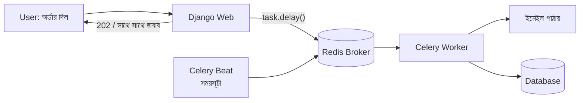

# Module 15 · API Quality and Background Jobs

> **Section 4 · Background Jobs & Security** · ২টি Live Class + ১টি DSA Class
> ⭐ **প্রজেক্ট:** API Docs + Postman Collection + Asynchronous Task System

## 🎯 লক্ষ্য

API-র মান প্রমাণ করা (automated API test, auto-generated docs, Postman collection) আর **ধীর কাজকে request-এর বাইরে পাঠানো** — Redis ও Celery দিয়ে background task, scheduled task, retry, আর caching।

## 📖 গল্প: রেস্টুরেন্টের কাউন্টার ও রান্নাঘর

ক্যাশিয়ার অর্ডার নিয়ে বলল "আপনার নম্বর ৪২, ডাকলে আসবেন" — গ্রাহক সাথে সাথে ছাড়া পেল। রান্না হচ্ছে পেছনে। যদি ক্যাশিয়ার নিজেই রান্না করত, লাইনে সবাই দাঁড়িয়ে থাকত। এটাই **async processing**: web request (কাউন্টার) দ্রুত জবাব দেয়, ভারী কাজ (ইমেইল পাঠানো, রিপোর্ট বানানো) **worker** (রান্নাঘর) করে। মাঝের টিকিট-র‍্যাক হলো **broker (Redis)**।



---

## 🧠 Live Class 1 · Proving and Publishing the API

### Automated API test

```python
# shop/tests/test_api.py
from rest_framework.test import APITestCase
from django.urls import reverse

class ProductAPITests(APITestCase):
    def setUp(self):
        self.user = User.objects.create_user("alice", password="pass12345")
        self.other = User.objects.create_user("bob", password="pass12345")

    def auth(self, user):
        res = self.client.post(reverse("token_obtain_pair"),
                               {"username": user.username, "password": "pass12345"})
        self.client.credentials(HTTP_AUTHORIZATION=f"Bearer {res.data['access']}")

    def test_authenticated_create(self):
        self.auth(self.user)
        res = self.client.post("/api/v1/products/", {"name": "কলম", "price": "10.00",
                                                     "stock": 5, "category_id": 1})
        self.assertEqual(res.status_code, 201)

    def test_invalid_price_returns_400(self):          # error response test
        self.auth(self.user)
        res = self.client.post("/api/v1/products/", {"name": "x", "price": "-5"})
        self.assertEqual(res.status_code, 400)

    def test_other_user_cannot_see_my_orders(self):    # permission boundary
        self.auth(self.other)
        res = self.client.get("/api/v1/orders/")
        self.assertEqual(len(res.data["results"]), 0)

    def test_unauthenticated_gets_401(self):
        res = self.client.get("/api/v1/orders/")
        self.assertEqual(res.status_code, 401)
```

যা test করতেই হবে: **authenticated endpoint**, **permission সীমা**, **error response**।

### Auto-generated API docs

```bash
pip install drf-spectacular
```

```python
REST_FRAMEWORK["DEFAULT_SCHEMA_CLASS"] = "drf_spectacular.openapi.AutoSchema"

# urls.py
from drf_spectacular.views import SpectacularAPIView, SpectacularSwaggerView
urlpatterns += [
    path("api/schema/", SpectacularAPIView.as_view(), name="schema"),
    path("api/docs/", SpectacularSwaggerView.as_view(url_name="schema")),
]
```

> **ডকুমেন্টেশন অন্যজন বোঝার মতো লেখো:** কোনো প্রশ্ন ছাড়া একজন বাইরের মানুষ যেন তোমার API ব্যবহার করতে পারে। উদাহরণ request/response সহ।

### Postman collection

- **Environment variable:** `{{base_url}}`, `{{access_token}}` — dev/staging/production-এ একই collection চলে
- **Factory pattern:** প্রথমে "login" request চালিয়ে token সেভ করার script, পরে সব request-এ সেই token
- **অন্য learner-কে collection দিয়ে চালাতে বলো** — যদি সে আটকে যায়, তোমার ডকুমেন্টেশন অসম্পূর্ণ

---

## 🧠 Live Class 2 · Work That Happens Later

### কেন request-এর ভেতর ভারী কাজ নয়?

```python
# ❌ ব্যবহারকারী ৫ সেকেন্ড বসে থাকে, SMTP ধীর হলে timeout
def checkout(request):
    order = create_order(...)
    send_confirmation_email(order)          # ধীর!
    return Response(...)
```

Synchronous = কাজ শেষ না হওয়া পর্যন্ত জবাব নেই। Asynchronous = কাজ রেখে এসে সাথে সাথে জবাব।

### Redis ও Celery সেটআপ

```bash
pip install celery redis
docker run -d -p 6379:6379 redis        # Redis চালু
```

```python
# config/celery.py
import os
from celery import Celery

os.environ.setdefault("DJANGO_SETTINGS_MODULE", "config.settings")
app = Celery("config")
app.config_from_object("django.conf:settings", namespace="CELERY")
app.autodiscover_tasks()

# config/__init__.py
from .celery import app as celery_app
__all__ = ("celery_app",)

# settings.py
CELERY_BROKER_URL = os.environ.get("REDIS_URL", "redis://localhost:6379/0")
```

### Task লেখা ও ডাকা

```python
# shop/tasks.py
from celery import shared_task
from django.core.mail import send_mail

@shared_task(bind=True, autoretry_for=(Exception,), retry_backoff=True, max_retries=3)
def send_order_confirmation(self, order_id):
    order = Order.objects.select_related("owner").get(pk=order_id)   # id পাঠাও, object নয়!
    send_mail("অর্ডার নিশ্চিত", f"অর্ডার #{order.pk}", None, [order.owner.email])
```

```python
# view
def checkout(request):
    order = create_order(...)
    send_order_confirmation.delay(order.pk)      # কিউতে রাখো, ফিরে এসো
    return Response({"status": "ok"}, status=201)
```

> ⚠️ Task-এ **model object নয়, id** পাঠাও। Object serialize হয়ে পুরোনো/ভুল হয়ে যেতে পারে।
> ⚠️ Task **idempotent** রাখো — দুবার চললেও যেন ক্ষতি না হয় (ডবল ইমেইল/ডবল চার্জ)।

```bash
celery -A config worker -l info       # worker
celery -A config beat -l info         # scheduler
```

### Scheduled / Periodic task (Celery Beat)

```python
CELERY_BEAT_SCHEDULE = {
    "daily-low-stock-report": {
        "task": "shop.tasks.low_stock_report",
        "schedule": crontab(hour=8, minute=0),
    },
}
```

### Retry ও ব্যর্থতা সামলানো

Retry-এর সাথে **exponential backoff**। চূড়ান্ত ব্যর্থ হলে লগ/অ্যালার্ট। Queue পর্যবেক্ষণ করতে **Flower**।

### Caching

```python
CACHES = {
    "default": {
        "BACKEND": "django.core.cache.backends.redis.RedisCache",
        "LOCATION": os.environ.get("REDIS_URL", "redis://localhost:6379/1"),
    }
}
```

```python
from django.core.cache import cache

def popular_products():
    data = cache.get("popular_products")
    if data is None:
        data = list(Product.objects.annotate(...)[:10].values())   # ধীর query
        cache.set("popular_products", data, timeout=300)           # ৫ মিনিট
    return data
```

**Cache invalidation** (সবচেয়ে কঠিন অংশ): ডাটা বদলালে cache মুছো — `cache.delete("popular_products")`। না করলে পুরোনো ডাটা দেখাবে।

বিকল্প: `@cache_page(60)` পুরো view-এর জন্য, template fragment cache।

### 🛠️ Build

- অর্ডার করলে **asynchronously confirmation email**
- **সবচেয়ে ধীর পাতা cache** করো (আগে `django-debug-toolbar` দিয়ে খুঁজে বের করো কোনটা ধীর)

---

## 🧩 DSA Class 5 · Sorting

Bubble · Selection · Insertion · Merge · Quick sort, আর **Binary search ও তার variant**।

```python
# Merge sort — O(n log n), stable
def merge_sort(arr):
    if len(arr) <= 1:
        return arr
    mid = len(arr) // 2
    left, right = merge_sort(arr[:mid]), merge_sort(arr[mid:])
    merged, i, j = [], 0, 0
    while i < len(left) and j < len(right):
        if left[i] <= right[j]:
            merged.append(left[i]); i += 1
        else:
            merged.append(right[j]); j += 1
    return merged + left[i:] + right[j:]

# Binary search — sorted array-তে O(log n)
def binary_search(arr, target):
    lo, hi = 0, len(arr) - 1
    while lo <= hi:
        mid = (lo + hi) // 2
        if arr[mid] == target:
            return mid
        if arr[mid] < target:
            lo = mid + 1
        else:
            hi = mid - 1
    return -1
```

| Sort | গড় | সবচেয়ে খারাপ |
|---|---|---|
| Bubble / Selection / Insertion | O(n²) | O(n²) |
| Merge | O(n log n) | O(n log n) |
| Quick | O(n log n) | O(n²) |

বাস্তবে Python-এর বিল্ট-ইন `sorted()` (Timsort) ব্যবহার করো — তবে ইন্টারভিউয়ে নিজে লিখতে হয়।

## ⚠️ সাধারণ ভুল

| ভুল | সমাধান |
|---|---|
| Task-এ model object পাঠানো | `order_id` পাঠাও |
| Task idempotent নয় | দুবার চললে কী হবে ভাবো |
| Cache invalidate না করা | ডাটা বদলালে cache মুছো |
| সব কিছু cache করা | শুধু ধীর ও কম বদলায় এমন জিনিস |
| Redis চালু না রেখে Celery চালানো | আগে Redis, তারপর worker |
| API docs নিজের জন্য লেখা | অন্যজন কি বুঝবে? পরীক্ষা করাও |

## ⭐ প্রজেক্ট: API Docs + Postman + Async Task System

- [ ] Automated API test (auth, permission, error) সব পাস
- [ ] Swagger/OpenAPI docs live
- [ ] Postman collection + environment, অন্য একজন চালিয়ে দেখেছে
- [ ] Celery + Redis দিয়ে async confirmation email
- [ ] অন্তত একটা periodic task (Beat)
- [ ] সবচেয়ে ধীর পাতা cache করে আগে-পরে সময় মাপা

## 🎤 Interview প্রশ্ন

1. Synchronous বনাম asynchronous processing?
2. Celery-র আর্কিটেকচার (producer, broker, worker, result backend) বোঝাও।
3. Idempotent task কেন গুরুত্বপূর্ণ?
4. Cache invalidation কেন কঠিন?
5. Merge sort ও quick sort তুলনা করো।
6. Binary search-এর শর্ত কী?

## 🔁 MERN / WordPress-এর সাথে তুলনা

| ধারণা | Celery | Node.js | WordPress |
|---|---|---|---|
| Background job | Celery task | BullMQ / Agenda | Action Scheduler / WP-Cron |
| Broker | Redis / RabbitMQ | Redis | ডাটাবেস (wp_options/table) |
| Scheduled | Celery Beat | node-cron / BullMQ repeat | `wp_schedule_event` |
| Cache | Redis cache | Redis / node-cache | Transients / object cache |

WP-Cron-এর সীমাবদ্ধতা (page visit-এ ট্রিগার হয়, সময়মতো নয়) আছে — Celery Beat সত্যিকারের scheduler।
