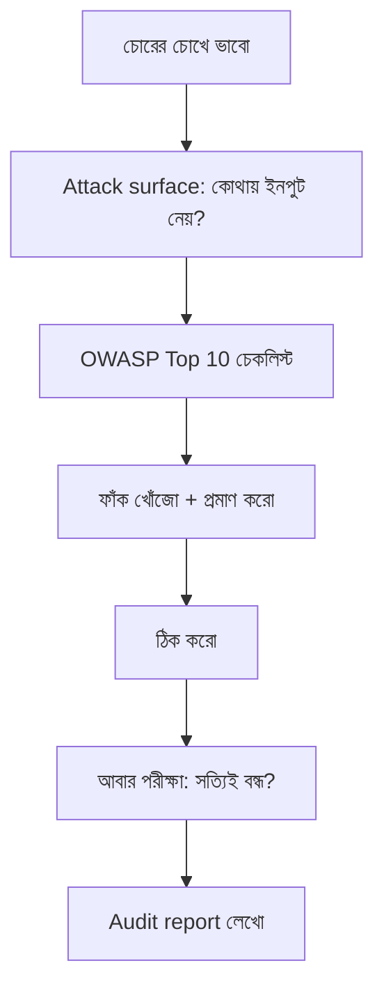

# Module 16 · Web Application Security

> **Section 4 · Background Jobs & Security** · ২টি Live Class
> ⭐ **প্রজেক্ট:** Vulnerability Hunt + Security Audit Report + 🚧 **GATE 2**

## 🎯 লক্ষ্য

আক্রমণকারী কীভাবে ভাবে তা বোঝা — OWASP Top 10, Django-র সুরক্ষা কোথায় আপনা-আপনি কাজ করে আর কোথায় করে না, একটা ইচ্ছাকৃতভাবে দুর্বল Django app ভেঙে দেখা, তারপর **নিজের product-এর security audit** করে ঠিক করা। GATE 2-তে audit ও tested API রক্ষা (defend) করতে হবে।

## 📖 গল্প: চোরের চোখ দিয়ে নিজের বাড়ি দেখা

তুমি তালা কিনেছ, কিন্তু চোর কখনো দরজায় যায় না — সে জানালা, বারান্দার পাইপ, চাবি লুকানো পাপোশ খোঁজে। নিরাপত্তা শেখা মানে **চোর হয়ে নিজের বাড়ি ঘুরে দেখা**। তারপর সবচেয়ে সহজ ফাঁক আগে বন্ধ করা।



---

## 🧠 Live Class 1 · How Applications Get Broken

### OWASP Top 10 — Django-র ভাষায়

OWASP হলো ওয়েব অ্যাপের সবচেয়ে সাধারণ ঝুঁকির তালিকা। এখানে ক্লাসের মূল ফাঁকগুলো:

#### ১. Cross-Site Scripting (XSS)

আক্রমণকারী তোমার পাতায় নিজের JavaScript ঢুকিয়ে দেয়।

- **Stored:** ডাটাবেসে সেভ হয়ে সবার কাছে চলে (কমেন্টে `<script>...</script>`)
- **Reflected:** URL-এ থাকে, ফেরত আসে
- **Django-র সুরক্ষা:** template **ডিফল্টে escape করে** — `{{ comment }}` নিরাপদ

```django
{{ comment }}                  {# ✅ নিরাপদ — escape হয় #}
{{ comment|safe }}             {# ❌ বিপজ্জনক — যাচাই ছাড়া কখনো নয় #}
...   {# ❌ #}
```

> `mark_safe()`, `|safe` ব্যবহারের আগে ১০ বার ভাবো — ব্যবহারকারীর ইনপুট হলে কখনোই নয়।

#### ২. SQL Injection

```python
# ❌ ভয়ংকর: ইনপুট সরাসরি SQL-এ
name = request.GET["name"]
Product.objects.raw(f"SELECT * FROM shop_product WHERE name = '{name}'")
# name = "x' OR '1'='1"  → সব ডাটা বেরিয়ে আসে

# ✅ ORM বা parameterized query
Product.objects.filter(name=name)
Product.objects.raw("SELECT * FROM shop_product WHERE name = %s", [name])
```

**কিন্তু শুধু ORM ব্যবহার করলেই স্বয়ংক্রিয় নিরাপত্তা নয়** — `.raw()`, `.extra()`, `cursor.execute(f"...")`-এ আবার ঝুঁকি।

#### ৩. CSRF (Cross-Site Request Forgery)

ব্যবহারকারী লগইন থাকা অবস্থায় অন্য সাইট তার হয়ে লুকিয়ে request পাঠায়। Django-র সুরক্ষা: `` + middleware। API-তে JWT header ব্যবহার করলে CSRF সমস্যা কম (কিন্তু cookie-based auth হলে আছে)।

#### ৪. Broken Access Control / IDOR

```python
# ❌ /orders/5/ বদলে /orders/6/ লিখলেই অন্যের অর্ডার
Order.objects.get(pk=pk)
# ✅
get_object_or_404(Order, pk=pk, owner=request.user)
```

#### ৫. Authentication দুর্বলতা

- দুর্বল পাসওয়ার্ড অনুমোদন, brute force-এ বাধা নেই, session মেয়াদ অসীম
- ঠিক: `AUTH_PASSWORD_VALIDATORS`, rate limit, লগইন ব্যর্থতার লগ

#### ৬. Security Misconfiguration

`DEBUG=True` production-এ → stack trace, settings, SQL প্রকাশ পায়।

### 🔬 Live demonstration

Instructor একটা **ইচ্ছাকৃতভাবে দুর্বল Django app** ভাঙবেন। তুমি দেখবে কীভাবে ৫ মিনিটে একটা XSS বা IDOR দিয়ে আসল ডাটা বের হয়।

### 🔎 Vulnerability Hunt

Learner-দের দেওয়া হবে একটা কোডবেস — তাতে **লুকানো দুর্বলতা** (planted vulnerability) আছে। খুঁজে বের করতে হবে।

খোঁজার পদ্ধতি:
1. যেখানে **ইনপুট আসে** (form, URL, header, file upload) সেগুলোর তালিকা করো
2. প্রতিটা ইনপুট **কোথায় যায়** অনুসরণ করো (SQL? HTML? ফাইল পাথ?)
3. **কী যাচাই হচ্ছে না?** — সেটাই ফাঁক

---

## 🧠 Live Class 2 · Securing Your Own Product

### ডিপ্লয়মেন্ট চেকলিস্ট

```bash
python manage.py check --deploy         # Django নিজেই ঝুঁকি দেখায়
```

```python
# settings.py (production)
DEBUG = False
ALLOWED_HOSTS = ["myproduct.com"]
SECRET_KEY = os.environ["DJANGO_SECRET_KEY"]       # কোডে নয়, Git-এ নয়

# HTTPS ও cookie
SECURE_SSL_REDIRECT = True
SESSION_COOKIE_SECURE = True
CSRF_COOKIE_SECURE = True
SESSION_COOKIE_HTTPONLY = True                      # JS cookie পড়তে পারবে না
SECURE_HSTS_SECONDS = 31536000
SECURE_CONTENT_TYPE_NOSNIFF = True
X_FRAME_OPTIONS = "DENY"                            # clickjacking বন্ধ
```

### Secret ও Environment variable

- `.env` ফাইল → `.gitignore`-এ
- **Git-এ credential না রাখা:** একবার push হলে ইতিহাস থেকেও বেরোয়। হয়ে গেলে → সাথে সাথে key **বদলাও (rotate)**, ইতিহাস মুছে ফেললেও আগে কেউ কপি করে থাকতে পারে
- `git-secrets` / `gitleaks` / GitHub secret scanning ব্যবহার করো

### Input validation ও sanitization

- Server-side যাচাই **সবসময়** (client validation শুধু সুবিধা)
- Allow-list (কী অনুমোদিত) > Block-list (কী নিষিদ্ধ)
- ফর্ম/Serializer-এ type, length, range

### File upload ঝুঁকি

```python
# ✅ extension + আসল content type + আকার সীমা + আলাদা storage
ALLOWED = {"image/jpeg", "image/png"}
if upload.content_type not in ALLOWED or upload.size > 2 * 1024 * 1024:
    raise ValidationError("অনুমোদিত নয়")
```
- ফাইলের নাম নিজে বানাও (ব্যবহারকারীর দেওয়া নামে `../../etc` আক্রমণ)
- আপলোড করা ফাইল কখনো **চালানো** হয় না, শুধু সংরক্ষণ

### Rate limiting ও Brute force সুরক্ষা

- DRF throttle (Module 13) — বিশেষ করে `/login/`, `/password-reset/`-এ কড়া
- `django-axes` দিয়ে বারবার ভুল লগইনে লক

### Dependency vulnerability

```bash
pip install pip-audit
pip-audit                       # পুরোনো/ঝুঁকিপূর্ণ প্যাকেজ খোঁজে
```
GitHub Dependabot চালু রাখো।

### Security event লগ

কে কখন লগইন করল, কতবার ব্যর্থ হলো, কে admin-এ ঢুকল — লগ করো (কিন্তু **password, token লগে লিখো না**)।

### 🛡️ প্রত্যেকে নিজের product audit করবে

| ধাপ | কাজ |
|---|---|
| ১ | `manage.py check --deploy` চালাও |
| ২ | প্রতিটা ইনপুট ও endpoint-এর তালিকা |
| ৩ | IDOR পরীক্ষা: অন্য user হিসেবে ID বদলে দেখো |
| ৪ | `|safe`, `.raw()`, `mark_safe` খোঁজো (`grep`) |
| ৫ | `.env`, secret ইতিহাসে আছে কিনা |
| ৬ | `pip-audit` |
| ৭ | যা পেলে ঠিক করো, আবার পরীক্ষা করো |

### Audit রিপোর্টের ছক

```markdown
## Finding #1: IDOR in /api/v1/orders/<id>/
- **তীব্রতা:** High
- **কীভাবে পুনরুৎপাদন:** user B-র token দিয়ে user A-র order ID চাইলে ডাটা পাওয়া যায়
- **প্রভাব:** যে কেউ যেকোনো গ্রাহকের অর্ডার দেখতে পারে
- **সমাধান:** queryset-এ `owner=request.user`
- **যাচাই:** নতুন test `test_other_user_cannot_see_order` পাস
```

### 🚧 GATE 2 — Audit ও tested API রক্ষা (viva)

প্রশ্ন আসবে: "এই ফাঁকটা কীভাবে খুঁজলে? কেন বিপজ্জনক? কীভাবে ঠিক করলে? প্রমাণ কী?"

- [ ] প্রতিটা finding ব্যাখ্যা করতে পারি
- [ ] সমাধানের test দেখাতে পারি
- [ ] যা ঠিক করিনি, কেন তা বলতে পারি

## ⚠️ সাধারণ ভুল

| ভুল | সমাধান |
|---|---|
| `DEBUG=True` production-এ | `False` + `ALLOWED_HOSTS` |
| `SECRET_KEY` কোডে | environment variable |
| `|safe` ইনপুটে | ব্যবহার না করা |
| "ORM আছে তাই SQLi নেই" | `.raw()` খেয়াল |
| Secret Git-এ গেছে, ইতিহাস মুছেছি | **key বদলাও**, মোছা যথেষ্ট নয় |
| শুধু ফ্রন্টএন্ডে যাচাই | server-side-ও |

## ⭐ প্রজেক্ট: Security Audit Report + GATE 2

- [ ] Vulnerability Hunt-এ planted ফাঁক খুঁজে পাওয়া
- [ ] নিজের product-এর পূর্ণ audit
- [ ] অন্তত ৩টা finding ঠিক করা, প্রতিটার test সহ
- [ ] `check --deploy` পরিষ্কার
- [ ] লিখিত রিপোর্ট (উপরের ছক)
- [ ] 🚧 GATE 2 পাস

## 🎤 Interview প্রশ্ন

1. XSS কী? Django কীভাবে সুরক্ষা দেয়? কোথায় দেয় না?
2. SQL Injection কীভাবে ঘটে? ORM কি সম্পূর্ণ নিরাপদ?
3. CSRF কী? কীভাবে ঠেকাও?
4. IDOR কী? উদাহরণ দাও।
5. Production-এ secret key Git-এ গেলে কী করবে?
6. Password কীভাবে সংরক্ষণ করা উচিত?

## 🔁 MERN / WordPress-এর সাথে তুলনা

| ঝুঁকি | Django | Express | WordPress |
|---|---|---|---|
| XSS | template auto-escape | `helmet` + নিজে escape | `esc_html()`, `esc_attr()`, `wp_kses()` |
| SQLi | ORM / parameterized | Mongoose (NoSQL injection আছে!) | `$wpdb->prepare()` |
| CSRF | `` | `csurf` / SameSite | nonce (`wp_nonce_field`) |
| ইনপুট | Form / Serializer | Joi / Zod | `sanitize_text_field()` |

WordPress plugin কাজে `esc_*`, `sanitize_*`, `$wpdb->prepare`, nonce — এই চারটাই এখানকার ধারণার সরাসরি প্রতিরূপ। এই মডিউলের অভ্যাস তোমার plugin কাজকেও নিরাপদ করবে।
