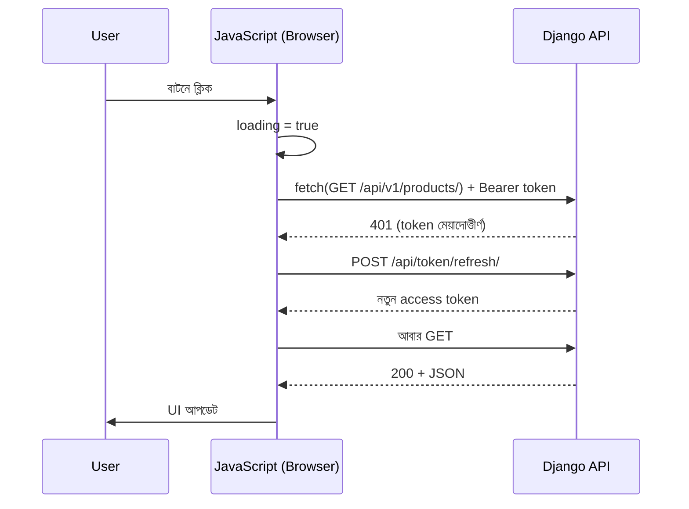

# Module 17 · JavaScript and API Integration

> **Section 5 · JavaScript & React** · ২টি Live Class
> ⭐ **প্রজেক্ট:** Live Data Dashboard — নিজের API দিয়ে read ও write

## 🎯 লক্ষ্য

JavaScript-এর মূল জিনিস (variable, function, array method, destructuring, DOM, event, Promise, async/await, fetch) দ্রুত ঝালিয়ে, **ব্রাউজার থেকে নিজের DRF API ডাকা** — loading state, error handling, CORS, authentication token, expired token refresh সহ — আর একটা live dashboard বানানো।

## 📖 গল্প: দোকানের সামনের কাউন্টার

এতদিন তোমার দোকানের পেছনের গুদাম (Django + API) তৈরি করেছ। এখন সামনের **কাউন্টার** (browser UI) বানাচ্ছ। কাউন্টারের লোক (JavaScript) গ্রাহকের কথা শোনে (event), গুদামে ফোন করে (fetch), উত্তরের জন্য অপেক্ষা করে (async/await), আর সেই সময় "একটু অপেক্ষা করুন" লেখা ঝুলিয়ে রাখে (loading state)। গুদাম বলল "ভুল" — কাউন্টারকে বিনয়ের সাথে গ্রাহককে জানাতে হবে (error handling)।



---

## 🧠 Live Class 1 · JavaScript Essentials

> তুমি MERN শিখেছ, তাই এটা **দ্রুত ঝালাই**। যেটুকু ধুলো জমেছে ঝেড়ে নাও।

### Variable ও Type

```javascript
const name = "Rafsun";      // const — পুনরায় বসানো যাবে না (ডিফল্ট পছন্দ)
let count = 0;              // let — বদলাবে
// var — ব্যবহার করবে না (scope ঝামেলা)

console.log(typeof 42, typeof "hi", typeof null);   // "number" "string" "object" (!)
console.log("5" + 3, "5" - 3);                      // "53" 2 — type coercion
console.log(0 == "0", 0 === "0");                   // true false — সবসময় === ব্যবহার
```

### Function ও Arrow function

```javascript
function add(a, b) { return a + b; }
const add2 = (a, b) => a + b;                  // arrow
const greet = (name = "বন্ধু") => `হ্যালো ${name}`;   // default + template literal
```

### Array method — loop-এর বদলে

```javascript
const products = [
  { id: 1, name: "কলম", price: 10 },
  { id: 2, name: "খাতা", price: 50 },
  { id: 3, name: "ব্যাগ", price: 800 },
];

const names = products.map(p => p.name);               // রূপান্তর
const cheap = products.filter(p => p.price < 100);     // ছাঁকনি
const total = products.reduce((sum, p) => sum + p.price, 0);   // একটা মানে গুটিয়ে আনা
const bag = products.find(p => p.id === 3);            // প্রথম মিল
```

### Destructuring, Spread, Rest

```javascript
const { name, price } = products[0];
const [first, ...others] = products;
const updated = { ...products[0], price: 15 };        // কপি + বদল (মূলটা অক্ষত)
```

### DOM ও Event

```javascript
const list = document.querySelector("#product-list");
const btn  = document.querySelector("#load-btn");

btn.addEventListener("click", () => { /* ... */ });

// Event delegation — প্রতিটা item-এ listener না বসিয়ে parent-এ একটাই
list.addEventListener("click", (e) => {
  if (e.target.matches(".delete-btn")) {
    deleteProduct(e.target.dataset.id);
  }
});
```

> ⚠️ **XSS মনে রাখো (Module 16):** ব্যবহারকারীর ডাটা `innerHTML`-এ বসিও না। `textContent` ব্যবহার করো।

```javascript
li.textContent = product.name;          // ✅ নিরাপদ
li.innerHTML = product.name;            // ❌ ডাটায় <script> থাকলে বিপদ
```

### Callback → Promise → async/await

```javascript
// Callback — গভীরে গেলে "callback hell"
// Promise
fetch(url).then(res => res.json()).then(data => console.log(data)).catch(console.error);

// async/await — একই জিনিস, পড়তে সহজ
async function load() {
  try {
    const res = await fetch(url);
    const data = await res.json();
    console.log(data);
  } catch (err) {
    console.error(err);
  }
}
```

### Modules

```javascript
// api.js
export async function getProducts() { ... }
// main.js
import { getProducts } from "./api.js";
```
```html
<script type="module" src="main.js"></script>
```

---

## 🧠 Live Class 2 · Talking to Your Own API

### Browser থেকে নিজের DRF endpoint ডাকা

```javascript
const BASE = "http://127.0.0.1:8000/api/v1";

async function api(path, options = {}) {
  const token = sessionStorage.getItem("access");        // বা memory-তে (নিচে দেখো)
  const res = await fetch(`${BASE}${path}`, {
    ...options,
    headers: {
      "Content-Type": "application/json",
      ...(token && { Authorization: `Bearer ${token}` }),
      ...options.headers,
    },
  });

  if (res.status === 401) {                              // access মেয়াদোত্তীর্ণ?
    const ok = await refreshToken();
    if (ok) return api(path, options);                   // একবার আবার চেষ্টা
    window.location.href = "/login.html";
    return;
  }

  if (!res.ok) {                                         // ⚠️ fetch 404/500-এ throw করে না!
    const err = await res.json().catch(() => ({}));
    throw new Error(err?.error?.message || `ত্রুটি: ${res.status}`);
  }
  return res.status === 204 ? null : res.json();
}

async function refreshToken() {
  const refresh = sessionStorage.getItem("refresh");
  if (!refresh) return false;
  const res = await fetch(`${BASE}/token/refresh/`, {
    method: "POST",
    headers: { "Content-Type": "application/json" },
    body: JSON.stringify({ refresh }),
  });
  if (!res.ok) return false;
  const { access } = await res.json();
  sessionStorage.setItem("access", access);
  return true;
}
```

> ⚠️ **`fetch` কেবল network ব্যর্থ হলে reject করে।** `404`/`500` পেলেও `await fetch()` সফল দেখায় — তাই `res.ok` নিজে যাচাই করতে হয়।

### Loading ও Error state

```javascript
async function showProducts() {
  const box = document.querySelector("#products");
  box.textContent = "লোড হচ্ছে…";                       // loading
  try {
    const { results } = await api("/products/");
    box.replaceChildren(...results.map(renderCard));
    if (results.length === 0) box.textContent = "কোনো পণ্য নেই";   // empty state
  } catch (e) {
    box.textContent = `সমস্যা হয়েছে: ${e.message}`;     // error state
  }
}
```

**তিনটা অবস্থা সবসময় ভাবো:** loading · error · empty (আর সফল)।

### CORS — কেন আটকায়, কীভাবে খুলি

Browser `http://localhost:3000` থেকে `http://localhost:8000`-এ request গেলে **origin আলাদা** হওয়ায় ব্লক করে। সমাধান সার্ভারে:

```python
# Django: django-cors-headers
CORS_ALLOWED_ORIGINS = ["http://localhost:3000", "http://127.0.0.1:5500"]
```
Browser console-এ `blocked by CORS policy` দেখলে ঠিক এটাই কারণ। (সার্ভারের ভুল নয়, browser-এর নিরাপত্তা-নীতি।)

### Token কোথায় রাখব?

| জায়গা | নিরাপত্তা |
|---|---|
| `localStorage` | সহজ, কিন্তু XSS হলে চুরি যায় |
| `sessionStorage` | ট্যাব বন্ধে মুছে যায়, তবু XSS ঝুঁকি |
| Memory (JS variable) | সবচেয়ে নিরাপদ, refresh-এ হারায় |
| `HttpOnly` cookie | JS পড়তে পারে না — সবচেয়ে ভালো, তবে CSRF ভাবতে হয় |

ক্লাসে যেটা শেখানো হবে সেটা শেখার জন্য ঠিক, কিন্তু **production-এ ঝুঁকি বুঝে বেছে নাও**।

### 🛠️ Build: নিজের API দিয়ে read ও write করা live dashboard

- লগইন → token সংরক্ষণ
- পণ্যের তালিকা (read), নতুন পণ্য যোগ (write), মুছে ফেলা (delete)
- loading / error / empty তিনটাই দেখায়
- Token মেয়াদোত্তীর্ণ হলে নিজে refresh করে

## ⚠️ সাধারণ ভুল

| ভুল | সমাধান |
|---|---|
| `res.ok` না দেখে `.json()` | আগে `res.ok` |
| `innerHTML`-এ ডাটা | `textContent` |
| `==` ব্যবহার | `===` |
| CORS error দেখে সার্ভার খুঁজে হয়রান | `CORS_ALLOWED_ORIGINS` |
| Token `localStorage`-এ রেখে নিশ্চিন্ত | XSS ঝুঁকি মনে রাখো |
| `await` ছাড়া async function ডাকা | Promise পাবে, ডাটা নয় |

## ⭐ প্রজেক্ট: Live Data Dashboard

- [ ] নিজের DRF API থেকে ডাটা পড়ে ও লেখে
- [ ] Bearer token + expired token refresh
- [ ] Loading / error / empty state
- [ ] `innerHTML`-এ অবিশ্বস্ত ডাটা নেই
- [ ] CORS ঠিকভাবে কনফিগার করা

## 🎤 Interview প্রশ্ন

1. `let`, `const`, `var`-এর পার্থক্য?
2. `==` vs `===`?
3. Promise আর async/await-এর সম্পর্ক?
4. `fetch` কখন reject করে, কখন করে না?
5. CORS কী? কেন আছে?
6. `map`, `filter`, `reduce` কখন কোনটা?
7. Event delegation কী?

## 🔁 MERN / WordPress-এর সাথে তুলনা

এই মডিউল তোমার MERN জ্ঞানের **সবচেয়ে কাছের**। `fetch` + `async/await` + DOM — সবই আগে থেকে জানা। নতুন যা পাবে: **নিজের Django API-র সাথে token refresh flow সম্পূর্ণ হাতে লেখা**। WordPress-এ `wp.apiFetch` (Gutenberg/Admin AJAX) একই ধারণা — nonce বা JWT সহ REST endpoint ডাকা।
