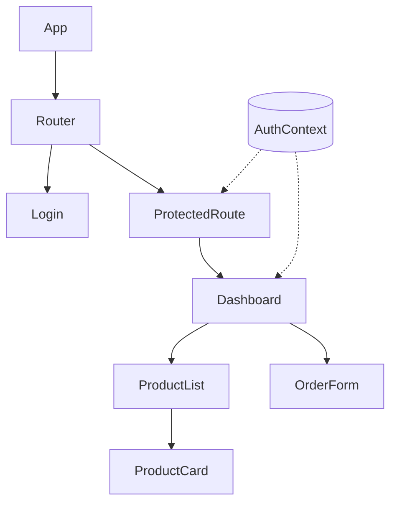

# Module 18 · React and Full Stack Integration

> **Section 5 · JavaScript & React** · ২টি Live Class + ১টি DSA Class
> ⭐ **প্রজেক্ট:** Customer Web App (React), fully deployed

## 🎯 লক্ষ্য

React-এর ধারণা (component, props, state, hooks) বোঝা, React Router দিয়ে একাধিক পাতা, form ও validation, data fetching, **protected route**, আর শেষে নিজের Django API-র সাথে জুড়ে production-এ deploy করা একটা পূর্ণ **Customer Web App**।

## 📖 গল্প: লেগো ব্লক

আগে প্রতিটা পাতা নতুন করে হাতে গড়তে হতো — একই বাটন দশ জায়গায় কপি-পেস্ট। React হলো **লেগো**: একবার একটা "ProductCard" ব্লক বানাও, যত জায়গায় দরকার বসাও। ব্লকের ভেতরে ডাটা বদলালে (`state`), শুধু সেই ব্লকটুকু নিজে নিজে আবার আঁকা হয় — পুরো পাতা নয়।



---

## 🧠 Live Class 1 · React Fundamentals

### কেন framework?

DOM হাতে বদলাতে বদলাতে "কোন অংশ কখন আপডেট হবে" ট্র্যাক করা অসম্ভব হয়ে ওঠে। React বলে: **তুমি শুধু বলো UI কেমন দেখাবে ডাটা অনুযায়ী** — বাকিটা সে সামলায়।

### প্রজেক্ট সেটআপ

```bash
npm create vite@latest customer-app -- --template react
cd customer-app && npm install && npm run dev
```

### Component ও JSX, Props

```jsx
// ProductCard.jsx
export default function ProductCard({ product, onAdd }) {
  return (
    <article className="card">
      <h3>{product.name}</h3>
      <p>৳{product.price}</p>
      {product.stock === 0
        ? <span>স্টক শেষ</span>            // conditional rendering
        : <button onClick={() => onAdd(product.id)}>কার্টে যোগ</button>}
    </article>
  );
}
```

- Component-এর নাম **বড় হাতের অক্ষরে** শুরু
- Props শুধু পড়া যায় (**read-only**), parent থেকে আসে
- `className` (HTML-এর `class` নয়)

### List ও key

```jsx
{products.map(p => <ProductCard key={p.id} product={p} onAdd={addToCart} />)}
```
> `key` হবে **স্থির, ইউনিক id** — array index নয় (ক্রম বদলালে ভুল আচরণ)।

### State — useState

```jsx
import { useState } from "react";

function Counter() {
  const [count, setCount] = useState(0);
  return <button onClick={() => setCount(c => c + 1)}>{count}</button>;
}
```

> ⚠️ state **সরাসরি বদলাবে না** (`count++` ✗)। সবসময় setter। Array/object-এ নতুন কপি বানাও: `setItems([...items, newItem])`।

### Event handling ও Lifting state up

দুই সন্তান component-এর একই ডাটা দরকার? **state তাদের কমন parent-এ তোলো**, props হিসেবে নিচে পাঠাও।

### useEffect ও dependency array

```jsx
import { useEffect, useState } from "react";

function ProductList() {
  const [products, setProducts] = useState([]);
  const [loading, setLoading] = useState(true);
  const [error, setError] = useState(null);

  useEffect(() => {
    let cancelled = false;                       // cleanup: পুরোনো request-এর ফল বাতিল
    (async () => {
      try {
        const data = await api("/products/");
        if (!cancelled) setProducts(data.results);
      } catch (e) {
        if (!cancelled) setError(e.message);
      } finally {
        if (!cancelled) setLoading(false);
      }
    })();
    return () => { cancelled = true; };
  }, []);                                        // [] = শুধু প্রথমবার

  if (loading) return <p>লোড হচ্ছে…</p>;
  if (error)   return <p>সমস্যা: {error}</p>;
  if (!products.length) return <p>কিছু নেই</p>;
  return products.map(p => <ProductCard key={p.id} product={p} />);
}
```

**Dependency array:** `[]` = একবার; `[id]` = `id` বদলালে আবার; **না দিলে** = প্রতি render-এ (প্রায়ই infinite loop)।

### Data fetching pattern

নিজে `useEffect` + `useState` লেখা শেখার জন্য ভালো। বাস্তবে **TanStack Query** (React Query) caching, retry, loading state নিজে সামলায় — পরে এটাই ব্যবহার করবে।

---

## 🧠 Live Class 2 · Full Stack Connected and Deployed

### Controlled input ও form

```jsx
function OrderForm({ onSubmit }) {
  const [qty, setQty] = useState(1);
  const [error, setError] = useState("");

  function handleSubmit(e) {
    e.preventDefault();                          // পাতা reload বন্ধ
    if (qty < 1) return setError("কমপক্ষে ১টি");
    setError("");
    onSubmit({ qty });
  }

  return (
    <form onSubmit={handleSubmit}>
      <input type="number" value={qty} onChange={e => setQty(Number(e.target.value))} />
      {error && <p role="alert">{error}</p>}
      <button type="submit">অর্ডার</button>
    </form>
  );
}
```

**Controlled input:** মান React state-এ থাকে (`value` + `onChange`) — একটাই সত্যের উৎস।

### React Router

```jsx
import { BrowserRouter, Routes, Route, Link, useParams, Navigate } from "react-router-dom";

function App() {
  return (
    <BrowserRouter>
      <nav><Link to="/">হোম</Link> <Link to="/products">পণ্য</Link></nav>
      <Routes>
        <Route path="/login" element={<Login />} />
        <Route path="/products" element={<ProductList />} />
        <Route path="/products/:id" element={<ProductDetail />} />      {/* useParams() */}
        <Route path="/orders" element={<ProtectedRoute><Orders /></ProtectedRoute>} />
        <Route path="*" element={<p>পাতা পাওয়া যায়নি</p>} />
      </Routes>
    </BrowserRouter>
  );
}
```

### Context দিয়ে Authentication state

```jsx
import { createContext, useContext, useState } from "react";

const AuthContext = createContext(null);

export function AuthProvider({ children }) {
  const [user, setUser] = useState(null);
  async function login(username, password) {
    const tokens = await api("/token/", { method: "POST", body: JSON.stringify({ username, password }) });
    sessionStorage.setItem("access", tokens.access);
    sessionStorage.setItem("refresh", tokens.refresh);
    setUser({ username });
  }
  function logout() { sessionStorage.clear(); setUser(null); }
  return <AuthContext.Provider value={{ user, login, logout }}>{children}</AuthContext.Provider>;
}
export const useAuth = () => useContext(AuthContext);
```

### Protected route

```jsx
function ProtectedRoute({ children }) {
  const { user } = useAuth();
  if (!user) return <Navigate to="/login" replace />;
  return children;
}
```

> ⚠️ **ফ্রন্টএন্ডের protected route শুধু UX।** আসল সুরক্ষা সবসময় **backend-এ** (Module 12–13)। কেউ JS বদলে UI-তে ঢুকে গেলেও API 401/403 দেবে।

### Environment variable ও Production build

```bash
# .env.development
VITE_API_URL=http://127.0.0.1:8000/api/v1
# .env.production
VITE_API_URL=https://api.myproduct.com/api/v1
```
```javascript
const BASE = import.meta.env.VITE_API_URL;
```
```bash
npm run build            # dist/ ফোল্ডার — production-এর জন্য ছোট, দ্রুত ফাইল
```

> `VITE_` ফ্রন্টএন্ডে **প্রকাশ্য** হয়ে যায় — এখানে secret key **কখনো** রেখো না।

### Deploy করে production API-তে point করা

1. ফ্রন্টএন্ড: Netlify/Vercel/Cloudflare Pages-এ deploy
2. `VITE_API_URL` production API-তে
3. Django-র `CORS_ALLOWED_ORIGINS`-এ ফ্রন্টএন্ডের domain যোগ
4. React Router-এর জন্য "সব path → `index.html`" rewrite নিয়ম (নইলে refresh-এ 404)
5. সম্পূর্ণ flow আসল ফোনে পরীক্ষা

---

## 🧩 DSA Class 6 · Stacks

**Queue · Deque · Monotonic stack · Valid parentheses family**

```python
# Stack (LIFO) — list দিয়েই হয়
def is_valid_parentheses(s):
    pairs = {")": "(", "]": "[", "}": "{"}
    stack = []
    for ch in s:
        if ch in "([{":
            stack.append(ch)
        elif not stack or stack.pop() != pairs[ch]:
            return False
    return not stack                       # O(n)

# Queue (FIFO) — deque ব্যবহার করো, list.pop(0) ধীর (O(n))
from collections import deque
q = deque([1, 2, 3])
q.append(4); q.popleft()

# Monotonic stack — "পরের বড় সংখ্যা"
def next_greater(nums):
    res, stack = [-1] * len(nums), []
    for i, x in enumerate(nums):
        while stack and nums[stack[-1]] < x:
            res[stack.pop()] = x
        stack.append(i)
    return res                             # O(n) — প্রতিটা সংখ্যা একবার ঢোকে ও বেরোয়
```

## ⚠️ সাধারণ ভুল

| ভুল | সমাধান |
|---|---|
| state সরাসরি বদলানো | setter + নতুন কপি |
| `useEffect`-এ dependency ভুল → infinite loop | dependency array যাচাই |
| `key={index}` | স্থির id |
| Protected route-কেই নিরাপত্তা ভাবা | backend-এ আসল চেক |
| `.env`-তে secret `VITE_` দিয়ে | প্রকাশ্য — secret নয় |
| Deploy-এ refresh করলে 404 | SPA rewrite নিয়ম |
| CORS-এ নতুন domain যোগ না করা | Django settings আপডেট |

## ⭐ প্রজেক্ট: Customer Web App (React), fully deployed

- [ ] Login / logout, token refresh
- [ ] পণ্য তালিকা, বিস্তারিত (Router, `useParams`)
- [ ] অর্ডার ফর্ম (controlled input + validation)
- [ ] Protected route
- [ ] Loading / error / empty state সর্বত্র
- [ ] Production build deploy + production API-তে সংযুক্ত
- [ ] আসল ফোনে end-to-end পরীক্ষা

## 🎤 Interview প্রশ্ন

1. Props vs state?
2. `useEffect`-এর dependency array কীভাবে কাজ করে?
3. List-এ `key` কেন দরকার?
4. Controlled vs uncontrolled input?
5. Protected route কি আসল নিরাপত্তা? কেন নয়?
6. Virtual DOM কী?
7. Stack ও queue-এর পার্থক্য? বাস্তব উদাহরণ?

## 🔁 MERN / WordPress-এর সাথে তুলনা

React তোমার MERN যাত্রার "R" — এটা আগে থেকেই জানা। এই মডিউলের নতুন অংশ হলো **React-কে Django API-র সাথে জোড়া** (JWT, CORS, deploy)। MERN-এ যেখানে Express-এর সাথে একই JS-এ থাকত, এখানে **দুই ভিন্ন ভাষা/সার্ভিস** মিলতে হয় — ঠিক সেই কারণে CORS ও token flow এত গুরুত্বপূর্ণ। Headless WordPress + React ফ্রন্টএন্ডের কাজেও এই একই প্যাটার্ন।
