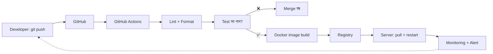
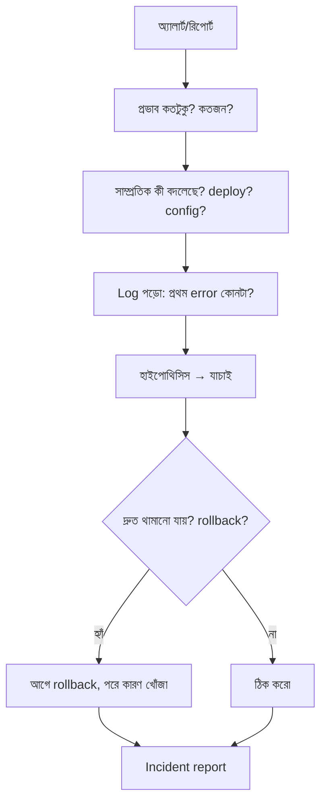

# Module 19 · Docker, CI/CD and Production Operations

> **Section 6 · Production, AI Engineering & System Design** · ২টি Live Class
> ⭐ **প্রজেক্ট:** Deployment Pipeline + Incident Report

## 🎯 লক্ষ্য

"আমার মেশিনে তো চলে" সমস্যার সমাধান — **Docker** দিয়ে app-কে প্যাকেজ করা; **GitHub Actions** দিয়ে প্রতিবার push-এ test + build + deploy স্বয়ংক্রিয় করা; আর production-এ কিছু ভাঙলে **log পড়ে কারণ খুঁজে বের করা** (একটা staged incident সহ)।

## 📖 গল্প: শিপিং কনটেইনার

আগে জাহাজে মালপত্র এলোমেলো তোলা হতো — প্রতিটা বন্দরে আলাদা কায়দা। তারপর এল **কনটেইনার**: ভেতরে যা-ই থাকুক, বাইরের মাপ একই — যেকোনো জাহাজ, ট্রাক, বন্দরে চলে। Docker কনটেইনার তোমার app-কে তার সব নির্ভরতাসহ একটা বাক্সে ভরে — আমার মেশিন, তোমার মেশিন, সার্ভার — সবখানে একই ভাবে চলে। আর **CI/CD** হলো সেই বন্দরের স্বয়ংক্রিয় ক্রেন: কোড জমা দিলেই পরীক্ষা, প্যাকেজ, বিতরণ।



---

## 🧠 Live Class 1 · Containerization and Automation

### "আমার machine-এ তো চলে" — আসল ইঞ্জিনিয়ারিং সমস্যা

Python ভার্সন, OS, প্যাকেজ — সব আলাদা হলে একই কোড ভিন্ন আচরণ করে। Container এই পরিবেশকেও কোডের সাথে প্যাক করে।

### Container বনাম Virtual Machine

| VM | Container |
|---|---|
| পুরো OS আছে | host OS-এর kernel ব্যবহার করে |
| GB, মিনিটে চালু | MB, সেকেন্ডে চালু |
| ভারী আলাদা করা | হালকা আলাদা করা |

### Dockerfile

```dockerfile
# Dockerfile
FROM python:3.12-slim

ENV PYTHONDONTWRITEBYTECODE=1 PYTHONUNBUFFERED=1
WORKDIR /app

# ১) আগে শুধু requirements কপি → layer cache কাজে লাগে
COPY requirements.txt .
RUN pip install --no-cache-dir -r requirements.txt

# ২) তারপর কোড — কোড বদলালেও উপরের ধাপ cache থেকে আসে
COPY . .

# non-root ব্যবহারকারী
RUN useradd -m appuser
USER appuser

EXPOSE 8000
CMD ["gunicorn", "config.wsgi:application", "--bind", "0.0.0.0:8000"]
```

**Layer ও build caching:** প্রতিটা `RUN`/`COPY` একটা layer। যা কম বদলায় (dependencies) আগে রাখো, যা বেশি বদলায় (কোড) পরে — build দ্রুত হয়।

```bash
docker build -t softex-api .
docker run -p 8000:8000 --env-file .env softex-api
```

`.dockerignore` রাখো: `.git`, `.venv`, `.env`, `__pycache__` — image ছোট ও নিরাপদ থাকে।

### docker-compose: Django + PostgreSQL + Redis একসাথে

```yaml
# docker-compose.yml
services:
  db:
    image: postgres:16
    environment:
      POSTGRES_DB: shop
      POSTGRES_USER: shop
      POSTGRES_PASSWORD: ${DB_PASSWORD}
    volumes:
      - pgdata:/var/lib/postgresql/data       # volume = ডাটা টিকিয়ে রাখে
  redis:
    image: redis:7
  web:
    build: .
    env_file: .env
    environment:
      DB_HOST: db                              # service-এর নামই hostname
      REDIS_URL: redis://redis:6379/0
    depends_on: [db, redis]
    ports: ["8000:8000"]
  worker:
    build: .
    command: celery -A config worker -l info
    env_file: .env
    depends_on: [db, redis]
volumes:
  pgdata:
```

```bash
docker compose up --build
docker compose logs -f web
```

> ⚠️ Container মুছে গেলে ভেতরের ডাটাও যায় — তাই ডাটাবেস **volume**-এ রাখো।

### Twelve-Factor ধারণা (সংক্ষেপে)

- **Config environment-এ**, কোডে নয়
- Dev / staging / production — **আলাদা settings**
- লগ **stdout-এ** লেখো (ফাইলে নয়)
- App **stateless**, state ডাটাবেস/Redis-এ

### GitHub Actions CI

```yaml
# .github/workflows/ci.yml
name: CI
on:
  push: { branches: [main] }
  pull_request:

jobs:
  test:
    runs-on: ubuntu-latest
    services:
      postgres:
        image: postgres:16
        env: { POSTGRES_PASSWORD: postgres, POSTGRES_DB: test }
        ports: ["5432:5432"]
        options: >-
          --health-cmd "pg_isready" --health-interval 10s --health-retries 5
    steps:
      - uses: actions/checkout@v4
      - uses: actions/setup-python@v5
        with: { python-version: "3.12", cache: pip }
      - run: pip install -r requirements.txt
      - run: ruff check .                          # linting
      - run: black --check .                       # formatting
      - run: pytest -x
        env:
          DB_HOST: localhost
          DB_NAME: test
          DB_USER: postgres
          DB_PASSWORD: postgres
          DJANGO_SECRET_KEY: ${{ secrets.DJANGO_SECRET_KEY }}   # CI secret
```

**Test fail করলে merge বন্ধ:** GitHub → Settings → Branches → **Branch protection** → "Require status checks to pass"।

### Build ও Deploy ধাপ

```yaml
  deploy:
    needs: test                            # test পাস না হলে deploy নয়
    if: github.ref == 'refs/heads/main'
    runs-on: ubuntu-latest
    steps:
      - uses: actions/checkout@v4
      - name: Build & push image
        run: |
          echo "${{ secrets.REGISTRY_TOKEN }}" | docker login ghcr.io -u ${{ github.actor }} --password-stdin
          docker build -t ghcr.io/${{ github.repository }}:${{ github.sha }} .
          docker push ghcr.io/${{ github.repository }}:${{ github.sha }}
      - name: Deploy over SSH
        uses: appleboy/ssh-action@v1
        with:
          host: ${{ secrets.SERVER_HOST }}
          username: ${{ secrets.SERVER_USER }}
          key: ${{ secrets.SERVER_SSH_KEY }}
          script: |
            docker pull ghcr.io/${{ github.repository }}:${{ github.sha }}
            docker compose up -d
```

**Rollback:** প্রতিটা image-কে **commit SHA** দিয়ে ট্যাগ করো — সমস্যা হলে আগের SHA-র image আবার চালালেই rollback।

> 🔐 **CI-তে secret:** GitHub → Settings → Secrets। কোড বা workflow ফাইলে কখনো সরাসরি নয়।

---

## 🧠 Live Class 2 · Operating What You Built

### Structured logging

```python
# settings.py
LOGGING = {
    "version": 1,
    "handlers": {"console": {"class": "logging.StreamHandler"}},
    "root": {"handlers": ["console"], "level": "INFO"},
}
```

```python
import logging
logger = logging.getLogger(__name__)

logger.info("order_created", extra={"order_id": order.pk, "user_id": user.pk})
logger.warning("payment_retry", extra={"order_id": order.pk, "attempt": 2})
logger.error("payment_failed", exc_info=True)       # stack trace সহ
```

**Log level:**

| Level | কখন |
|---|---|
| `DEBUG` | ডিবাগের খুঁটিনাটি (production-এ বন্ধ) |
| `INFO` | স্বাভাবিক ঘটনা |
| `WARNING` | সন্দেহজনক, কিন্তু চলছে |
| `ERROR` | কিছু ব্যর্থ হয়েছে |
| `CRITICAL` | সিস্টেম বিপদে |

> **কী log করবে না:** password, token, কার্ড নম্বর, ব্যক্তিগত তথ্য।

### Error tracking, Uptime ও Performance

- **Sentry** (error tracking): exception ধরে, কোন লাইনে, কোন ব্যবহারকারীর (গোপন তথ্য ছাড়া) — সব জানায়
- **Uptime monitoring:** UptimeRobot / Better Stack — সাইট বন্ধ হলে SMS/ইমেইল
- **Slow query detection:** `django-debug-toolbar` (dev), PostgreSQL `pg_stat_statements` / slow query log
- **Alerting:** সাড়া দেওয়ার মতো জিনিসে alert — সব কিছুতে নয়, নইলে alert অবহেলা শুরু হয়

### 🚨 Staged incident (ক্লাসের লাইভ অনুশীলন)

Instructor deploy করা app ভাঙবেন। **তুমি শুধু log দেখে, সময়ের চাপে** diagnose করবে।

**Incident-এ কীভাবে ভাবব:**



> **নিয়ম:** আগে **রক্তক্ষরণ থামাও** (rollback), পরে অপারেশন (root cause)।

### Incident Report-এর ছক

```markdown
# Incident Report — [তারিখ]

**সারসংক্ষেপ:** একবাক্যে কী হয়েছিল
**প্রভাব:** কতক্ষণ, কতজন, কী কাজ করছিল না
**সময়রেখা:**
- 10:02 — deploy
- 10:05 — error rate বাড়ল
- 10:12 — রিপোর্ট পেলাম
- 10:20 — rollback
**মূল কারণ (root cause):**
**কীভাবে ঠিক করলাম:**
**পরবর্তীতে আটকানোর উপায়:** (test? alert? config check?)
```
**Blameless:** "কে ভুল করল" নয়, "সিস্টেম কেন ভুল ঠেকাতে পারল না" — এটাই শেখার পথ।

## ⚠️ সাধারণ ভুল

| ভুল | সমাধান |
|---|---|
| `COPY . .` আগে, `pip install` পরে | requirements আগে → cache |
| container-এ root হিসেবে চালানো | `USER appuser` |
| `.env` image-এ ঢুকে যাওয়া | `.dockerignore` |
| ডাটাবেস volume ছাড়া | ডাটা হারাবে |
| `latest` ট্যাগ ব্যবহার | commit SHA দিয়ে ট্যাগ |
| CI-তে secret workflow ফাইলে লেখা | GitHub Secrets |
| সব কিছুতে alert | শুধু কাজের কিছুতে |
| Incident-এ আগে কারণ খোঁজা | আগে rollback/stop |

## ⭐ প্রজেক্ট: Deployment Pipeline + Incident Report

- [ ] `Dockerfile` + `docker-compose.yml` (Django, PostgreSQL, Redis, worker)
- [ ] GitHub Actions: lint → test → build → deploy
- [ ] Test ব্যর্থ হলে merge আটকায় (branch protection)
- [ ] Rollback-এর উপায় দেখানো
- [ ] Structured logging + error tracking
- [ ] Staged incident diagnose + লিখিত blameless report

## 🎤 Interview প্রশ্ন

1. Container আর VM-এর পার্থক্য?
2. Docker layer caching কীভাবে কাজ করে? Dockerfile-এর ক্রম কেন গুরুত্বপূর্ণ?
3. CI আর CD-র পার্থক্য?
4. Rollback কীভাবে করবে?
5. Incident-এ প্রথম কী করবে?
6. Log level কী কী? production-এ DEBUG কেন বন্ধ?
7. Twelve-factor app বলতে কী বোঝো?

## 🔁 MERN / WordPress-এর সাথে তুলনা

তোমার **staging/production deployment ও Linux server অভিজ্ঞতা** এই মডিউলের সরাসরি ভিত্তি। Docker-এর বদলে যদি এখন পর্যন্ত FTP/SSH/rsync দিয়ে deploy করে থাকো, তাহলে এই মডিউল সেই কাজকে **পুনরুৎপাদনযোগ্য ও স্বয়ংক্রিয়** করে। WordPress প্লাগইনের জন্যও `wp-env`/Docker দিয়ে একই পরিবেশে test ও GitHub Actions-এ PHPUnit চালানো সম্ভব — সরাসরি কাজে লাগবে। Node/NestJS প্রজেক্টেও একই `Dockerfile` + compose প্যাটার্ন।
