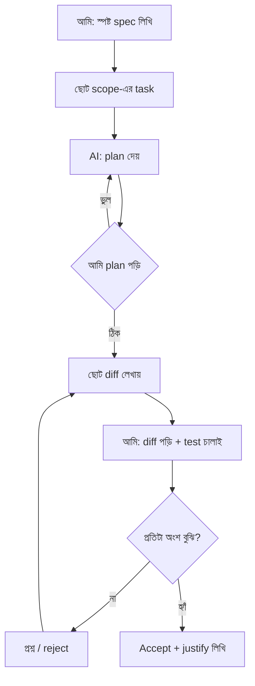
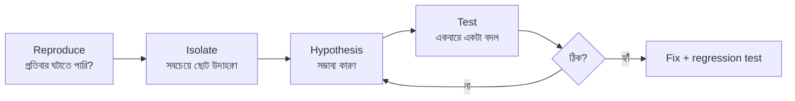

# Module 20 · AI Assisted Engineering and Debugging

> **Section 6 · Production, AI Engineering & System Design** · ২টি Live Class
> ⭐ **প্রজেক্ট:** AI-Built Feature (review note সহ) + Bug Hunt Challenge

## 🎯 লক্ষ্য

AI-কে **নির্দেশ দিয়ে কাজ করানো** শেখা — কোথায় সে সত্যিই সাহায্য করে, কোথায় সময় নষ্ট করে; AI-র লেখা pull request **সমালোচনার চোখে পড়া**; প্রতিটা accept/reject **নিজের যুক্তিসহ** লেখা; আর পদ্ধতি ধরে **নিজে debug** করা — AI ছাড়া ও AI সহ দুই পদ্ধতিতেই।

## 📖 গল্প: দক্ষ কিন্তু অতি-উৎসাহী ইন্টার্ন

ধরো তোমার অফিসে একজন অসম্ভব দ্রুত ইন্টার্ন এসেছে — মিনিটে ৫০০ লাইন লেখে, কখনো ক্লান্ত হয় না। কিন্তু সে **কখনো "আমি জানি না" বলে না**, মাঝে মাঝে আত্মবিশ্বাসের সাথে ভুল কথা বলে, আর তোমার প্রজেক্টের ইতিহাস সে জানে না যদি তুমি না বলো। এই ইন্টার্নকে **ছোট ছোট স্পষ্ট কাজ** দিলে অসাধারণ। "পুরো সিস্টেম বানিয়ে ফেলো" বললে — ভুল ও অজানা জায়গায় ভরা বিশাল কোড। আর শেষ কথা: **কোড সে লেখে, কিন্তু দায় তোমার।**



---

## 🧠 Live Class 1 · Directing an Agent

### AI কোথায় সত্যিই সাহায্য করে আর কোথায় সময় নষ্ট করে

| ✅ ভালো | ❌ ঝুঁকিপূর্ণ |
|---|---|
| Boilerplate, CRUD | জটিল business rule (সে অনুমান করে) |
| Test-এর প্রথম খসড়া | নিরাপত্তা-সংবেদনশীল কোড (auth, payment) |
| Refactor, rename | আর্কিটেকচার সিদ্ধান্ত |
| Error ব্যাখ্যা | যা সে জানে না কিন্তু বলে না |
| নতুন কোডবেস বুঝতে সাহায্য | বড় একসাথে generation |

### Repository-র জন্য context file লেখা

Agent-কে প্রজেক্ট চেনাও — একটা ফাইল যা সে প্রতিবার পড়বে (`CLAUDE.md`, `.cursorrules` বা `AGENTS.md`):

```markdown
# প্রজেক্ট: Softex Shop

## Stack
Django 5, DRF, PostgreSQL, Celery/Redis, React (Vite)

## নিয়ম
- সব নতুন কোডে আগে test লিখবে (pytest)
- Query-তে N+1 এড়াবে (`select_related`/`prefetch_related`)
- সব endpoint-এ object-level permission আবশ্যক
- Secret কখনো কোডে নয়, environment variable-এ
- Migration হাতে বদলাবে না

## কমান্ড
- Test: `pytest -x`
- Lint: `ruff check . && black --check .`
- Run: `docker compose up`

## করবে না
- `.env` পড়বে/লিখবে না
- `--force` push নয়
- সরাসরি production ডাটাবেসে কিছু নয়
```

### Requirement → Specification (agent-এর কাজে লাগার মতো)

| ❌ অস্পষ্ট | ✅ স্পষ্ট spec |
|---|---|
| "wishlist feature বানাও" | "লগইন করা user পণ্য wishlist-এ যোগ/মুছতে পারবে। `POST /api/v1/wishlist/`, `DELETE /api/v1/wishlist/<id>/`। শুধু নিজের wishlist দেখা যাবে। একই পণ্য দুবার যোগ করলে `409`। Test সহ।" |

Spec-এ লেখো: **কী করবে, endpoint, permission, edge case, error আচরণ, test শর্ত**।

### Plan আগে, generation পরে

> "কোড লেখার আগে একটা **plan** দাও: কোন ফাইল বদলাবে, কী যোগ হবে, কী ঝুঁকি।"

Plan পড়ে ভুল ধরা কোড পড়ে ভুল ধরার চেয়ে অনেক সস্তা।

### বড় generation বদলে ছোট diff

- ❌ "পুরো orders module নতুন করে লেখো"
- ✅ "শুধু `OrderSerializer`-এ `total` validation যোগ করো"

ছোট diff = পড়া সহজ = ভুল ধরা সহজ।

### Task-এর scope এমনভাবে রাখো যেন output review করা যায়

যদি diff এত বড় যে তুমি পুরোটা পড়তে পারবে না — task খুব বড়। ভাগ করো।

### Context management, Cost ও token সচেতনতা

- দীর্ঘ কথোপকথনে agent আগের কথা ভোলে/গুলিয়ে ফেলে → মাঝে মাঝে নতুন সেশন + context file
- অপ্রয়োজনীয় ফাইল ঢুকিও না — token = টাকা = ধীর
- বারবার একই ভুল করলে → context file-এ নিয়ম যোগ করো

### কোন কাজে Cursor, কোন কাজে Claude Code

| টুল | সুবিধা |
|---|---|
| **Cursor** (IDE) | ছোট সম্পাদনা, inline suggestion, ফাইল দেখে দেখে |
| **Claude Code** (terminal agent) | বহু-ফাইলের কাজ, কমান্ড চালানো, test চালিয়ে নিজে ঠিক করা |

---

## 🧠 Live Class 2 · Reviewing, Debugging and the Bug Hunt

### Test-first prompting

```text
আমি আগে test লিখেছি (test_wishlist.py)। সেগুলো পাস করাতে ন্যূনতম কোড লেখো।
টেস্ট বদলাবে না।
```
Test = AI-র জন্য **নিখুঁত spec**। সে আন্দাজ করে না, পাস করাতে চেষ্টা করে।

### AI-generated pull request সমালোচকের চোখে পড়া

**Review checklist:**

- [ ] আমি কি **প্রতিটা লাইন** বুঝেছি?
- [ ] এমন কিছু যোগ হয়েছে কি যা আমি চাইনি? (অতিরিক্ত dependency, বড় refactor)
- [ ] Object-level permission আছে?
- [ ] N+1 আছে?
- [ ] Secret/hardcoded মান আছে?
- [ ] Error/edge case সামলানো?
- [ ] **Test কি আসলেই কিছু পরীক্ষা করে?** (নাকি `assert True` টাইপ?)
- [ ] এমন library ডাকছে কি যা আসলে নেই? (hallucinated API)

### AI-র তিন ধরনের error

| ধরন | উদাহরণ | কীভাবে ধরবে |
|---|---|---|
| ❌ **ভুল** | সিনট্যাক্স/লজিক ভুল | test ব্যর্থ, কোড চলে না — ধরা সহজ |
| 🎭 **বিশ্বাসযোগ্য ভুল** | যে ফাংশন বা `settings` key আসলে নেই, কিন্তু দেখতে ঠিক | ডকুমেন্টেশনে মিলিয়ে দেখো |
| 🕳️ **সঠিক কিন্তু অনিরাপদ** | কোড চলে, test পাস — কিন্তু IDOR/XSS ফাঁক আছে | **Module 16-এর জ্ঞান** দিয়ে নিজে ধরো |

> **তৃতীয়টাই সবচেয়ে বিপজ্জনক।** কারণ সব সবুজ দেখায়। এজন্যই Module 16-এর নিরাপত্তা-চোখ AI ব্যবহারের পূর্বশর্ত।

### নিজের লেখা বনাম AI-র — "না বুঝে accept করা যাবে না"

কখনো ভুল করে **AI-র পুরো output বাতিল** করে **নিজে লেখাই** ভালো — যদি ঠিক করতে ঠিক করতে নতুন করে লেখার চেয়ে বেশি সময় লাগে।

### প্রতিটা accept ও reject-এর review note

```markdown
## Review Note — wishlist feature (AI-generated)

**Accepted:**
- `WishlistSerializer` — সরল, ঠিক আছে
- Unique constraint (user, product) — চমৎকার, আমি ভাবিনি

**Rejected:**
- `WishlistViewSet.get_queryset()` — সব user-এর wishlist ফেরত দিচ্ছিল (IDOR)।
  → `.filter(user=self.request.user)` যোগ করলাম।
- AI একটা নতুন package (`drf-extras`) যোগ করেছিল — অপ্রয়োজনীয়, বাদ।

**আমি নিজে লিখেছি:**
- নিরাপত্তা test (`test_cannot_see_other_wishlist`)

**AI-কতটুকু:** ~৬০% কোড, ০% নিরাপত্তা সিদ্ধান্ত।
```

### Systematic debugging



- **Debugger ঠিকমতো ব্যবহার করো:** `breakpoint()`, VS Code debugger, `pdb`
- **Binary search debugging:** কোডের অর্ধেক বাদ দিয়ে দেখো — সমস্যা কোন অর্ধে? `git bisect` — কোন commit-এ ভেঙেছে খুঁজে দেয়
- **Rubber duck:** জোরে ব্যাখ্যা করলেই অনেক সময় ভুল ধরা পড়ে

```bash
git bisect start
git bisect bad                 # এখনকার অবস্থা খারাপ
git bisect good v1.2           # এই ট্যাগে ভালো ছিল
# git নিজে মাঝামাঝি commit-এ নিয়ে যাবে; তুমি test চালিয়ে good/bad বলবে
```

### 🐞 Bug Hunt — ৫টা planted bug একটা repository-তে

| রাউন্ড | শর্ত |
|---|---|
| **Round 1** | **AI ছাড়া**, সময়সীমা সহ |
| **Round 2** | **AI সহ**, সময়সীমা সহ |

ক্লাস শেষে মেলানো হবে: **agent কোথায় সাহায্য করল, কোথায় বিভ্রান্ত করল।** এই ফল তোমার নিজের AI-ব্যবহারের নীতি ঠিক করতে সাহায্য করবে।

**নিজের স্কোরবোর্ড রাখো:**

| Bug | AI ছাড়া (সময়) | AI সহ (সময়) | AI-র ভূমিকা |
|---|---|---|---|
| #1 | | | |
| #2 | | | |

## ⚠️ সাধারণ ভুল

| ভুল | সমাধান |
|---|---|
| "পুরো app বানাও" প্রম্পট | ছোট, নির্দিষ্ট task |
| Plan না দেখেই কোড accept | আগে plan, তারপর কোড |
| Test পাস দেখে নিশ্চিন্ত | নিরাপত্তা ও edge নিজে ভাবো |
| বারবার একই ভুল সংশোধন | context file-এ নিয়ম লেখো |
| Debug না করে AI-কে "ঠিক করো" বলা | আগে reproduce ও hypothesis |
| AI-র ব্যবহার লুকানো | সৎ থাকো (ইন্টারভিউ-এর প্রশ্নও!) |

## ⭐ প্রজেক্ট: AI-Built Feature + Bug Hunt

- [ ] নিজের product-এর জন্য একটা feature **স্পষ্ট spec** লিখে AI দিয়ে বানানো
- [ ] Plan-first, ছোট diff পদ্ধতিতে
- [ ] Test-first
- [ ] **Review note:** প্রতিটা accept/reject-এর যুক্তি
- [ ] নিরাপত্তা ও permission আমি নিজে যাচাই করেছি
- [ ] Bug Hunt — Round 1 ও 2 স্কোরবোর্ড

## 🎤 Interview প্রশ্ন

1. AI tool ব্যবহার করে কীভাবে কাজ করো? কোথায় ব্যবহার করো না?
2. AI-র কোড ভুল হলে কীভাবে ধরো?
3. AI-র লেখা কোড নিরাপদ কিনা কীভাবে যাচাই করো?
4. কোনো bug পেলে কোন ধাপে এগোও?
5. `git bisect` কী?
6. এমন কোনো ঘটনা বলো যেখানে AI তোমাকে ভুল পথে নিয়েছিল।

## 🔁 MERN / WordPress-এর সাথে তুলনা

তুমি আগে থেকেই AI দিয়ে কাজ করো (কাঠামো ও লজিক নিজে ঠিক করে, AI কোড লেখে)। এই মডিউল সেই অভ্যাসকে **শৃঙ্খলাবদ্ধ করে**: spec → plan → ছোট diff → review note। WordPress প্লাগইনে নিরাপত্তা (`esc_*`, nonce, capability check) AI প্রায়ই বাদ দেয় — এই review checklist সেখানেও হুবহু প্রযোজ্য। ক্লায়েন্টকে AI-ব্যবহার নিয়ে আগে থেকে জানানোর অভ্যাসও এখানে "সৎ বলার" নীতির সাথে মেলে।
