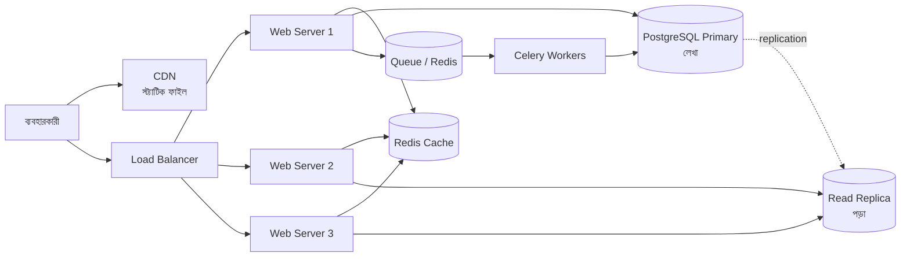
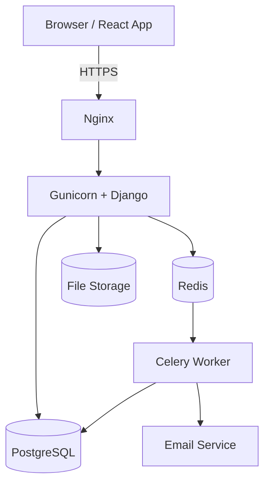
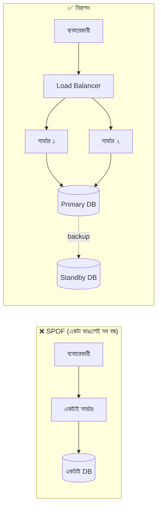
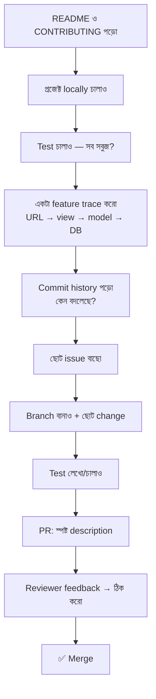

# Module 21 · System Design and Working in Unfamiliar Codebases

> **Section 6 · Production, AI Engineering & System Design** · ২টি Live Class + ১টি DSA Class
> ⭐ **প্রজেক্ট:** Architecture Diagram + Scaling Plan + Open Source Contribution

## 🎯 লক্ষ্য

দুটো আলাদা কিন্তু একে অপরের পরিপূরক দক্ষতা:

1. **নিজের product-এর আর্কিটেকচার আঁকা** এবং ব্যবহারকারী ৬০০ থেকে ৬ লাখ হলে কোথায় ভাঙবে আর কীভাবে সামলাবে তার লিখিত পরিকল্পনা।
2. **যে কোডবেস কখনো দেখোনি**, সেখানে ঢুকে কাজ বুঝে একটা pull request পাঠানো — আসল চাকরির প্রথম দিনের মতো।

## 📖 গল্প: ছোট চায়ের দোকান থেকে শপিং মল

রহিম একটা ছোট চায়ের দোকান চালায়। দিনে ৫০ জন খদ্দের — সে নিজেই চা বানায়, নিজেই টাকা নেয়, নিজেই বাসন ধোয়। কোনো সমস্যা নেই।

খদ্দের হলো ৫০০। এখন কী ভাঙল?

- **একজন মানুষ সব কাজ করছে** → আরেকজন কর্মচারী দরকার (**horizontal scaling**)
- **একই চুলা** → চুলা বড় করা (**vertical scaling**) নাকি আরেকটা চুলা বসানো?
- **একই চা বারবার বানাচ্ছে** → আগে থেকে ফ্লাস্কে রেখে দাও (**cache**)
- **লাইন লম্বা** → টোকেন দিয়ে ডাকো, রান্নাঘর পিছনে (**queue**)
- **ক্যাশিয়ার একজন, সে অসুস্থ হলে দোকান বন্ধ** → **single point of failure**

System design আসলে এই প্রশ্নটাই: **"কী ভাঙবে আগে, আর তখন কী করব?"**



---

## 🧠 Live Class 1 · System Design Foundations

### ধাপ ১: নিজের product আঁকা

প্রথমে একটা ছবি আঁকো — আজকের অবস্থা। কোনো কিছু ঠিক করার আগে বর্তমান সিস্টেম একটা কাগজে থাকা দরকার।



**প্রতিটা বাক্স নিয়ে নিজেকে প্রশ্ন করো:**

| উপাদান | কী কাজ | ভাঙলে কী হবে? |
|---|---|---|
| Frontend | UI দেখায় | সাইট দেখা যায় না |
| Backend | লজিক | কিছুই কাজ করে না |
| Database | ডাটা রাখে | সব ডাটা হারাতে পারে |
| Cache | দ্রুত উত্তর | ধীর হবে, তবে চলবে |
| Queue | ধীর কাজ পিছনে পাঠায় | ইমেইল/রিপোর্ট আটকে যাবে |
| Storage | ছবি/ফাইল | ছবি দেখাবে না |

### ধাপ ২: ব্যবহারকারী বাড়লে কী হয়?

| ব্যবহারকারী | কী ঘটে | প্রথম পদক্ষেপ |
|---|---|---|
| **৬০০** | একটা সার্ভারেই চলে | N+1 ঠিক রাখো, index দাও |
| **৬,০০০** | ডাটাবেস ধীর হতে শুরু | cache, ধীর query ঠিক করা |
| **৬০,০০০** | একটা web server যথেষ্ট নয় | load balancer + একাধিক server |
| **৬ লাখ** | DB-ই বোতলের ঘাড় | read replica, queue, CDN |

> ⚠️ **সবচেয়ে বড় ভুল:** ৬০০ ব্যবহারকারীর জন্য Kubernetes, microservices, ১০টা সার্ভার সাজানো। প্রথম নিয়ম: **যা ভাঙছে শুধু তাই ঠিক করো।** আগেভাগে জটিলতা এনো না।

### Vertical বনাম Horizontal scaling

| | Vertical (বড় করো) | Horizontal (বেশি করো) |
|---|---|---|
| কী | আরও RAM/CPU | আরও সার্ভার |
| সুবিধা | সহজ, কোড বদলাতে হয় না | সীমা নেই, একটা গেলেও চলে |
| অসুবিধা | সীমা আছে, দামি, একটাই ভরসা | কোড stateless হতে হয়, জটিল |

**Horizontal-এর শর্ত — stateless:**

```python
# ❌ stateful: সার্ভারের মেমোরিতে session — সার্ভার ২-এ গেলে হারিয়ে যায়
user_sessions = {}                  # শুধু এই process-এ আছে, অন্য সার্ভার দেখে না

def login(request):
    user_sessions[request.user.id] = {"cart": []}    # ← বিপদ

# ✅ stateless: state বাইরে — Redis/ডাটাবেসে, যেকোনো সার্ভার পড়তে পারে
from django.core.cache import cache  # Redis দিয়ে সাজানো

def add_to_cart(user_id, item):
    key = f"cart:{user_id}"          # key = কার কার্ট, user_id দিয়ে আলাদা
    cart = cache.get(key, [])        # cart = আগের কার্ট, না থাকলে খালি list
    cart.append(item)                # item = যে পণ্য যোগ হচ্ছে
    cache.set(key, cart, timeout=86400)   # 86400 সেকেন্ড = ১ দিন
```

### Load Balancer, Caching Layer, Read Replica

- **Load balancer:** ট্রাফিক ভাগ করে (round-robin), অসুস্থ সার্ভার বাদ দেয় (health check)
- **Caching layer:** বারবার একই query-র উত্তর Redis-এ — DB-র চাপ কমে
- **Read replica:** অধিকাংশ app **পড়ে বেশি, লেখে কম** — পড়ার জন্য আলাদা কপি
  - ⚠️ replication-এ সামান্য **দেরি (lag)** থাকে — লেখার সাথে সাথে পড়লে পুরোনো ডাটা পেতে পারো

### Queue ও Asynchronous processing

ধীর কাজ (ইমেইল, রিপোর্ট, ছবি রিসাইজ) request-এর বাইরে (Module 15)। Queue তাই **ঢেউ সামলায়**: হঠাৎ ১০ হাজার অর্ডার এলেও সবাইকে "গ্রহণ করা হয়েছে" বলে worker ধীরে ধীরে সামলায়।

### CDN ও Static asset

CSS/JS/ছবি ব্যবহারকারীর **কাছের সার্ভার** থেকে আসে। আসল সার্ভার শুধু আসল কাজ করে।

### Stateless service, Single point of failure



**প্রশ্ন সবসময়:** "এই বাক্সটা ভাঙলে কী হবে?" উত্তর "সব বন্ধ" হলে সেটা SPOF।

### Trade-off — প্রতিটা সিদ্ধান্তের দাম আছে

| সিদ্ধান্ত | লাভ | মূল্য |
|---|---|---|
| Cache যোগ করা | দ্রুত | ডাটা পুরোনো হতে পারে (consistency কমে) |
| Read replica | পড়ার ক্ষমতা বাড়ে | replication lag |
| Queue | ঢেউ সামলায় | ফলাফল সাথে সাথে পাওয়া যায় না, জটিলতা |
| Microservices | স্বাধীন স্কেল | নেটওয়ার্ক জটিলতা, ডিবাগ কঠিন |

**CAP সংক্ষেপে:** নেটওয়ার্ক ভাগ হয়ে গেলে **Consistency** (সবাই একই ডাটা দেখে) আর **Availability** (সবসময় উত্তর দেয়) — দুটোর একটা বাছতে হয়।

### 🛠️ Build

- নিজের product-এর আর্কিটেকচার ডায়াগ্রাম (Mermaid বা draw.io)
- **৬০০ গুণ বেশি ব্যবহারকারীর জন্য লিখিত পরিকল্পনা:** কী ভাঙবে, কোন ক্রমে ঠিক করব, কত খরচ

```markdown
## Scaling Plan: ৬০০ → ৩,৬০,০০০ ব্যবহারকারী

### ধাপ ১ (৬০০ → ৬,০০০)
- কী ভাঙবে: ধীর পণ্য-তালিকা query
- সমাধান: index + cache (৫ মিনিট)
- মাপব কীভাবে: p95 response time < 300ms

### ধাপ ২ (৬,০০০ → ৬০,০০০)
- কী ভাঙবে: একটা web server-এর CPU
- সমাধান: ২টা server + load balancer
...
```

---

## 🧠 Live Class 2 · Code You Did Not Write

### কখনো দেখোনি এমন কোডবেসে প্রথম দিন

ভয় পেয়ো না, সবাই ভয় পায়। পদ্ধতি আছে।



### Entry point খোঁজা — URL থেকে ডাটাবেস পর্যন্ত trace

```bash
# ধাপ ১: URL কোথায় সংজ্ঞায়িত?
grep -rn "products/" --include="urls.py" .

# ধাপ ২: সেই URL কোন view ডাকে?
grep -rn "class ProductViewSet" --include="*.py" .

# ধাপ ৩: view কোন model ব্যবহার করে?
grep -rn "class Product(" --include="models.py" .

# ধাপ ৪: কে এই model বদলায়?
grep -rn "Product.objects" --include="*.py" . | head -20
```

> **নিয়ম:** পুরো কোডবেস পড়ো না। **একটা feature বেছে একটা সুতো ধরে** শেষ পর্যন্ত যাও।

### Commit history ও blame — **কেন** এমন লেখা হয়েছে

```bash
git log --oneline -- shop/views.py        # এই ফাইলের ইতিহাস
git log -p -S "select_related" -- shop/   # কোন commit-এ এই শব্দ যোগ হয়েছিল
git blame -L 40,60 shop/views.py          # প্রতিটা লাইন কে, কখন, কোন commit-এ
```

অদ্ভুত দেখতে কোডের পেছনে প্রায়ই একটা পুরোনো bug-fix থাকে। মুছে ফেলার আগে ইতিহাস পড়ো।

### Test পড়া — intent বোঝার সবচেয়ে ভালো উৎস

Test হলো **চলমান ডকুমেন্টেশন**: কোডটা কী করার কথা, কোন কোন অবস্থায় — সব লেখা আছে।

### Commit message ও PR description

```text
# ❌ খারাপ
fix bug
update

# ✅ ভালো (Conventional Commits)
fix(orders): prevent negative stock on concurrent checkout
feat(api): add ordering filter to product list
docs: clarify local setup steps in README
```

```markdown
## PR Description

### সমস্যা
`GET /api/v1/products/?ordering=price` কাজ করছিল না — `ordering_fields` ঘোষণা করা ছিল না।

### সমাধান
`ProductViewSet`-এ `ordering_fields = ["price", "created_at"]` যোগ।

### পরীক্ষা
- নতুন test: `test_ordering_by_price` (আগে ব্যর্থ, এখন পাস)
- ম্যানুয়ালি Postman-এ চেষ্টা করেছি

### সম্পর্কিত
Closes #142
```

### Focused change — একটা PR, একটা কাজ

- ❌ bug ঠিক করতে করতে ১০টা ফাইলের ফরম্যাট বদলে দেওয়া
- ✅ শুধু যা দরকার, ছোট, পড়া সহজ

### Reviewer-এর feedback — defensive না হয়ে

| ❌ | ✅ |
|---|---|
| "কিন্তু আমার মেশিনে তো চলে" | "ঠিক বলেছেন, এই edge case ভাবিনি। ঠিক করছি।" |
| সব মন্তব্যে তর্ক | যুক্তি থাকলে বিনয়ে ব্যাখ্যা, না থাকলে বদলাও |
| নীরব থাকা | "দেখছি" লিখে দাও |

Feedback তোমার বিরুদ্ধে নয়, কোডের পক্ষে।

### Ostad-maintained repository-তে আসল contribution

- Curated **beginner issue** বাছো (`good first issue` লেবেল)
- TA review করবেন, তাঁদের সাথে পেশাদারভাবে কথা বলো
- Branching convention মানো, merge হওয়া পর্যন্ত লেগে থাকো

---

## 🧩 DSA Class 7 · Linked Lists

**Singly ও doubly · Reversal · Cycle detection · Fast and slow pointers**

```python
class Node:
    def __init__(self, value):
        self.value = value        # value = এই node-এর ডাটা
        self.next = None          # next = পরের node-এর ঠিকানা (শেষে None)


def reverse(head):
    prev = None                   # prev = উল্টানো অংশের শুরু (শুরুতে খালি)
    curr = head                   # curr = এখন যে node-এ আছি
    while curr:
        nxt = curr.next           # nxt = পরের node আগে সরিয়ে রাখি, নইলে হারিয়ে যাবে
        curr.next = prev          # তীর উল্টে দিই
        prev = curr               # prev এক ধাপ এগোয়
        curr = nxt                # curr-ও এক ধাপ এগোয়
    return prev                   # prev এখন নতুন head
    # সময় O(n), অতিরিক্ত জায়গা O(1)


def has_cycle(head):
    slow = fast = head            # slow = ১ ধাপে চলে, fast = ২ ধাপে চলে
    while fast and fast.next:
        slow = slow.next
        fast = fast.next.next
        if slow is fast:          # দুজন মিলে গেলে loop আছে (বৃত্তাকার ট্র্যাকে দৌড়ের মতো)
            return True
    return False                  # fast শেষে পৌঁছে গেলে loop নেই


def middle(head):
    slow = fast = head
    while fast and fast.next:     # fast শেষে পৌঁছালে slow ঠিক মাঝখানে
        slow, fast = slow.next, fast.next.next
    return slow
```

**গল্পে মনে রাখো:** দুজন দৌড়বিদ একই ট্র্যাকে — একজন আস্তে, একজন দ্বিগুণ গতিতে। ট্র্যাক বৃত্তাকার হলে দ্রুতজন একসময় ধীরজনকে ধরে ফেলবেই।

## ⚠️ সাধারণ ভুল

| ভুল | সমাধান |
|---|---|
| ৬০০ ব্যবহারকারীর জন্য microservices | যা ভাঙছে শুধু তাই ঠিক করো |
| Stateful server রেখে scale করার চেষ্টা | state বাইরে (Redis/DB) |
| Replica-তে লেখার পর সাথে সাথে পড়া | lag মনে রাখো |
| Cache সব জায়গায় | কী কতক্ষণ বদলায় ভাবো |
| পুরো কোডবেস পড়তে বসা | একটা feature trace করো |
| PR-এ সব কিছুর ফরম্যাট বদল | focused change |
| Feedback-এ তর্ক | বুঝে নাও, ঠিক করো |
| Linked list-এ `next` সরানোর আগে হারিয়ে ফেলা | `nxt` আগে সংরক্ষণ |

## ⭐ প্রজেক্ট: Architecture Diagram + Scaling Plan + Open Source Contribution

- [ ] নিজের product-এর আর্কিটেকচার ডায়াগ্রাম
- [ ] প্রতিটা উপাদানের "ভাঙলে কী হবে" টেবিল
- [ ] ৬০০× স্কেলের লিখিত পরিকল্পনা (কী ভাঙবে, কী ক্রমে, trade-off)
- [ ] Ostad-maintained repo-তে একটা আসল PR (merge সহ)
- [ ] PR description ও commit message সঠিক ফরম্যাটে

## 🎤 Interview প্রশ্ন

1. Vertical বনাম horizontal scaling?
2. Stateless service কেন গুরুত্বপূর্ণ?
3. Read replica কী? কী সমস্যা হতে পারে?
4. Cache যোগ করলে কী কী trade-off?
5. "১০ লাখ ব্যবহারকারীর জন্য একটা URL shortener ডিজাইন করো।" কোথা থেকে শুরু করবে?
6. অপরিচিত কোডবেসে প্রথম দিন কী করো?
7. Linked list-এ cycle কীভাবে ধরো?
8. তোমার PR-এ reviewer অসন্তুষ্ট হলে কী করো?

## 🔁 MERN / WordPress-এর সাথে তুলনা

- WordPress সাইট স্কেল করতে যা করো — page cache, object cache (Redis), CDN, DB read replica — এগুলো এই মডিউলেরই বাস্তব রূপ। তোমার WooCommerce কাজে traffic বাড়লে এই ছবিটাই কাজে লাগবে।
- WordPress core বা কোনো জনপ্রিয় plugin-এর কোডবেসে ঢোকা প্রায় একই অনুশীলন — hooks ধরে trace করা (`add_action` → callback → `$wpdb`)।
- Node/NestJS প্রজেক্টে horizontal scale-এর শর্ত একই: stateless, session Redis-এ।
