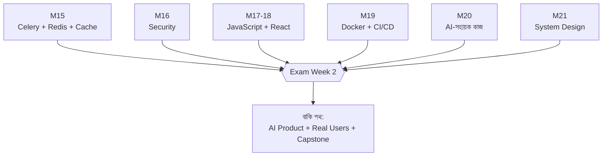

# Module 22 · Exam Week 2

> **Section 6 · Production, AI Engineering & System Design** · অ্যাসাইনমেন্ট ও লাইভ টেস্ট
> **কভার করে:** Module 15 – Module 22

## 🎯 লক্ষ্য

Exam Week 1-এর পর আরও আটটা মডিউল জমেছে — background job, security, JavaScript, React, Docker, AI-সহায়ক ইঞ্জিনিয়ারিং, system design। এই সপ্তাহে নতুন কিছু শেখা নয়। **কী বুঝেছি আর কী বুঝিনি** তা ধরার সময়।

## 📖 গল্প: গাড়ি সার্ভিসিংয়ের দিন

লম্বা সফরের মাঝখানে গাড়ি সার্ভিস সেন্টারে গেল। মেকানিক ইঞ্জিন, ব্রেক, টায়ার, তেল — সব একে একে দেখে। কিছু ঠিক আছে, কিছু ক্ষয় হয়েছে, একটা ছোট লিক ধরা পড়ল যেটা আজ ছোট, কিন্তু হাইওয়েতে বড় হতো। এই সপ্তাহ সেই সার্ভিসিং। লক্ষ্য গাড়িকে দোষ দেওয়া নয় — **সফরের বাকি পথ নিরাপদ করা।**



---

## 🧭 মডিউল ধরে ঝালাই

### Module 15 · API Quality ও Background Jobs
- [ ] Synchronous বনাম asynchronous — কেন email request-এর ভেতরে নয়
- [ ] Celery: producer → broker (Redis) → worker
- [ ] Task-এ **id** পাঠাই, object নয় — কেন?
- [ ] **Idempotent** task — দুবার চললে কী হয়?
- [ ] Cache invalidation কেন কঠিন
- [ ] DSA: merge sort, quick sort, binary search

### Module 16 · Security
- [ ] OWASP Top 10-এর মধ্যে: XSS, SQLi, CSRF, IDOR
- [ ] `|safe` ও `.raw()` কেন ঝুঁকিপূর্ণ
- [ ] Secret Git-এ গেলে — কী করি?
- [ ] `check --deploy` কী দেখায়

### Module 17–18 · JavaScript ও React
- [ ] `fetch`-এ `res.ok` কেন নিজে যাচাই করতে হয়
- [ ] CORS কেন ও কীভাবে
- [ ] Props বনাম state, `useEffect`-এর dependency array
- [ ] Protected route কেন আসল নিরাপত্তা নয়
- [ ] DSA: stack, queue, valid parentheses

### Module 19 · Docker ও CI/CD
- [ ] Dockerfile-এর ক্রম (layer cache)
- [ ] Container বনাম VM
- [ ] CI-তে test ফেল → merge বন্ধ
- [ ] Rollback কীভাবে (commit SHA ট্যাগ)
- [ ] Incident-এ প্রথম কাজ: **আগে রক্তক্ষরণ থামাও**

### Module 20 · AI-সহায়ক ইঞ্জিনিয়ারিং
- [ ] Spec → plan → ছোট diff → review
- [ ] AI-র তিন ধরনের ভুল (ভুল, বিশ্বাসযোগ্য ভুল, সঠিক-কিন্তু-অনিরাপদ)
- [ ] Systematic debugging: reproduce → isolate → hypothesis → test
- [ ] `git bisect`

### Module 21 · System Design
- [ ] Vertical vs horizontal scaling
- [ ] Load balancer, cache, read replica, queue, CDN
- [ ] SPOF চেনা
- [ ] Trade-off বলতে পারি
- [ ] DSA: linked list, cycle detection

---

## 🧪 নিজে নিজে করার মক টেস্ট (AI ছাড়া, টাইমার সহ)

### ১. Celery কাজ (৪৫ মিনিট)
অর্ডার তৈরি হলে `send_confirmation.delay(order.pk)` ডাকো। Task লেখো যা retry করে (exponential backoff), আর দুবার চললেও একই ইমেইল দুবার পাঠায় না।

```python
@shared_task(bind=True, autoretry_for=(Exception,), retry_backoff=True, max_retries=3)
def send_confirmation(self, order_id):
    order = Order.objects.get(pk=order_id)        # order_id = কোন অর্ডার; object নয়, id পাঠাই
    if order.confirmation_sent:                   # confirmation_sent = আগেই পাঠানো হয়েছে কিনা
        return                                    # idempotent: দুবার চললেও ক্ষতি নেই
    send_mail("নিশ্চিত", f"#{order.pk}", None, [order.owner.email])
    order.confirmation_sent = True
    order.save(update_fields=["confirmation_sent"])    # শুধু এই field আপডেট, বাকি নয়
```

### ২. Security (৩০ মিনিট)
এই কোডে ৩টা ফাঁক খোঁজো:

```python
def search(request):
    q = request.GET["q"]
    rows = Product.objects.raw(f"SELECT * FROM shop_product WHERE name LIKE '%{q}%'")
    return HttpResponse(f"<h1>ফলাফল: {q}</h1>" + "".join(r.name for r in rows))

def order(request, pk):
    return JsonResponse(model_to_dict(Order.objects.get(pk=pk)))
```
**উত্তর:** (১) `raw` + f-string → SQL injection; (২) `q` সরাসরি HTML-এ → XSS; (৩) `order` view-তে লগইন ও owner চেক নেই → IDOR।

### ৩. React (৪৫ মিনিট)
একটা পণ্য-তালিকা component লেখো: loading, error, empty — তিনটা অবস্থাই দেখায়, protected route-এর ভেতরে।

### ৪. Docker (৩০ মিনিট)
Django + PostgreSQL + Redis-এর `docker-compose.yml` লেখো। ডাটাবেস volume-এ থাকে।

### ৫. Debug (৩০ মিনিট)
নিজের পুরোনো কোডে ইচ্ছাকৃত একটা N+1 আর একটা IDOR ঢুকিয়ে অন্য কাউকে খুঁজতে বলো।

### ৬. DSA (৩০ মিনিট)
```python
# valid parentheses — মুখস্থ নয়, ব্যাখ্যা করে লেখো
def valid(s):
    pairs = {")": "(", "]": "[", "}": "{"}    # pairs = বন্ধনীর জোড়া: বন্ধ → খোলা
    stack = []                                  # stack = এখনো বন্ধ না হওয়া খোলা বন্ধনী
    for ch in s:                                # ch = এখন যে অক্ষর দেখছি
        if ch in "([{":
            stack.append(ch)                    # খুললে stack-এ রাখো
        elif not stack or stack.pop() != pairs[ch]:
            return False                        # বন্ধ করার মতো খোলা নেই, বা মিলছে না
    return not stack                            # শেষে stack খালি হলে সব ঠিক
```

## 🛠️ লাইভ টেস্টের কৌশল

1. প্রশ্ন **পুরো** পড়ো, তারপর শুরু
2. ছোট করে ভাগ করে সবচেয়ে সহজ অংশ আগে
3. ২০ লাইন লিখে একবার চালাও
4. আটকালে **জোরে ভাবো** — যুক্তিও নম্বর পায়
5. Error message পড়ো
6. শেষে **test ও নিরাপত্তা** একবার ভেবে নাও

## ⚠️ পরীক্ষায় সাধারণ ভুল

| ভুল | সমাধান |
|---|---|
| বড় প্রশ্নে ঘাবড়ে যাওয়া | টুকরো করো |
| Test লেখা ভুলে যাওয়া | অন্তত একটা জরুরি test |
| Permission চেক ভুলে যাওয়া | "অন্যের ডাটা পাবে?" নিজেকে জিজ্ঞেস করো |
| Secret কোডে | environment variable |
| শেষ মুহূর্তে চালিয়ে দেখা | বারবার চালাও |

## ⭐ অ্যাসাইনমেন্ট চেকলিস্ট

- [ ] Async task + cache আমার product-এ কাজ করছে
- [ ] Security audit-এর সব finding ঠিক করা, test সহ
- [ ] React app deploy হয়েছে, production API-তে
- [ ] CI pipeline সবুজ, rollback দেখানো যায়
- [ ] AI-built feature-এর review note আছে
- [ ] আর্কিটেকচার ডায়াগ্রাম + scaling plan
- [ ] README আপডেট, কোডে secret নেই

## 🎤 নিজেকে যাচাই (মুখে ১ মিনিটে)

1. Celery কীভাবে কাজ করে? Idempotent কেন?
2. XSS আর SQL injection-এর পার্থক্য ও প্রতিকার?
3. Production-এ Django কনফিগে কী কী বদলাও?
4. CI/CD pipeline-এ কোন কোন ধাপ?
5. AI-র লেখা কোড কীভাবে যাচাই করো?
6. ১০ গুণ ব্যবহারকারী এলে প্রথম কী ভাঙবে ও কী করবে?

## 🔁 নোট

এই সপ্তাহের পর কোর্সের সুর বদলে যাবে — এতদিন "কীভাবে বানাব", এখন থেকে "কীভাবে **ভালো** বানাব, **প্রমাণ** করব ও **মানুষের** কাছে নেব।" যেসব বিষয়ে ঝাপসা লাগছে, পরের সপ্তাহের আগে সেগুলো পরিষ্কার করে নাও।
