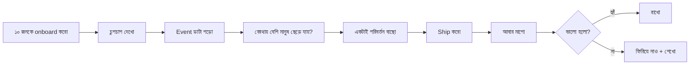
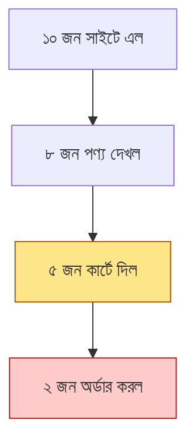
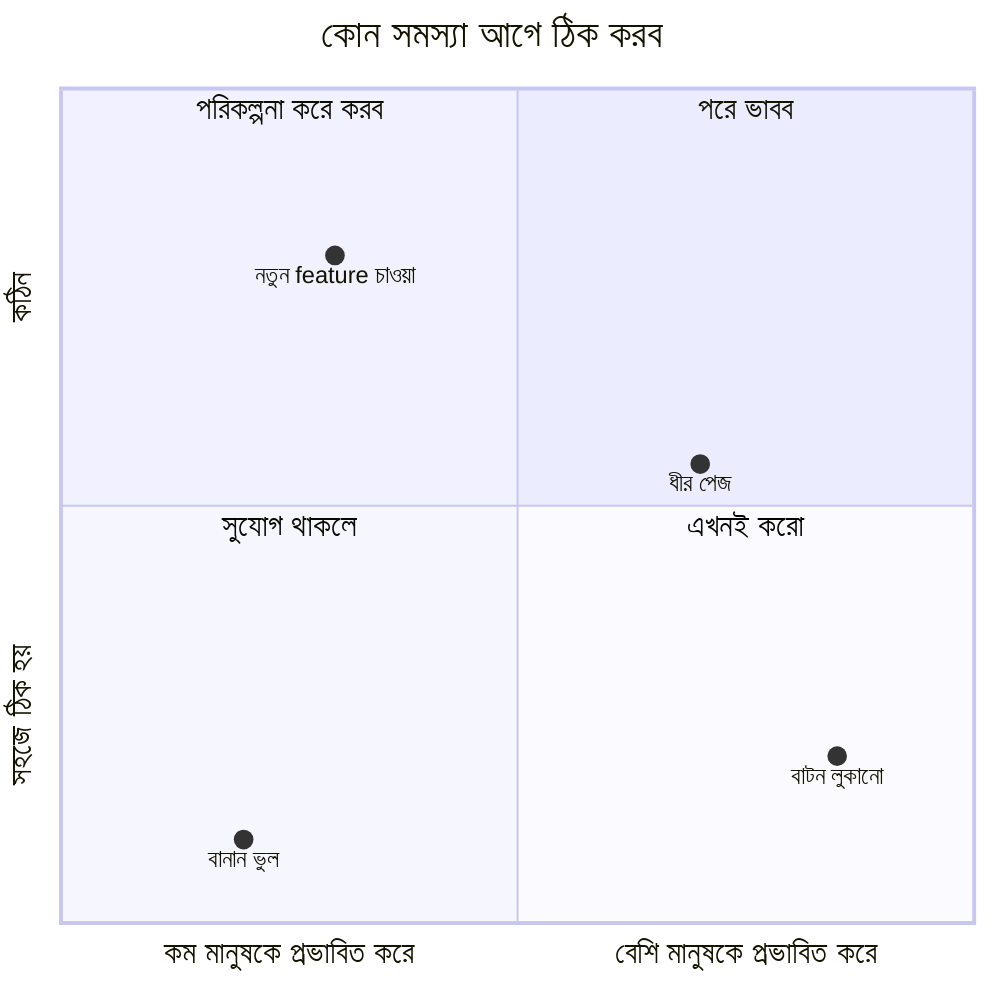
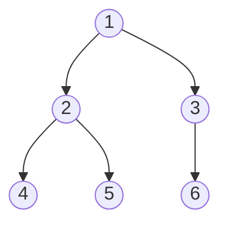

# Module 25 · Real Users and Product Analytics

> **Section 7 · AI Product, Real Users & Career** · ২টি Live Class + ১টি DSA Class
> ⭐ **প্রজেক্ট:** First 10 Users Report

## 🎯 লক্ষ্য

এতদিন তুমি নিজের জন্য বানিয়েছ। এবার **দশজন আসল মানুষকে** তোমার product দিয়ে কাজ করাও, দেখো কী ঘটে, ডাটা পড়ো, আর **একটা পরিবর্তন ship করে মাপো — কাজ করল কিনা।** সাথে product-এ event instrument করা, ছোট funnel বানানো, গোপনীয়তা বুঝে কী সংগ্রহ করা উচিত।

## 📖 গল্প: দোকানের উদ্বোধনের দিন

তুমি নতুন দোকান খুলেছ। পাড়ার দশজন এলো। তুমি পিছন থেকে **চুপচাপ** দেখছ — কে ঢুকে দরজার সামনেই ফিরে গেল, কে জিনিস হাতে নিয়ে রেখে দিল, কে কাউন্টারে গিয়ে লাইনে দাঁড়িয়ে আবার বেরিয়ে গেল।

তুমি তাদের থামিয়ে জিজ্ঞেস করো না "কেন চলে গেলেন?" — কারণ তারা ভদ্রতা করে বলবে "ভালোই তো, পরে আসব।" তুমি দেখো **কী করল**, শোনো না **কী বলল**।

আর যারা ফিরে গেল, তাদের **মধ্যে একটা সাধারণ জায়গা** খোঁজো: সবাই কি কাউন্টারেই আটকাল? তাহলে কাউন্টার ঠিক করো — পুরো দোকান নয়।



---

## 🧠 Live Class 1 · Measuring What Happens

### কী মাপব আর কী উপেক্ষা করব

| ✅ কাজের মাপ | ❌ অসার মাপ (vanity metrics) |
|---|---|
| কতজন প্রথম কাজটা **শেষ** করল | মোট পাতা-দর্শন |
| কোন ধাপে ছেড়ে গেল | "মোট সাইন-আপ" (সক্রিয় কতজন?) |
| কতজন **দ্বিতীয়বার** ফিরল | শুধু visitor সংখ্যা |

**মূল প্রশ্ন:** "ব্যবহারকারী কি সেই কাজটা করতে পারল যার জন্য product বানানো?" (Module 06-এর MVP-র তিনটা কাজ মনে আছে?)

### Event instrument করা

```python
# analytics/models.py
from django.db import models
from django.conf import settings

class Event(models.Model):
    # একটা "ঘটনা" = ব্যবহারকারী কিছু একটা করেছে
    user = models.ForeignKey(settings.AUTH_USER_MODEL, null=True, on_delete=models.SET_NULL)
    # user = কে করল; null=True কারণ লগইনের আগের ঘটনাও থাকতে পারে
    anon_id = models.CharField(max_length=64, blank=True)
    # anon_id = লগইন না করা অবস্থায় চেনার জন্য র‍্যান্ডম আইডি (ব্যক্তিগত তথ্য নয়)
    name = models.CharField(max_length=50, db_index=True)
    # name = ঘটনার নাম, যেমন "signup", "product_viewed"; db_index = দ্রুত গোনার জন্য
    props = models.JSONField(default=dict, blank=True)
    # props = অতিরিক্ত তথ্য, যেমন {"product_id": 5}; নমনীয় রাখতে JSON
    created_at = models.DateTimeField(auto_now_add=True, db_index=True)
    # created_at = কখন ঘটল; সময়ের হিসাবে গোনার জন্য index


def track(name, user=None, anon_id="", **props):
    # name = ঘটনার নাম; props = যা যা বিস্তারিত দিতে চাই
    Event.objects.create(
        user=user if getattr(user, "is_authenticated", False) else None,
        anon_id=anon_id, name=name, props=props,
    )
```

```python
# views-এ ব্যবহার
def checkout(request):
    order = create_order(request)
    track("order_placed", user=request.user, order_id=order.pk, total=str(order.total))
    ...
```

> **ছোট রাখো:** ৫–৮টা মূল event যথেষ্ট — `signup`, `first_product_viewed`, `added_to_cart`, `order_placed`, `returned_next_day`। সব কিছু মাপতে গেলে কিছুই বোঝা যায় না।

### Session recording-এর বেসিক

কিছু সরঞ্জাম (Microsoft Clarity, Hotjar) ব্যবহারকারীর স্ক্রিনে ক্লিক ও স্ক্রলের **ভিডিও** দেখায়। ১০ জনের জন্য এটা সোনার খনি — কিন্তু গোপনীয়তার নিয়ম মানতে হবে (নিচে)।

### একটা সহজ Funnel বানানো

**Funnel = ধাপে ধাপে কতজন টিকল।**



```python
from django.db.models import Count

FUNNEL = ["signup", "product_viewed", "added_to_cart", "order_placed"]
# FUNNEL = ধাপগুলো ক্রমানুসারে; প্রতিটার পর কতজন বাকি আছে দেখব

def funnel_report():
    previous = None                                # previous = আগের ধাপে কতজন ছিল
    for step in FUNNEL:                            # step = এখন কোন ধাপ
        users = (Event.objects.filter(name=step)
                 .values("user").distinct().count())    # distinct = একই জন বারবার গুনব না
        drop = "" if previous in (None, 0) else f"  (ঝরে পড়া: {1 - users / previous:.0%})"
        print(f"{step:<18} {users:>4}{drop}")
        previous = users

# উদাহরণ ফলাফল:
# signup               10
# product_viewed        8  (ঝরে পড়া: 20%)
# added_to_cart         5  (ঝরে পড়া: 38%)
# order_placed          2  (ঝরে পড়া: 60%)   ← সমস্যা এখানে!
```

**সবচেয়ে বড় ঝরে পড়া কোথায়?** সেখানেই প্রথম হাত দাও।

### Drop-off পড়া ও Cohort

- **Drop-off:** কোন ধাপে মানুষ ছেড়ে যায়
- **Cohort:** একই সময়ে যোগ দেওয়া একদল — "গত সপ্তাহে যারা এসেছে, তারা এই সপ্তাহে কয়জন ফিরল?"

```python
from datetime import timedelta
from django.utils import timezone

def returned_next_day(cohort_day):
    # cohort_day = যেদিন যারা সাইন-আপ করেছে, সেই দিন
    signups = Event.objects.filter(name="signup", created_at__date=cohort_day)
    users = set(signups.values_list("user", flat=True))         # users = ওই দিনের নতুন সদস্য
    next_day = cohort_day + timedelta(days=1)                   # next_day = পরের দিন
    came_back = (Event.objects.filter(user__in=users, created_at__date=next_day)
                 .values("user").distinct().count())            # came_back = পরের দিন ফিরেছে কতজন
    return came_back, len(users)
```

### User যা বলে আর যা করে — পার্থক্য

| ব্যবহারকারী বলে | আসলে করে |
|---|---|
| "খুব সহজ ছিল!" | ৩ বার ভুল বাটনে ক্লিক |
| "পরে কিনব" | আর ফেরে না |
| "দারুণ আইডিয়া" | ব্যবহার করে না |

**নীতি:** মতামত শোনো, কিন্তু **আচরণ বিশ্বাস করো।**

### গোপনীয়তা — কী সংগ্রহ করা উচিত

| ✅ করো | ❌ করো না |
|---|---|
| যা দরকার শুধু তাই | "পরে কাজে লাগতে পারে" বলে সব |
| ব্যবহারকারীকে জানাও কী ট্র্যাক হচ্ছে | লুকিয়ে ট্র্যাক |
| `anon_id` (র‍্যান্ডম) | নাম/ফোন event-এর props-এ |
| মেয়াদ ঠিক করো, পুরোনো মুছো | চিরকাল রাখা |
| পাসওয়ার্ড/কার্ড ক্ষেত্র session recording-এ মাস্ক | সবকিছু রেকর্ড |

---

## 🧠 Live Class 2 · Ten Real Users

### ১০ জন আসল ব্যবহারকারী কোথা থেকে?

| উৎস | কীভাবে |
|---|---|
| **Ostad Facebook গ্রুপ** | নিজের product-এর ছোট পরিচিতি + লিংক |
| সহপাঠী | সরাসরি অনুরোধ |
| **পরিবারের ব্যবসা** | Module 06-এর সেই মানুষটা, তাঁর পরিচিতরা |
| ক্যাম্পাস/পাড়ার গ্রুপ | যাদের সমস্যাটা আছে |

> **ধৈর্য:** Module 06-এর সেই আসল ব্রিফের মানুষটাকে আবার ব্যবহার করাও — তিনিই সবচেয়ে প্রাসঙ্গিক।

### Onboard করা — সাহায্য ছাড়া

> **সবচেয়ে কঠিন নিয়ম: তাদের সাহায্য করবে না, কিছু ব্যাখ্যা করবে না।**

তুমি বলো: "এই লিংকটা খুলুন, আর একটা কাজ করুন: [মূল কাজ]।" তারপর **চুপ করে দেখো।**

যখন সে আটকে যায়, তোমার মনে হবে "আরে, ওই বাটনটা তো ওখানেই!" — **ঠিক ওই মুহূর্তটাই তোমার সবচেয়ে মূল্যবান ডাটা।** সাহায্য করলে সেটা হারিয়ে যায়।

**পর্যবেক্ষণ নোট নাও:**

```markdown
## ব্যবহারকারী #3 — রফিক (দোকানদার)
- ০:২০ — হোমপেজে এসে ৩০ সেকেন্ড কিছু করল না
- ১:১০ — "যোগ করুন" বাটন খুঁজে পেল না (পাতার নিচে)
- ২:০০ — ভুল করে "মুছুন" চাপল
- ৩:৩০ — কাজ শেষ করল, কিন্তু বলল "ফোনে আরও কঠিন ছিল"
**আশ্চর্য হলাম:** সে "সংরক্ষণ" চাপল না, Enter চাপল
```

### দুজনকে চুপচাপ বসে দেখা — কয়েকদিন ধরে

**"তারা কীভাবে ফিরে এল?"** — প্রথম কয়েকদিন পরে কেউ কি নিজে থেকে ফিরে এল? এটাই আসল পরীক্ষা: নিজে ফিরে এলে product-এ মূল্য আছে।

### Data পড়া — কোথায় সবচেয়ে বেশি প্রভাব ফেলবে?



**একটাই পরিবর্তন বাছো** — যেটা **সবচেয়ে বেশি মানুষকে** প্রভাবিত করে।

### পরিবর্তন ship করা ও ফলাফল মাপা

```python
# আগে-পরে তুলনা: পরিবর্তনের আগের সপ্তাহ বনাম পরের সপ্তাহ
def conversion(start, end):
    # start, end = কোন সময়কাল মাপব
    viewed = (Event.objects.filter(name="product_viewed", created_at__range=(start, end))
              .values("user").distinct().count())           # viewed = কতজন পণ্য দেখল
    ordered = (Event.objects.filter(name="order_placed", created_at__range=(start, end))
               .values("user").distinct().count())          # ordered = কতজন অর্ডার করল
    return ordered / viewed if viewed else 0                # হার = অর্ডার ÷ দেখা

before = conversion(week1_start, week1_end)   # পরিবর্তনের আগে
after  = conversion(week2_start, week2_end)   # পরিবর্তনের পরে
print(f"আগে: {before:.0%}, পরে: {after:.0%}")
```

> ⚠️ **সৎ থাকো:** ১০ জনে "২০% থেকে ৪০%" মানে ২ জন থেকে ৪ জন। এটা **ইঙ্গিত**, প্রমাণ নয়। ছোট নমুনার সীমা রিপোর্টে স্পষ্ট লেখো।

### রিপোর্ট লেখা: কাজ করল, না করল?

```markdown
# First 10 Users Report

## সারসংক্ষেপ
১০ জনের মধ্যে ৭ জন মূল কাজ শেষ করেছে, ৩ জন আটকেছে।

## আমি যা ভেবেছিলাম vs যা ঘটল
- ভেবেছিলাম: "যোগ করুন" বাটন স্পষ্ট
- ঘটল: ৬ জনের ৪ জন বাটন খুঁজে পায়নি

## Funnel
signup 10 → viewed 8 → added 5 → ordered 2

## আমি যে একটা পরিবর্তন বেছেছি
বাটন পাতার উপরে ও বড় করলাম।

## ফলাফল
অর্ডার-রূপান্তর ২ → ৫ (সীমা: নমুনা মাত্র ১০)

## যা এখনো জানি না
কেন ২ জন দ্বিতীয় দিনে ফেরেনি

## পরবর্তী পদক্ষেপ
```

---

## 🧩 DSA Class 8 · Trees

**Binary tree traversal: inorder, preorder, postorder · BFS ও DFS · Interview problem solving session**

```python
from collections import deque

class TreeNode:
    def __init__(self, value):
        self.value = value        # value = এই node-এর ডাটা
        self.left = None          # left = বাম সন্তান
        self.right = None         # right = ডান সন্তান


def inorder(node, out):           # বাম → নিজে → ডান (BST-তে সাজানো ক্রম দেয়)
    if node is None:              # base case: খালি জায়গায় পৌঁছালে থামো
        return
    inorder(node.left, out)       # out = ফলাফল জমানোর list
    out.append(node.value)
    inorder(node.right, out)


def preorder(node, out):          # নিজে → বাম → ডান (গাছের কপি বানাতে কাজে লাগে)
    if node is None:
        return
    out.append(node.value)
    preorder(node.left, out)
    preorder(node.right, out)


def postorder(node, out):         # বাম → ডান → নিজে (মোছার সময় সন্তান আগে)
    if node is None:
        return
    postorder(node.left, out)
    postorder(node.right, out)
    out.append(node.value)


def bfs(root):                    # স্তর ধরে ধরে (level order) — queue দিয়ে
    if root is None:
        return []
    result = []                   # result = স্তরভিত্তিক তালিকা
    queue = deque([root])         # queue = এখনো দেখা বাকি node-এর সারি
    while queue:
        level_size = len(queue)   # level_size = এই স্তরে কয়টা node
        level = []                # level = এই স্তরের মান
        for _ in range(level_size):
            node = queue.popleft()
            level.append(node.value)
            if node.left:
                queue.append(node.left)
            if node.right:
                queue.append(node.right)
        result.append(level)
    return result


def max_depth(node):              # DFS: গাছ কত গভীর?
    if node is None:
        return 0
    return 1 + max(max_depth(node.left), max_depth(node.right))
```



| ক্রম | ফলাফল (উপরের গাছ) |
|---|---|
| Preorder | 1 2 4 5 3 6 |
| Inorder | 4 2 5 1 6 3 |
| Postorder | 4 5 2 6 3 1 |
| BFS (level) | [1] [2 3] [4 5 6] |

**গল্পে মনে রাখো:** DFS = একটা সুড়ঙ্গে ঢুকে শেষ পর্যন্ত গিয়ে ফিরে আসা। BFS = ঢেউয়ের মতো স্তর ধরে ছড়ানো। সম্পর্কহীন DFS-এ **stack/recursion**, BFS-এ **queue**।

## ⚠️ সাধারণ ভুল

| ভুল | সমাধান |
|---|---|
| ব্যবহারকারীকে সাহায্য করে ফেলা | চুপ করে দেখো |
| তারা যা **বলে** তাতে বিশ্বাস | যা **করে** তাতে |
| একসাথে ৫টা পরিবর্তন | একটাই, নইলে কোনটা কাজ করল বোঝা যায় না |
| ১০ জনের ফল দিয়ে বড় দাবি | সীমা সৎভাবে লেখো |
| সব কিছু ট্র্যাক | ৫–৮টা মূল event |
| নাম/ফোন event-এ | `anon_id` / ID |
| শুধু "বেশি সাইন-আপ"-এ খুশি | সক্রিয় ও ফিরে আসা কত? |

## ⭐ প্রজেক্ট: First 10 Users Report

- [ ] ১০ জন আসল ব্যবহারকারী onboard (সাহায্য ছাড়া)
- [ ] ৫–৮টা event instrument
- [ ] Funnel রিপোর্ট ও সবচেয়ে বড় drop-off
- [ ] অন্তত ২ জনকে চুপচাপ দেখে পর্যবেক্ষণ-নোট
- [ ] **একটা** পরিবর্তন ship ও আগে-পরে মাপ
- [ ] "কাজ করল কিনা" সৎ রিপোর্ট (সীমাসহ)
- [ ] গোপনীয়তা: কী সংগ্রহ করছি ও কেন

## 🎤 Interview প্রশ্ন

1. কীভাবে বুঝবে তোমার product কাজ করছে?
2. Funnel কী? কীভাবে বানাও?
3. Vanity metric কী? উদাহরণ দাও।
4. ব্যবহারকারী যা বলে আর যা করে — কোনটায় আস্থা রাখো?
5. একসাথে একাধিক পরিবর্তন কেন বিপজ্জনক?
6. BFS আর DFS-এর পার্থক্য? কখন কোনটা?
7. Binary tree-এর inorder traversal কী ক্রম দেয়?

## 🔁 MERN / WordPress-এর সাথে তুলনা

- WooCommerce ক্লায়েন্টদের জন্য funnel (পণ্য দেখা → কার্ট → চেকআউট → অর্ডার) হুবহু এই মডেল। Google Analytics 4 বা WooCommerce Analytics-এর "abandoned cart" আসলে একই drop-off বিশ্লেষণ।
- ক্লায়েন্টকে "সাইট সুন্দর হয়েছে" নয়, "কার্ট থেকে চেকআউটে ঝরে পড়া ৬০% থেকে ৪০%" বলতে পারলে তোমার সার্ভিসের মূল্য আলাদা।
- Node/React-এ `track("event", props)` প্যাটার্ন একই (PostHog, Mixpanel, নিজের endpoint)।
