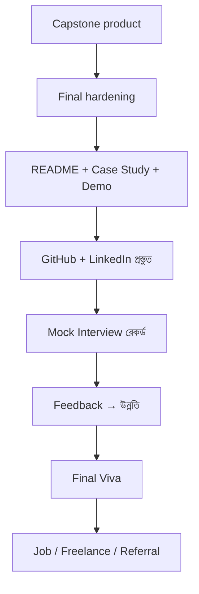
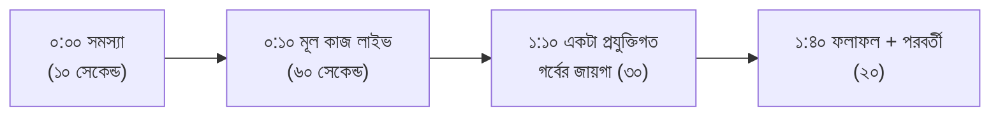
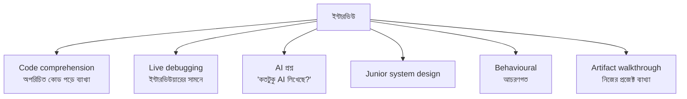
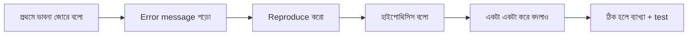
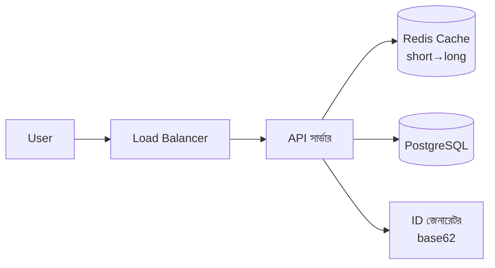

# Module 26 · Capstone, Interview and Career Launch

> **Section 7 · AI Product, Real Users & Career** · ২টি Live Class
> ⭐ **প্রজেক্ট:** Capstone + Case Study + Recorded Mock Interview + Final Viva

## 🎯 লক্ষ্য

২৬ মডিউলের যাত্রার সমাপ্তি। দুটো কাজ:

1. **নিজের product-কে চূড়ান্ত রূপ দেওয়া** — নিরাপত্তা, error state, মোবাইল, পারফরম্যান্স; একটা portfolio case study; hiring manager-এর জন্য README; পরিষ্কার commit history; দুই মিনিটের demo ভিডিও।
2. **আজকের ইন্টারভিউয়ের জন্য প্রস্তুত হওয়া** — অপরিচিত কোড ব্যাখ্যা, live debugging, "এর কতটুকু AI লিখেছে?" প্রশ্নের সৎ উত্তর, junior system design, আচরণগত প্রশ্ন, আর final viva।

## 📖 গল্প: নতুন চাকরির প্রথম দিন-এর আগের রাত

তুমি একটা বাড়ি বানিয়েছ — ইট গেঁথেছ, ওয়্যারিং করেছ, রং করেছ। এখন বাড়িটা **বিক্রি** করতে হবে। ক্রেতা (hiring manager) বাড়িতে ঢুকে প্রথম ৩০ সেকেন্ডে সিদ্ধান্তের দিকে ঝুঁকে যায়। সে দেখে না তুমি কত কঠিন কাজ করেছ — সে দেখে **দরজা খুলতে কত সহজ, ভেতরে কী পরিষ্কার, আর তুমি প্রতিটা দেয়ালের কারণ ব্যাখ্যা করতে পারো কিনা।**

তারপর সে তোমাকে কিছু অচেনা ঘরে নিয়ে গিয়ে জিজ্ঞেস করে "এই দেয়াল কী কাজে লাগে?" — এটা অপরিচিত কোড-পরীক্ষা। শেষে জিজ্ঞেস করে "বাড়ি বানাতে মিস্ত্রি কতটা সাহায্য করল?" (AI) — **সৎ উত্তর** মানেই আস্থা।



---

## 🧠 Live Class 1 · Finishing Properly

### Final hardening — প্রকাশের আগে শেষ পরিষ্কার

| ক্ষেত্র | যাচাই |
|---|---|
| **নিরাপত্তা** | Module 16-এর চেকলিস্ট আবার; `check --deploy`; secret ইতিহাসে নেই; `pip-audit` |
| **Error state** | নেটওয়ার্ক বন্ধ/সার্ভার ভুল — ব্যবহারকারী বোঝার মতো বার্তা পায়? সাদা পাতা নয় |
| **Empty state** | নতুন ব্যবহারকারীর কিছু নেই — খালি পাতা নয়, পথনির্দেশ |
| **Mobile** | আসল ফোনে পুরো flow |
| **Performance** | ধীরতম পাতা মেপে ঠিক করা (N+1, cache) |
| **Accessibility** | alt, label, কীবোর্ড |

```bash
# শেষবার সবকিছু একসাথে
python manage.py check --deploy
pip-audit
pytest -x
gitleaks detect          # ইতিহাসে secret আছে কিনা (বা: trufflehog)
```

### Portfolio case study লেখা — গল্প হিসেবে

Hiring manager কোড পড়ার আগে **গল্পটা** পড়ে। কাঠামো:

```markdown
# [Product নাম] — Case Study

## সমস্যা
কার, কী সমস্যা (Module 06-এর আসল মানুষটা)। এক অনুচ্ছেদে।

## ব্যবহারকারী
রফিক ভাই, পাড়ার দোকানদার, বাকির হিসাব খাতায় রাখেন, মাসে ~৩,০০০ টাকা ভুলে যান।

## সিদ্ধান্ত ও কেন (Trade-off)
- **PostgreSQL**, MongoDB নয় — কারণ বাকি-কিস্তি-পরিশোধের সম্পর্ক জটিল ও টাকার হিসাব
- **Celery**-তে SMS রিমাইন্ডার — request-এ ধীর কাজ নয়
- **MVP-তে বাদ দিয়েছি:** রিপোর্ট ডাউনলোড, কারণ ব্যবহারকারী চায়নি

## কঠিনতম সমস্যা ও সমাধান
N+1 সমস্যায় তালিকা পাতা ৪ সেকেন্ড → `select_related` দিয়ে ০.৩ সেকেন্ড।

## ফলাফল
১০ জন ব্যবহারকারী, ৭ জন মূল কাজ শেষ করেছে (Module 25)।

## আমি আবার বদলাতাম
প্রথম দিন থেকে custom user model; আরও আগে ব্যবহারকারীর সাথে কথা।

## AI কতটুকু
আনুমানিক ৫০% কোড AI-র সাহায্যে; সব নিরাপত্তা ও permission সিদ্ধান্ত নিজের।

## লিংক
[Live](#) · [GitHub](#) · [Demo ভিডিও](#)
```

> **সমস্যা → ব্যবহারকারী → সিদ্ধান্ত → trade-off → আবার বদলাতাম** — এই ক্রম মনে রাখো।

### Hiring manager-এর জন্য README

প্রথম ১০ সেকেন্ডে তিনটা প্রশ্নের উত্তর:

1. **এটা কী?** (একবাক্য)
2. **দেখব কীভাবে?** (live লিংক + স্ক্রিনশট/GIF)
3. **চালাব কীভাবে?** (৩টা কমান্ডে)

````markdown
# 🧾 Hishab — দোকানের বাকির হিসাব

> পাড়ার দোকানদারদের জন্য, ফোনে বাকি ও কিস্তির হিসাব — ভুল ছাড়া।

🔗 **Live:** https://hishab.example.com  ·  🎥 [২ মিনিটের demo](#)

## ⚡ চালাতে
```bash
git clone ... && cd hishab
cp .env.example .env
docker compose up
```

## 🏗️ আর্কিটেকচার
(Mermaid ডায়াগ্রাম এখানে)

## ✅ test চালাতে
`pytest`
````

### Repository পরিষ্কার

- `.gitignore` ঠিক (`.env`, `.venv`, `__pycache__`)
- অব্যবহৃত ফাইল/মৃত কোড মুছো
- `.env.example` আছে (আসল মান নয়)
- লাইসেন্স ফাইল

### Commit history — পড়ার যোগ্য

```text
❌ fix / update / aaa / final / final2 / final-final
✅ feat(orders): add async confirmation email
   fix(api): block cross-user order access (IDOR)
   test: add regression for stock going negative
   docs: add architecture diagram
```

ইন্টারভিউয়ার প্রায়ই `git log` দেখে — এটা তোমার **কাজের অভ্যাসের আয়না।**

### দুই মিনিটের demo ভিডিও



---

## 🧠 Live Class 2 · The Interview As It Is Now, and Final Viva

### ইন্টারভিউয়ের ধরন আজকাল



### ১. Code comprehension — অপরিচিত কোড পড়ে ব্যাখ্যা

```python
# ইন্টারভিউয়ার এই কোড দেখিয়ে জিজ্ঞেস করে: "এটা কী করে? কোনো সমস্যা আছে?"
def get_orders(request):
    status = request.GET.get("status")
    orders = Order.objects.all()
    if status:
        orders = orders.filter(status=status)
    data = []
    for o in orders:
        data.append({"id": o.id, "customer": o.customer.name, "total": o.total})
    return JsonResponse(data, safe=False)
```

**ভালো উত্তরের ধাপ (জোরে ভাবো):**

1. **কী করে:** `status` query parameter দিয়ে অর্ডার ফিল্টার করে JSON ফেরত দেয়।
2. **সমস্যা #১ (নিরাপত্তা):** লগইন নেই, `Order.objects.all()` — যে কেউ সব অর্ডার দেখে → IDOR।
3. **সমস্যা #২ (পারফরম্যান্স):** `o.customer.name` লুপে → **N+1**। `select_related("customer")`।
4. **সমস্যা #৩:** pagination নেই → লক্ষাধিক অর্ডারে মেমোরি শেষ।
5. **সমস্যা #৪:** `status`-এর মান যাচাই নেই (যদিও ORM নিরাপদ)।
6. **আমি যা করতাম:** `@login_required`, `.filter(owner=request.user)`, `select_related`, `Paginator`।

> কৌশল: **বুঝে নিয়ে, জোরে বলে, অগ্রাধিকার ক্রমে।** নিরাপত্তা আগে, তারপর পারফরম্যান্স।

### ২. Live debugging — ইন্টারভিউয়ারের সামনে



> ইন্টারভিউয়ার দেখে **তুমি কীভাবে ভাবো**, তুমি উত্তর জানো কিনা নয়। আটকে গেলে নীরব থেকো না — "আমি ভাবছি এটা এই কারণে হতে পারে, যাচাই করতে..." বলো।

### ৩. "এর কতটুকু AI লিখেছে?" — সৎ ও ভালো উত্তর

এই প্রশ্ন এখন প্রায় নিশ্চিত আসবে।

| ❌ খারাপ | ✅ ভালো |
|---|---|
| "সব আমি লিখেছি" (মিথ্যা, ধরা পড়ে) | "আনুমানিক ৫০% কোড AI-র সাহায্যে। কাঠামো, সিদ্ধান্ত ও নিরাপত্তা আমার। উদাহরণ: AI দেওয়া একটা viewset-এ IDOR ছিল, আমি ধরে ঠিক করেছি।" |
| "AI সব করেছে" | "বয়লারপ্লেট ও প্রথম খসড়া AI-র, কিন্তু আমি প্রতিটা লাইন review করেছি ও না বুঝে কিছু রাখিনি।" |
| এড়িয়ে যাওয়া | সৎ, নির্দিষ্ট উদাহরণ |

**সূত্র:** **কতটুকু + কোথায় সাহায্য পেয়েছি + আমি কী যাচাই করেছি + একটা বাস্তব ঘটনা যেখানে AI ভুল ছিল।** (Module 20-র review note এখানে সোনা।)

### ৪. Feature বুঝিয়ে trade-off বলা

"কেন PostgreSQL?" — "ফিচার X-এর জন্য" নয়, **"আমার ডাটার সম্পর্ক জটিল ও টাকার হিসাব, তাই ACID দরকার ছিল; খারাপ দিক হলো স্কিমা বদল কঠিন, যা আমি migration দিয়ে সামলাই।"**

প্রতিটা সিদ্ধান্তে: **কী বেছেছি → কেন → দাম কী।**

### ৫. Junior-level system design

প্রশ্ন: "একটা URL shortener ডিজাইন করো।" (Module 21-এর জ্ঞান)



**উত্তরের কাঠামো:** ১) প্রশ্ন করো (কত ব্যবহারকারী? কাস্টম লিংক?) → ২) সরল সংস্করণ → ৩) কোথায় ভাঙবে → ৪) স্কেল (cache, replica) → ৫) trade-off।

### ৬. Behavioural প্রশ্ন — STAR পদ্ধতি

| অক্ষর | অর্থ | উদাহরণ |
|---|---|---|
| **S**ituation | পরিস্থিতি | "ক্লায়েন্টের সাইট প্রচণ্ড ধীর ছিল" |
| **T**ask | আমার দায়িত্ব | "কারণ খুঁজে ঠিক করা" |
| **A**ction | আমি কী করলাম | "query লগ করে N+1 পেলাম, ঠিক করলাম" |
| **R**esult | ফলাফল | "৪ সেকেন্ড → ০.৩ সেকেন্ড" |

সাধারণ প্রশ্ন: "কঠিন bug-এর গল্প বলো", "দলে মতভেদ কীভাবে সামলাও?", "ভুল করেছ কখনো?", "কেন আমাদের কোম্পানি?"

### Recorded mock interview

কোর্সের কোনো working engineer-এর সাথে রেকর্ড হবে — **নিজে দেখো** (অস্বস্তিকর কিন্তু সবচেয়ে কার্যকর): কোথায় "আ-আ" বেশি? কোথায় আটকালে? কোন উত্তর অস্পষ্ট?

### Technology-র তালিকা নয়, artifact-কেন্দ্রিক

CV-তে "Python, Django, React, Docker…" লেখা প্রায় সবাই করে। আলাদা করো:

| ❌ | ✅ |
|---|---|
| "Django, DRF, Celery জানি" | "**Hishab**: Django+DRF API, Celery SMS রিমাইন্ডার, ১০ জন আসল ব্যবহারকারী → [লিংক]" |

### GitHub ও LinkedIn পর্যালোচনা

**GitHub profile:**
- Pinned repo: ৩–৪টা সেরা, প্রতিটায় ভালো README
- Profile README: একটা ছোট পরিচিতি
- Activity সচেতনভাবে সবুজ রাখার বদলে **অর্থবহ commit**

**LinkedIn:**
- Headline: শুধু "Student" নয় — "Python/Django Developer | সত্যিকারের ব্যবহারকারীসহ product বানিয়েছি"
- Featured: Case study + demo লিংক
- About: সমস্যা-ভিত্তিক গল্প

### বাংলাদেশে junior Python/Django ও remote কাজ আসলে কোথায়

- স্থানীয় সফটওয়্যার কোম্পানি, স্টার্টআপ (প্রায়ই Django/FastAPI চাহিদা)
- Fintech, ERP, e-commerce
- রিমোট: Upwork/Contra/Toptal-ধাঁচের প্ল্যাটফর্ম, আন্তর্জাতিক স্টার্টআপ
- **বাস্তবতা:** চাকরির বিজ্ঞপ্তিতে "১–২ বছর অভিজ্ঞতা" চায়; তোমার প্রজেক্ট ও আসল ব্যবহারকারী সেই ফাঁক পূরণ করে

> ⚠️ নির্দিষ্ট কোম্পানি, বেতন বা চাহিদার সংখ্যা আমি এখানে লিখিনি — এগুলো দ্রুত বদলায়। নিজে Bdjobs, LinkedIn Jobs ও কোম্পানির পেজে যাচাই করে নাও।

### Cold application-এর চেয়ে referral কেন কাজ করে

- Cold application: শত শত CV-র ভিড়ে একটা
- Referral: কেউ নিজের নামে সুপারিশ করছে — **আস্থা ধার করা**

**কীভাবে referral বানাবে:** কোর্সের পরিচিতজন, ইন্সট্রাক্টর, সহপাঠী; **আগে সাহায্য দাও** (open source PR, লেখা, প্রশ্নের উত্তর); তারপর বিনয়ে জিজ্ঞেস করো।

### Freelance ও client work — সমান্তরাল আয়

- চাকরির পাশাপাশি বা আগে আয় ও অভিজ্ঞতা
- **ছোট প্রজেক্টের মূল্য নির্ধারণ:** ঘণ্টা × (অনুমান + ঝুঁকির বাফার) + পরিধির সীমা লিখিত; সংশোধনের সংখ্যা নির্দিষ্ট
- সব সময় **scope লিখিত** (Module 06-এর "না করার তালিকা" এখানে কাজে লাগে)
- ক্লায়েন্টকে AI-ব্যবহার নিয়ে আগে থেকে সৎ থাকো

> তোমার ক্ষেত্রে: WordPress/WooCommerce কাজ আগে থেকেই আছে — Django দক্ষতা যোগ হলে **কাস্টম ব্যাকএন্ড/API/AI ফিচারসহ** প্রস্তাব দেওয়ার সুযোগ পাবে। এটাই তোমার আলাদা অবস্থান।

### 🎓 Final panel viva

প্যানেলের সামনে তুমি **রক্ষা (defend)** করবে:

| বিষয় | প্রশ্ন |
|---|---|
| **Product** | কার জন্য? কেন? ১০ জন ব্যবহারকারী কী শেখাল? |
| **Architecture** | কেন এই ডিজাইন? কী ভাঙবে? কীভাবে স্কেল করবে? |
| **Security** | কোন কোন ফাঁক খুঁজে ঠিক করেছ? কীভাবে প্রমাণ? |
| **AI ফিচার** | কীভাবে test করেছ? pass rate কত? কখন ship করতে না? |
| **AI-ব্যবহার** | কতটুকু AI? কোথায় ভুল ধরেছ? |

**Artifact link সহ Forge-এ handoff:** চূড়ান্ত জমা — live লিংক, GitHub, case study, demo ভিডিও।

## ⚠️ সাধারণ ভুল

| ভুল | সমাধান |
|---|---|
| README-তে শুধু "কীভাবে install" | কী + দেখব কীভাবে + চালাব কীভাবে |
| `final-final2` commit | অর্থবহ বার্তা |
| "সব আমি লিখেছি" | সৎ ও নির্দিষ্ট |
| ইন্টারভিউতে নীরব থেকে ভাবা | জোরে ভাবো |
| CV-তে প্রযুক্তির তালিকা | artifact + ফলাফল |
| শুধু cold application | referral + কাজ দেখিয়ে সম্পর্ক |
| Trade-off ছাড়া সিদ্ধান্ত | কেন + দাম কী |

## ⭐ প্রজেক্ট: Capstone + Case Study + Recorded Mock Interview + Final Viva

- [ ] Final hardening: নিরাপত্তা, error/empty state, mobile, পারফরম্যান্স
- [ ] Portfolio case study (সমস্যা → ব্যবহারকারী → সিদ্ধান্ত → trade-off → আবার বদলাতাম)
- [ ] Hiring-manager-বান্ধব README
- [ ] পরিষ্কার repo ও commit history
- [ ] ২ মিনিটের demo ভিডিও
- [ ] GitHub ও LinkedIn আপডেট
- [ ] Recorded mock interview + নিজের মূল্যায়ন
- [ ] Final viva প্রস্তুতি (৫টা বিষয়ে ২ মিনিট করে ব্যাখ্যা)
- [ ] Artifact লিংকসহ চূড়ান্ত জমা

## 🎤 শেষ আত্মপরীক্ষা

1. আমার product এক বাক্যে কী? কার জন্য?
2. সবচেয়ে কঠিন প্রযুক্তিগত সিদ্ধান্ত কী ছিল? কেন?
3. "এর কতটুকু AI লিখেছে?" — আমার ৩০ সেকেন্ডের সৎ উত্তর কী?
4. আমার সবচেয়ে বড় নিরাপত্তা-শিক্ষা কী?
5. ১০ জন ব্যবহারকারী আমাকে কী শিখিয়েছে?
6. ১০ গুণ ব্যবহারকারী এলে প্রথম কী ভাঙবে?
7. আবার বানালে কী বদলাতাম?

## 🔁 MERN / WordPress-এর সাথে তুলনা

তুমি ইতিমধ্যে freelance/ক্লায়েন্ট কাজ করো, AI-ব্যবহারে সৎ থাকো, staging/production deploy জানো। এই মডিউলে নতুন যা যোগ হচ্ছে তা হলো **নিজের কাজকে "প্রমাণসহ গল্প" হিসেবে উপস্থাপন করা।** তোমার WordPress, WooCommerce, NestJS, React, Django — সব মিলিয়ে case study-তে এমন একটা অবস্থান দেখাও: "আমি ব্যবসার সমস্যা বুঝি, নিরাপদ ও দ্রুত সিস্টেম বানাই, AI-কে দায়িত্ব নিয়ে ব্যবহার করি।"

---

> 🎉 **২৬ মডিউলের যাত্রা শেষ।** এখন থেকে প্রতিটা নতুন প্রজেক্ট এই ছাঁচেই: সমস্যা বোঝো → ছোট করে বানাও → test করো → নিরাপদ করো → ব্যবহারকারীকে দাও → মাপো → শেখো।
